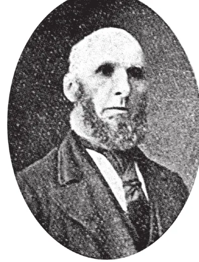

Неудивительно, что, когда лодка доставила начальника порта осмотреть «Лалворт-Ков» и «Эмили», он даже не потрудился ступить на борт. Вместо этого он поместил оба судна в карантин, запретив любую высадку по меньшей мере на две недели. Колониальное правительство не позволит ни одному человеку покинуть ни то, ни другое судно. Суда могли постоять в гавани ночь-другую — в 800 метрах от конечной цели, которая дразняще видна всем. Затем зачумлённым судам предстояло вернуться к Норт-Хеду и стоять там на якоре, пока карантин не снимут.

### Побег

Прокламация губернатора стала дурной вестью для всех на борту обоих судов, но особенно встревожила преподобного Элайджу Фредерикса. Чувствуя жуткое давление в черепе от двух яиц, готовых вылупиться, служитель церкви решился на отчаянный поступок. Посреди ночи капеллан прокрался на палубу «Лалворт-Ков» и прыгнул в чернильную тьму Сиднейской гавани — видимо, задумав доплыть до берега. Каким бы безумным ни казался этот план, он сработал — прежде всего благодаря обострённым чувствам ещё не рождённых чуждых тварей внутри слепца. Добравшись до частной пристани в районе, известном как Рокс, к западу от Сиднейской бухты, Фредерикс встретился с членом местной секты Глашатаев — сержантом Корпуса Нового Южного Уэльса Рупертом Роусторном. Местные Глашатаи ждали этот драгоценный груз и уже приготовили особое место для благословенного рождения Отродий Стража.

Нарушение Фредериксом карантина видели несколько человек на борту «Лалворт-Ков», и это ставит капитана судна перед дилеммой: известить колониального губернатора и навлечь на себя его гнев или промолчать и рискнуть тем, что зараза расползётся и охватит весь Сидней. Посовещавшись с капитаном «Эмили», они договорились о плане. Небольшая группа — только из тех, у кого явно нет признаков болезни, — догребёт до Казённой пристани, чтобы сообщить властям о нарушении, вымолить прощение и униженно предложить найти и задержать сбежавшего священника.

### Как вовлечь сыщиков

Сыщики начинают сценарий на борту «Лалворт-Ков» (если они солдаты или свободные поселенцы) или «Эмили» (если они каторжники). У них позади неприятное и долгое плавание в колонию Новый Южный Уэльс — рассказ о нём с точки зрения каторжника и некаторжника см. в **раздатке 1** и **раздатке 2**.

Каждый сыщик — из той горстки людей на борту своего судна, у кого нет признаков жутких жёлтых струпьев, отмечающих поражённых загадочной болезнью. Поэтому капитан выберет их в делегацию. Каторжников, несогласных с этим предложением, хорошенько выпорют и спросят снова. Возражения свободных поселенцев и военных выслушают внимательнее, но в конечном счёте нужды обоих судов перевешивают любые личные желания — по крайней мере в глазах капитанов. Так что выбранным персонажам придётся помочь.

Сыщикам не обязательно быть знакомыми до того, как соберут делегацию, хотя вполне могут и быть. С каторжников, выбранных для этого поручения, собьют ножные кандалы, которые были на них с тех пор, как они несколько месяцев назад покинули Англию, — вероятно, к их облегчению. Если среди сыщиков есть военные офицеры, старшему по званию поручат следить за тем, чтобы
