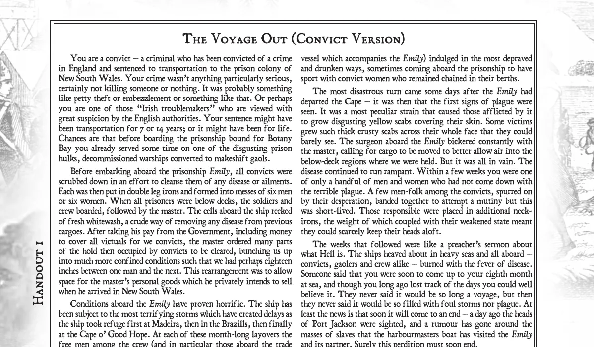
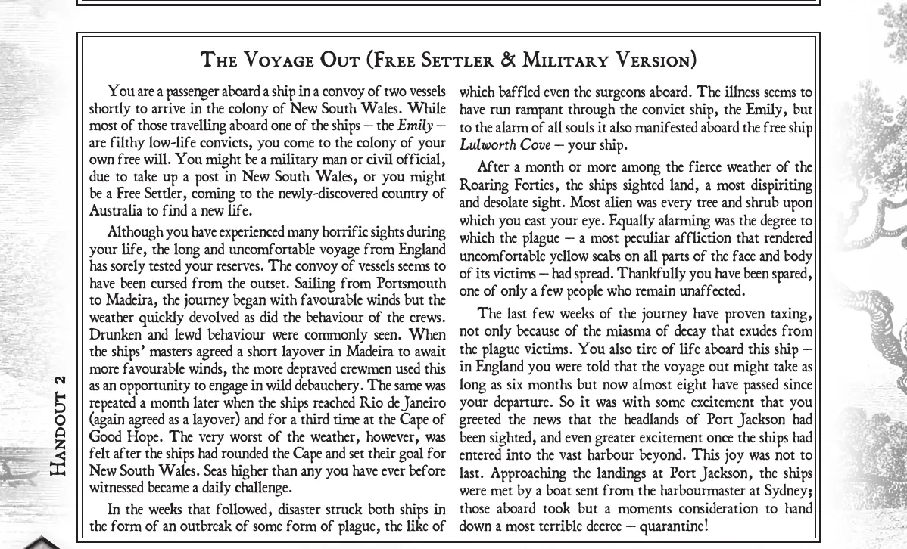

> **Раздатка 1: «Путь сюда» (для каторжников)**
>
> Вы каторжник — преступник, осуждённый за преступление в Англии и приговорённый к ссылке в каторжную колонию Новый Южный Уэльс. Ваше преступление не было чем-то особо серьёзным — уж точно не убийство или что-то такое. Скорее всего, мелкая кража, растрата или что-то в этом роде. А может, вы из тех «ирландских смутьянов», на которых английские власти смотрят с большим подозрением. Вас могли приговорить к ссылке на 7 или 14 лет — или пожизненно. Скорее всего, прежде чем подняться на тюремное судно, идущее в Ботани-Бей, вы уже отсидели на одном из мерзких тюремных блокшивов — списанных военных кораблей, переделанных во временные тюрьмы.
>
> Перед посадкой на тюремное судно «Эмили» всех каторжников отскребли, чтобы очистить от болезней и хворей. Потом каждого заковали в двойные ножные кандалы и разбили на артели по шесть мужчин или шесть женщин. Когда все заключённые оказались под палубой, поднялись солдаты и команда, а за ними капитан. Камеры на судне воняли свежей побелкой — грубым способом избавиться от болезней прежнего груза. Получив от правительства плату, включая деньги на всё пропитание нас, каторжников, капитан велел освободить многие части трюма, где были каторжники, и сбил нас в куда более тесные условия — так, что между людьми оставалось, может быть, сантиметров сорок пять. Это было нужно, чтобы освободить место для личного товара капитана, который он втихую собирался продать по прибытии в Новый Южный Уэльс.
>
> Условия на «Эмили» оказались ужасающими. Судно попадало в страшнейшие шторма, из-за которых случались задержки: оно укрывалось сначала на Мадейре, потом в Бразилии и наконец на мысе Доброй Надежды. На каждой из этих месячных стоянок свободные люди из команды (особенно с торгового судна, что идёт вместе с «Эмили») предавались самому развратному пьянству и порой поднимались на тюремное судно позабавиться с каторжницами, остававшимися прикованными на своих койках.
>
> Самый гибельный поворот случился через несколько дней после того, как «Эмили» покинула мыс: тогда появились первые признаки чумы. Это была престранная зараза: у больных кожу покрывали мерзкие жёлтые струпья. У некоторых на всём лице наросли такие толстые корки, что они почти ничего не видели. Судовой хирург «Эмили» вечно препирался с капитаном, требуя переставить груз, чтобы лучше проветривать нижние помещения, где нас держали. Но всё было напрасно. Болезнь продолжала свирепствовать. Через несколько недель вы оказались среди считанных мужчин и женщин, кто не слёг от страшной чумы. Несколько мужчин-каторжников в отчаянии сговорились поднять мятеж, но он был недолгим. Зачинщиков заковали ещё и в шейные кандалы, чья тяжесть при их слабости не давала им даже держать голову.
>
> Последовавшие недели были как проповедь о том, что такое ад. Корабли швыряло в бурном море, и все на борту — каторжники, тюремщики и команда — горели в лихорадке. Кто-то сказал, что скоро пойдёт восьмой месяц в море, и, хотя вы давно потеряли счёт дням, в это легко поверить. Никто не говорил, что путь будет таким долгим, — но никто и не говорил, что он будет полон таких мерзких штормов и чумы. По крайней мере, говорят, что скоро конец: день назад показались мысы Порт-Джексона, а среди массы рабов прошёл слух, что лодка начальника порта побывала у «Эмили» и её спутника. Конечно же, эта погибель скоро кончится.

<!-- -->

> **Раздатка 2: «Путь сюда» (для свободных и военных)**
>
> Вы пассажир корабля в конвое из двух судов, вскоре прибывающем в колонию Новый Южный Уэльс. Большинство плывущих на одном из кораблей — «Эмили» — грязные отбросы-каторжники, но вы едете в колонию по своей воле. Может быть, вы военный или гражданский чиновник, направленный на должность в Новый Южный Уэльс, а может, свободный поселенец, едущий в недавно открытую страну Австралию за новой жизнью.
>
> Вы видели в жизни немало ужасов, но долгое и тяжёлое плавание из Англии сильно испытало ваши силы. Конвой будто проклят с самого начала. Из Портсмута на Мадейру путь начался с попутными ветрами, но погода быстро испортилась — как и поведение команд. Пьянство и непристойности стали обычным делом. Когда капитаны договорились о короткой стоянке на Мадейре в ожидании попутного ветра, самые развращённые матросы воспользовались ею для дикого разгула. То же повторилось через месяц, когда корабли дошли до Рио-де-Жанейро (снова условленная стоянка), и в третий раз — на мысе Доброй Надежды. Но худшая погода ждала после того, как корабли обогнули мыс и взяли курс на Новый Южный Уэльс: волны выше всех, что вы видели, стали ежедневным испытанием.
>
> В последующие недели на оба корабля обрушилось бедствие — вспышка какой-то чумы, поставившей в тупик даже судовых хирургов. Болезнь, похоже, свирепствовала на каторжном судне «Эмили», но, к тревоге всех душ, проявилась и на свободном корабле «Лалворт-Ков» — вашем корабле.
>
> Больше месяца в свирепой погоде «ревущих сороковых» — и корабли увидели землю, самое унылое и пустынное зрелище. Чужим казалось каждое дерево и куст, на какой ни взгляни. Не менее тревожило, как далеко зашла чума — престранная хворь, покрывающая неприятными жёлтыми струпьями всё лицо и тело больных. К счастью, вас она обошла: вы из немногих, кого она не тронула.
>
> Последние недели плавания были тяжелы — и не только из-за миазмов разложения от больных. Вы устали и от жизни на корабле: в Англии вам говорили, что плавание может длиться до шести месяцев, а прошло уже почти восемь. Поэтому вы с волнением встретили весть, что показались мысы Порт-Джексона, и с ещё большим — когда корабли вошли в огромную гавань за ними. Радость была недолгой. У причалов Порт-Джексона корабли встретила лодка начальника порта Сиднея; люди на ней лишь мгновение подумали и огласили страшнейший приговор — карантин!
