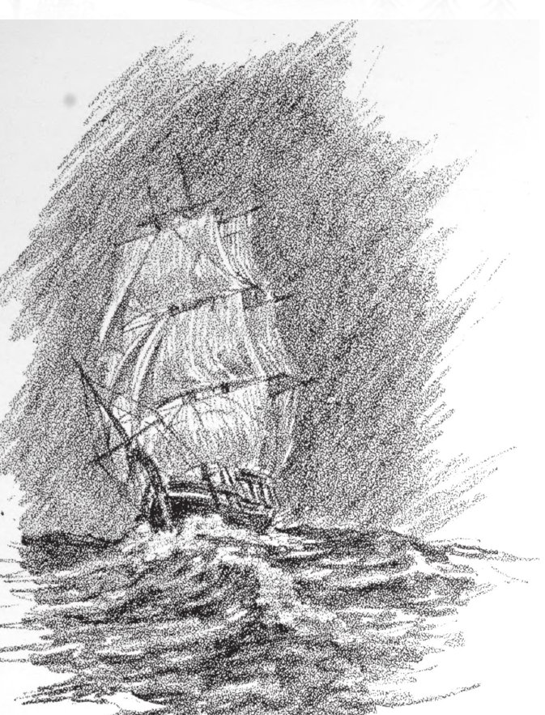

Когда лодка швартуется у Казённой пристани, сыщики обнаружат, что их прибытия ждали. В конце пристани их поджидает суровая фигура в напудренном парике, с сердитым выражением, словно вырезанным на лице. Этот угрюмый человек с натянутой вежливостью представляется: Эдмунд Гриффин, колониальный секретарь Нового Южного Уэльса. Он поясняет, что он — старший гражданский управляющий колонии и личный помощник самого губернатора. Гриффин говорит сыщикам, что его вызвал сюда начальник порта — испортив ему превосходный завтрак, — потому что поднята тревога: законный приказ губернатора о карантине нарушен. Он вопросительно смотрит на сыщиков и спрашивает: «Господа, что вы можете сказать в защиту этого преступного поступка? Или мне просто послать за констеблем и заковать вас всех в кандалы?»

Сыщики, надо думать, станут оправдываться перед колониальным секретарём и молить о снисхождении. Чтобы преодолеть подозрительный гнев этого человека, сыщикам нужно набрать четыре «успеха» во встречных проверках, где один из их социальных навыков (**Обаяние**, **Убеждение** или **Красноречие**) противопоставлен его **Проницательности** (55%). Каждый раз, когда сыщик получает во встречной проверке лучший результат, группа набирает один «успех»; каждый раз, когда лучший результат у Гриффина, группа теряет один «успех». Проверки, в которых обе стороны получили успех одного уровня, на счёт не влияют. Как только счёт доходит до 4 успехов, сыщики успешно погасили гнев Гриффина. Если счёт когда-нибудь дойдёт до −2 или если у кого-то из сыщиков выпадет неудача (т. е. выброшено 00), колониальный секретарь решает, что сыщики — преступники, тратящие его время, и исполняет обещание: запирает их до суда.

Если сыщики объяснили своё появление тем, что ищут сбежавшего капеллана, Гриффин нехотя скажет: «Пожалуй, я могу закрыть глаза на ваше присутствие здесь, если оно только ради поимки человека, сбежавшего с вашего корабля. Но весть о случившемся рано или поздно дойдёт до губернатора, а он куда менее сговорчив, чем я. Так что предупреждаю вас, господа: поспешите с поисками и верните своего беглеца на карантинное судно, пока на вас не обрушился гнев колонии!»

### По следу слепца

Если сыщики спросят Гриффина, откуда им начать поиски, он лишь цокает языком и поворачивается к ним спиной. Уходя, он бросает через плечо: «Можете спросить капеллана колонии, преподобного Марсдена; полагаю, ваш человек должен был стать его новым помощником. Вверх по холму, к Дому правительства — там его контора».

Оглядывая унылую картину вокруг Сиднейской бухты, сыщики различают несколько групп каторжников — все в ножных кандалах, — которые сносят ветхое здание из сырцового кирпича. Взглянув вверх по холму, они видят несколько улиц низких уродливых построек, сгрудившихся вокруг жалкого ручья, текущего в гавань. Дальше по берегу бухты можно разглядеть что-то вроде трущобного посёлка, жмущегося к западному рукаву бухты.

#### Слухи на улице

Добыть сведения у каторжных артелей — дело трудное. Хотя большинство каторжников только рады бросить тяжёлую работу и поговорить с сыщиками, такие разговоры почти сразу прерывает надсмотрщик. Эти здоровенные громилы — сами каторжники, но вооружённые кнутами и
