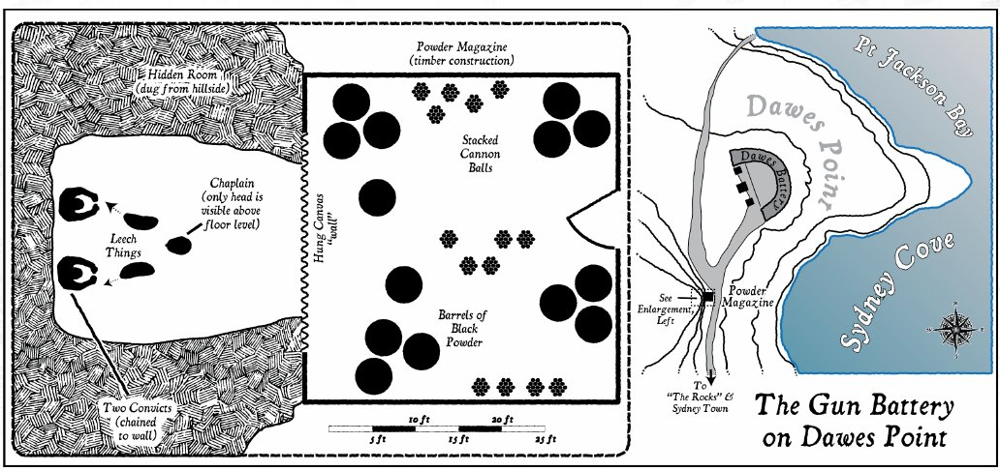

### Карта батареи на мысу Доуз

*Надписи на карте.* Слева, увеличенный план порохового погреба: «Пороховой погреб (деревянный)»; «Тайная комната (вырыта в склоне холма)»; «Капеллан (над полом видна только голова)»; «Пиявки» (Отродья Стража); «Двое каторжников (прикованы к стене)»; «Повешенная парусиновая „стена“»; «Пирамиды ядер»; «Бочонки чёрного пороха»; масштаб в футах (1 фут ≈ 0,3 м). Справа: «Мыс Доуз», «Батарея Доуза», «Пороховой погреб (увеличение слева)», «Сиднейская бухта», «К Роксу и городу Сидней». Подпись: «Батарея на мысу Доуз».

смущается; примерно в то же время сыщики услышат едва приглушённые звуки соития из соседней комнаты. «Если подождёте минутку, господа, — уверен, он недолго».

Если сыщики подождут, дежурный офицер — сержант Фрили — выйдет вместе с истощённой немолодой каторжницей. Мундир солдата в ужасном беспорядке. От него разит ромом. Если сыщики спросят его о военных Корпуса, которые прошлой ночью могли быть в Роксе, он отмахнётся от вопроса: у бухты в любое время дня и ночи полно солдат — это опасное место, его нужно охранять. Если сыщики надавят сильнее — пройдут проверку **Запугивания** или намекнут, что могут рассказать о поведении Фрили его начальству, — они узнают больше. Каждое утро бывает перекличка, на которой обязаны присутствовать все солдаты Корпуса; список сегодняшнего утра показывает, что, хотя несколько военных не явились на перекличку, лишь у одного из них был пост, который поместил бы его близко к Роксу. Это сержант Руперт Роусторн, и его пост — охрана артиллерийской батареи на мысу Доуз.

Сыщики могут попросить показать им жилище сержанта Роусторна, но Фрили прямо заявит, что не уполномочен пускать кого-либо в офицерские казармы. **Трудная проверка Запугивания** или изрядная взятка (ценное украшение или бутылка рома) развеют любые его сомнения. Угол Роусторна в общем помещении казарм заметно аскетичнее, чем у большинства: немногие пожитки этого человека разложены очень аккуратно, почти одержимо. Ничего явно необычного нет, но проверка **Внимания** покажет, что у деревянного сундука, где Роусторн держит одежду и постель, двойное дно. Под ним лежат две любопытные вещи — кольцо со странным узором и запечатанная бумажная трубка.

- *Кольцо:* проверка **Оценки** покажет, что оно слишком ценное, чтобы принадлежать простому сержанту, — оно стоит больше, чем все прочие пожитки Роусторна вместе взятые. На нём заметный знак, похожий на стилизованную букву «H», переплетённую со странными переливчатыми пузырями.
- *Бумажная трубка:* открыв трубку с торца, сыщики найдут внутри единственный лист кремово-белой бумаги. Похоже, это какая-то грамота или документ о членстве. Шапка листа — непонятный рисунок с тем же знаком, что и на кольце. Каллиграфическая надпись гласит:

> **Раздатка: грамота Глашатаев Серебряной Зари**
>
> *«В сей день, 23 июня 1792 года, брат Руперт Рэндольф Роусторн принят в ступень Странника за пределом в Истинном и Священном ордене Глашатаев Серебряной Зари».*

### Пороховой погреб

След пропавшего капеллана, как и след сержанта Руперта Роусторна, ведёт сыщиков на мыс Доуз — к артиллерийской батарее на самой северной его оконечности. Это
