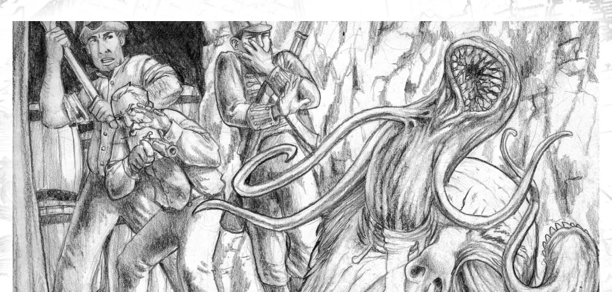

мёртвого священника начинает сочиться светящаяся жёлтая жидкость, пятная землю вокруг закопанного тела жуткой тошнотворной сукровицей. Затем обе глазницы взрываются: изнутри наружу протискиваются предметы покрупнее и поплотнее. Сначала они похожи на комки той же жёлтой сукровицы, но быстро становится ясно, что эти массы размером с грейпфрут — живые существа особого рода. Две твари похожи на пиявок, но со щупальцами и зубастой пастью. Чтобы увидеть это отвратительное рождение, сыщики должны пройти проверку Рассудка (3/1d8).

Если сыщики не будут особенно решительны, только что вылупившиеся Отродья Стража почуют прикованных каторжников, которые всего в 2 метрах от места, где закопан священник. Эти прикованные, очевидно, предназначались новорождённым в пищу, и твари охотно возьмут эту лёгкую добычу. С тревожной быстротой перелетев через комнату, пиявкоподобные существа буквально вгрызаются в беззащитных каторжников, мгновенно убивая их и разбрызгивая мелкую кровавую пыль, пока прогрызают кости и сухожилия. Каждого каторжника пожирают всего за несколько раундов. Затем Отродья Стража ненадолго впадают в оцепенение, затаившись внутри трупов своих жертв.

Это время нужно тварям, чтобы впитать кровь из трупов, и по ходу дела они растут с пугающей быстротой. Уже через минуту сыщики увидят, как тела мёртвых каторжников раздуваются и жутко дёргаются, словно внутри пульсирует что-то большое. Вскоре после этого два насытившихся Отродья Стража — теперь каждое размером с человека — вырываются из выпотрошенных трупов, голоднее прежнего. Если сыщики всё ещё в пороховом погребе, они наверняка станут целями этой пары прожорливых ужасов.

Если сыщики каким-то образом успеют напасть на Отродий Стража до того, как те насытятся, с ними будет куда легче справиться. Однако обстоятельства вылупления делают это трудным. Победить двух насытившихся Отродий Стража — тяжёлый бой для большинства групп сыщиков, особенно если огнестрельное оружие есть лишь у немногих.

#### Выжженная земля

Сообразительные сыщики воспользуются тем, что всё здание — в буквальном смысле пороховая бочка: в погребе достаточно чёрного пороха, чтобы взорвать всё в радиусе 20 метров. Конечно,
