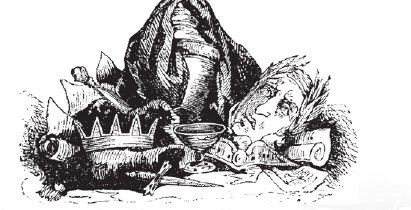

…почти наверняка закончатся тем, что сыщикам посоветуют съездить в Коул-Ривер и разыскать кого-нибудь из выживших.

- Одна из девушек-каторжниц, работающих в Элизабет-Фарм, — Молли Роусон — хорошо это скрывает, но на самом деле была возлюбленной человека, который возглавил восстание в Касл-Хилле. Если её спросить, Роусон может рассказать сыщикам, что в живых остался лишь один человек, который, возможно, знает правду о последних днях Каннингема и других вожаков мятежа. Это Эдвард Нейл, ныне приговорённый к работам в шахте Коул-Ривер.
- Всякий, кто станет расспрашивать каторжников в Коул-Ривер, обнаружит, что помогать они не хотят: на большинство вопросов отвечают молчанием. Почти все здешние каторжники не раз получали плети в награду за длинный язык. Но если подкупить или уговорить, кое-кто может упомянуть слухи о проклятой «куче серебра», которая будто бы была у вожака мятежников Филлипа Каннингема. Некоторые припомнят толки о том, что сокровище прислал какой-то неизвестный благодетель из Ирландии, чтобы помочь основать свободное ирландское государство на австралийской земле, хотя большинство каторжников считает это лишь легендой, рождённой надеждой.
- Если удастся найти Эдварда Нейла, окажется, что о серебре Каннингема он знает больше всех — более того, он утверждает, что знает, где закопаны проклятые монеты. Загвоздка в том, что Нейл согласится рассказать то, что знает, только если сыщики пообещают либо устроить ему побег из Коул-Ривер, либо выхлопотать ему отпускной билет. Если они это сделают, Нейл окажется крайне ненадёжной обузой: он будет пытаться сбежать из-под их надзора при каждом удобном случае.
- Сыщики, которые отважатся подняться ночью на Винегар-Хилл, могут, если Хранитель пожелает, увидеть явление своими глазами. Это может быть какая-то сверхъестественная встреча — или, возможно, всего лишь раскрытие тайных поисков клада, в зависимости от того, какой вариант выбрал Хранитель.

## Набросок 2: Огни Ботани-Бей

Этот набросок начинается в Сиднее и включает короткую (но богатую событиями) поездку для обследования окрестностей Ботани-Бей к югу. Его можно вести в любой период эпохи «Каторжников и Ктулху».

### Предыстория

Ботани-Бей — так назван большой мелкий залив примерно в 13 км к югу от городка Сидней. Название ему дал капитан Джеймс Кук, высадившийся здесь в 1770 году во время знаменитого исследовательского плавания «Индевора». Экспедиция Кука провела в Ботани-Бей немало времени, и учёные Королевского общества (под началом Джозефа Бэнкса) смогли изучить множество странных зверей и растений, которые водились только в этой новой земле. Кук также смог понаблюдать за местными аборигенами и записать рассказы о человеческих жертвоприношениях, которые те совершали на коралловых рифах залива. По возвращении в Англию и Кук, и Бэнкс рекомендовали основать в Ботани-Бей британскую колонию. Но этому не суждено было случиться: когда Первый флот с каторжниками прибыл под командованием будущего губернатора Артура Филлипа, было решено, что Ботани-Бей не годится для поселения из-за болотистого берега и нехватки пресной воды. Вместо этого колонию основали севернее, в Порт-Джексоне; это решение ускорило известие о том, что у Ботани-Бей рыщет французский корабль (под командованием графа де Лаперуза).

*Прим. перев.: в оригинале здесь и ниже — «Arthur Phillips»; губернатор — Артур Филлип.*

События, связанные с Куком, Бэнксом, Филлипом и Лаперузом, теперь лишь далёкие воспоминания, а Ботани-Бей — не более чем промеренная водная гладь на картах колонии Новый Южный Уэльс. Но странный приезжий в Сиднее вот-вот это изменит. Едва сойдя с американского вольного торгового судна «Стеллар», морщинистый, но жилистый старик привлекает внимание и даёт пищу для сплетен. Неопределённого возраста, в тяжёлых чёрных одеждах, он путешествует один и тем, кто спрашивает, называет — с любопытным акцентом — лишь имя «Соландер». Цель Соландера в колонии Новый Южный Уэльс понемногу проясняется. Несколько дней спустя — после нескольких встреч за закрытыми дверями между горбатым стариком и губернатором колонии — отдан официальный приказ собрать отряд для короткой экспедиции к Ботани-Бей.
