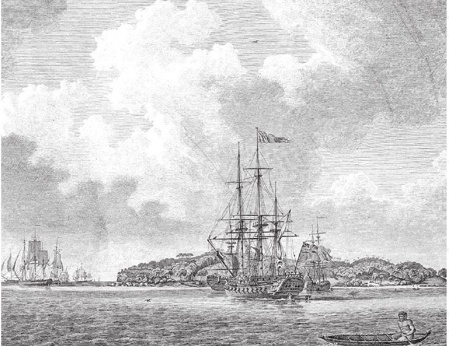

Новоприбывший в Новый Южный Уэльс — по-видимому, человек немалого богатства или веса (хотя подробности туманны) — располагает сведениями, почерпнутыми из записей Джозефа Бэнкса: из них следует, что там можно сделать единственное в своём роде и ценное для Его Величества открытие. Слухи расходятся и среди солдат Корпуса Нового Южного Уэльса, и среди каторжников: намекают, что этот посланник в чёрном — агент короля, или могущественный лорд, или, быть может, сам дьявол. Несмотря на все эти мрачные перешёптывания, поход Соландера к Ботани-Бей готовят быстро. Старик, похоже, отчаянно стремится добраться до места до ночи следующего новолуния. Губернатор призвал добровольцев из Корпуса Нового Южного Уэльса охранять научную экспедицию, и на этот призыв быстро откликнулся лейтенант Полсон, взявшийся возглавить военный отряд.

### Как вовлечь сыщиков

Проще всего вовлечь сыщиков, назначив их в экспедицию Соландера. Солдаты Корпуса Нового Южного Уэльса могут либо вызваться сами, либо (что вероятнее) просто получить приказ сопровождать лейтенанта Полсона. Сыщики-каторжники точно так же могут оказаться в небольшой артели каторжников-работников, затребованной для всей тяжёлой работы в походе, включая расчистку дороги перед лошадьми. Сыщиков-аборигенов военные (или даже сам губернатор) могут нанять местными проводниками — и прокладывать путь, и «мириться» со всеми встречными группами туземцев. У свободных поселенцев и каторжников с отпускным билетом, пожалуй, меньше поводов ввязываться в предприятие Соландера, но тех, кто знает местность или прослыл «человеком учёным», могут позвать с собой за их опыт. Другие могут ввязаться из-за намёков, что экспедиция должна отыскать нечто «несметной ценности».

### Расследование

- Расспросы в городке Сидней быстро дадут основные сведения о Ботани-Бей, изложенные выше в предыстории. Расспросы среди людей менее учёных (то есть более суеверных) могут вызвать и дикие рассказы о «странных светящихся фигурах», которые иногда видят у берегов Ботани-Бей; кое-кто даже утверждает, что среди этих призрачных светящихся фигур бывает корабль Лаперуза «Астролябия».
- Сыщики-аборигены могут что-то знать о местных преданиях народов, живущих вокруг Ботани-Бей, — кланов бидьигал и гвейгал. Кроме того, любой сыщик, который попробует поговорить с аборигенами из этих общин, обнаружит, что они в целом готовы помочь, хотя и немного настороженно относятся к тем, кто расспрашивает о «странных огнях» и тому подобном. Местные предания говорят о месте на южном берегу залива, где иногда — в ночи, когда на небе нет луны, — предки устраивают свой корробори с множеством разноцветных огней. Все знают, что туда лучше не соваться.
- Никто в Сиднее почти ничего не знает о странном старике «Соландере», недавно прибывшем в колонию. Если сыщики поспрашивают среди людей учёных — скажем, у колониальных врачей или юристов, — может найтись тот, кто вспомнит, что имя Соландер как-то связано с командой Кука на «Индеворе». Поиски в колониальных записях без труда обнаружат упоминание о докторе Даниэле Соландере как о важном учёном участнике той экспедиции и близком соратнике президента Королевского общества Джозефа Бэнкса. В других бумагах, которые, вероятно, найти труднее, записано, что доктор Соландер умер от удара в 1782 году.
- Расспрашивать старика о его имени или о связи с доктором Соландером из команды «Индевора» — пустая затея: он попросту не даёт никаких сведений, кроме тех, что подчёркивают необходимость скорее снарядить поход к Ботани-Бей. Он — буквально чистый холст.
