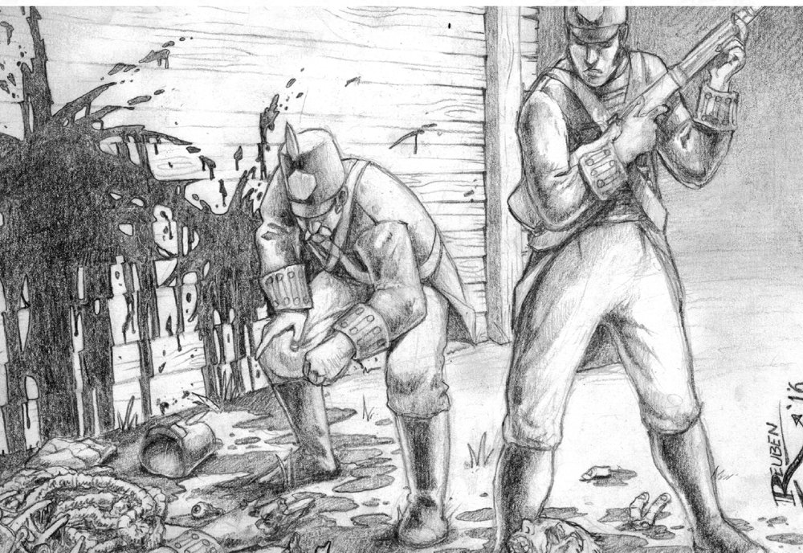

- Если сыщики поговорят с напуганной командой, они узнают о недавних странствиях «Невы». Перед тем как прийти в Австралию, корабль какое-то время стоял у нескольких небольших тихоокеанских островов, хотя последней крупной стоянкой была Аляска.
- Помимо семи убитых русских, Корпус Нового Южного Уэльса записал в окрестностях Сиднея четыре смерти каторжников и солдат, у каждой из которых те же признаки, что и у смертей русских. Один из погибших — каторжник, отбившийся от рабочей артели на Дауэс-Пойнт всего на несколько минут; другой — пьяный солдат, ушедший из казарм Корпуса в поисках развлечений.

### Правда

Предлагаются три возможных объяснения вспышки зверских убийств.

1. *Проклятие шамана.* В этом варианте у одного из русских матросов «Невы» есть страшная тайна: ещё на Аляске он навлёк на себя гнев местного племени, осквернив одно из их священных мест. Местный шаман племени наложил на него проклятие, которое тогда никак явно не сказалось, но теперь сеет хаос. Проклятый матрос, Руди Горелов, несёт метку Вендиго: всякий раз, когда он сходит на берег там, где стоит зима, сверхъестественная сила выслеживает его. Июнь в Южном полушарии — зима, так что прибытие «Невы» в Сидней не только вызвало ужасную погоду с метелями, но и призвало Вендиго выследить и убить всякого, с кем соприкасался Руди. Изучение закономерности смертей быстро покажет, что все они связаны, и эта связь — Руди Горелов, который теперь прячется (по крайней мере отчасти — чтобы уберечь окружающих). Расследование в конце концов откроет, что матрос, вокруг которого всё крутится, скорее жертва, чем злодей. Но когда сыщики наконец его разыщут, он скажет, что у него не хватает мужества покончить с собой, а тот, кто его убьёт, примет его проклятие на себя. Сыщики могут воспользоваться для изысканий русскими книгами с корабля или придумать собственный способ сразиться с Вендиго и рассеять его. (Хранитель может решить, что это победа над Вендиго в бою, или его призыв и победа в магической схватке, или какое-то иное решение.)
