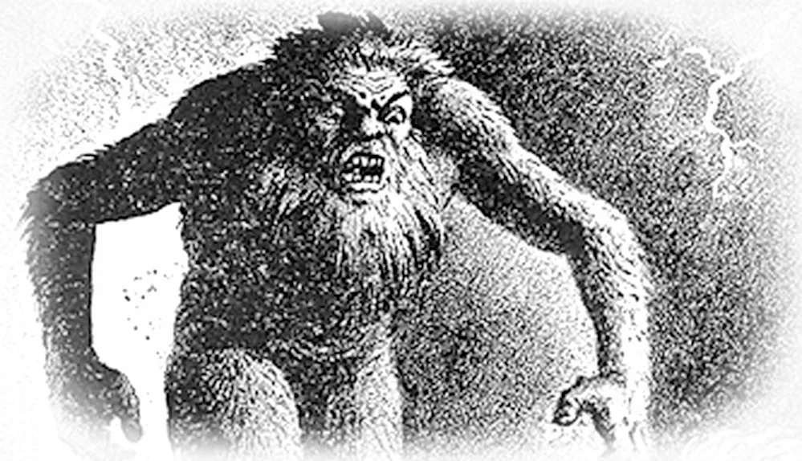

### Как вовлечь сыщиков

Скорее всего, экспедиция будет состоять из казённых чиновников, некоторые из которых могут быть учёными-любителями. Один, возможно, окажется землемером. Их будут сопровождать несколько солдат Корпуса Нового Южного Уэльса и один-два местных проводника-аборигена. Любую из этих ролей вполне может взять сыщик. Кроме того, любого, кто хоть немного знает местность вокруг Ричмонд-Хилла, могут взять с собой, чтобы он помогал отряду с выбором пути.

### Правда

Предлагаются три возможных объяснения ужасов, таящихся в глубинке.

1. *Царство йови.* В этом варианте край, куда забрели сыщики, — охотничьи угодья уникального австралийского криптида, известного как йови (своего рода «волосатый человек», похожий на сасквоча, или бигфута, — подробнее см. «Secrets of Australia»). Хотя йови не особенно умны, они искусные охотники, умеют прятаться и очень быстры. Вместе эти умения делают их пугающим противником в здешних густых лесах. Йови держатся этого маленького уголка глубинки потому, что каким-то мистическим образом связаны с особой рощицей сосен уникального вида, вымершего во всём остальном мире. Йови поклоняются этим деревьям и сделают всё, чтобы не дать людям осквернить свою священную рощу.
2. *Черви снизу.* В этом варианте отряд сыщиков забрёл в край, где оставлено гнездо яиц хтонийцев. Многие странные видения и ощущения, которые испытывают члены экспедиции, — невольные побочные действия телепатических излучений нескольких хтонийцев, всё ещё таящихся под окрестными холмами. Как только сыщики найдут гнездо с яйцами, взрослые существа почуют их присутствие и сочтут их угрозой своему потомству. Хтонийцы не остановятся ни перед чем, чтобы защитить яйца: сперва они пустят в ход свои мощные телепатические способности, чтобы натравить членов отряда друг на друга, а затем при необходимости вмешаются напрямую. Если сыщики быстро не уйдут из этих мест, вскоре они могут обнаружить, что сами горы начинают гнуться и сдвигаться, пока ужасы Мифов прорезают к ним путь.
3. *Трещина во времени.* В этом варианте странные явления, которые испытывает экспедиция, магической природы: край находится рядом с исполинскими вратами времени, которые медленно разрушаются. Узнать, кто и зачем создал это тайное и невидимое устройство, никак нельзя, но одно несомненно: в нынешнем состоянии оно опасно для сыщиков. Время от времени разрушающиеся врата изрыгают отвратительных допотопных тварей (несколько возможных идей — в бестиарии мегафауны в PDF-приложении «Secrets of Australia Companion»). Если кто-то из экспедиции или вся она забредёт в сами врата, они, скорее всего, исчезнут навсегда, перенесённые в какой-то момент далёкого прошлого (или далёкого будущего?).

## Набросок 6: Сон за сном

Этот набросок можно вести в любое время периода, которому посвящена эта книга. Основная часть действия происходит в обжитом месте (например, в Сиднее, Парраматте или Хобарт-Тауне), но его легко приспособить и к самым разным более отдалённым местам.

### Предыстория

Сыщики — как и многие в колонии — в последнее время совсем плохо спят. Последние несколько ночей каждого из них мучают жестокие и странные кошмары, подробности которых трудно припомнить. Иногда по утрам сыщики просыпаются в синяках и мелких порезах — видимо, оттого что ворочались и метались во сне. Порой сны так мучительны, что может потребоваться проверка Рассудка с потерей 0/1d3.
