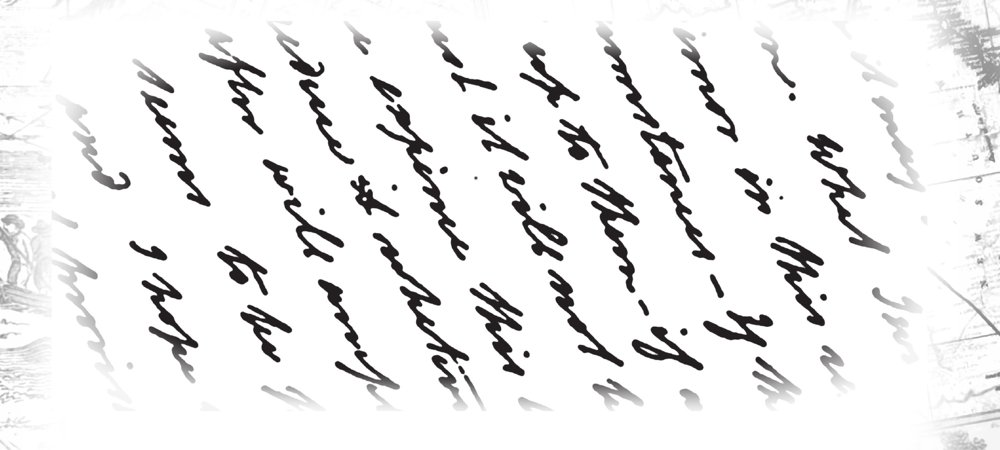

# Часть VI. Ресурсы

## Краткая библиография

Работая над «Каторжниками и Ктулху», авторы изучили множество книг, статей и сайтов о колониальной Австралии — и даже не притронулись к основной массе того, что доступно. Для доступного дальнейшего чтения об эпохе с игровыми целями Хранителям и игрокам рекомендуется следующее.

### Кино и телевидение

Недавний телесериал Би-би-си «Banished» («Изгнанные», 2015), хотя его действие происходит чуть раньше периода, которому посвящена эта книга, остаётся богатым источником — особенно о лишениях и личных испытаниях, выпадавших каторжникам.

Недавний двухсерийный мини-сериал Австралийской радиовещательной корпорации «The Secret River» («Тайная река», 2015) — экранизация романа Кейт Гренвилл (см. ниже); он рассказывает о фермерах-каторжниках на реке Хоксбери в 1806 году и их отношениях с местными аборигенами.

### Художественная литература о каторжниках

Современной художественной литературы с каторжным антуражем немало. Ниже — небольшая подборка полезных книг, особенно тех, что находятся в общественном достоянии и доступны для бесплатного скачивания.

Отмеченные звёздочкой (*) происходят именно в период, которому посвящена эта книга.

- Marcus Clarke, *For the Term of His Natural Life*, 1871 (Маркус Кларк, «Пожизненно»). Самый знаменитый роман о каторжниках и австралийская классика. (Бесплатная электронная книга: http://www.gutenberg.org/files/3424/3424-h/3424-h.htm.)
- Richard Cobbold*, *The History of Margaret Catchpole: A Suffolk Girl*, 1845 (Ричард Коббольд, «История Маргарет Кэтчпол, девушки из Суффолка»). Маргарет Кэтчпол — реальная каторжница, пережившая наводнения на Хоксбери. Это беллетризованный рассказ о её жизни. (Бесплатная электронная книга: http://www.gutenberg.org/ebooks/39326.)
