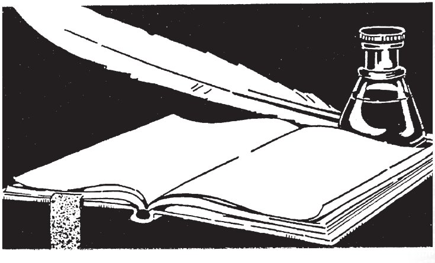

### Типичный мужчина-абориген

*Представитель быстро убывающего населения коренных австралийцев*

```stat
СИЛ 70    ВЫН 75    ТЕЛ 65    ЛВК 75    ИНТ 65
НАР 50    МОЩ 55    ОБР 45*   Рассудок 60    ПЗ 14
БкУ: +1d4   Комплекция: 1   Скорость: 9   ПМ: 11

Ближний бой (драка)   55% (27/11), урон 1d3 + БкУ
Метательное копьё     65% (32/13), урон 1d8+1 + ½ БкУ [дальность 70 м; 1 раунд, чтобы приготовить копьё к броску]
Боевой бумеранг       45% (22/9), урон 1d8 + ½ БкУ [дальность 210 м; не возвращается к бросившему]
Уклонение             70% (35/14)

Броня: нет.
Навыки: Лазание 40%, Слух 45%, Естествознание 60%, Внимание 40%, Скрытность 70%, Выживание 50%.

[* ОБР персонажей-аборигенов отражает обучение традиционному закону; по меркам европейской учёности у всех персонажей-аборигенов фактически ОБР 0.]
```

### Типичный хирург

*Бывший корабельный врач, ныне на службе правительства Нового Южного Уэльса*

```stat
СИЛ 60    ВЫН 50    ТЕЛ 65    ЛВК 75    ИНТ 75
НАР 70    МОЩ 65    ОБР 80    Рассудок 65    ПЗ 11
БкУ: +1d4   Комплекция: 1   Скорость: 9   ПМ: 13

Ближний бой (драка)   25% (12/5), урон 1d3 + БкУ
Кремнёвый пистолет*   40% (20/8), урон 1d6+1 [дальность 10 м; 1 выстрел за 4 раунда; осечка 95+]
Сабля                 55% (27/11), урон 1d8+1 + БкУ
Уклонение             45% (22/9)

Броня: нет.
Навыки: Средства 65%, Первая помощь 70%, Медицина 70%, Убеждение 40%, Психология 50%, Верховая езда 45%, Наука (химия, биология) 60%, Внимание 50%.

[* Вероятно, носит «пару» пистолетов — подобранный комплект из двух.]
```

### Типичный правительственный чиновник

*Знаток своего дела на службе губернатора*

```stat
СИЛ 60    ВЫН 50    ТЕЛ 55    ЛВК 60    ИНТ 65
НАР 50    МОЩ 50    ОБР 70    Рассудок 50    ПЗ 11
БкУ: нет   Комплекция: 0   Скорость: 9   ПМ: 11

Ближний бой (драка)   50% (25/10), урон 1d3 + БкУ
Уклонение             45% (22/9)

Броня: нет.
Навыки: Бухгалтерское дело 50%, Средства 65%, Первая помощь 40%, Убеждение 60%, Верховая езда 40%, (личная специальность) 80%, Внимание 50%.
```

### Типичный торговец

*Хочет, чтобы колония выросла из тюрьмы в большой новый рынок*

```stat
СИЛ 60    ВЫН 70    ТЕЛ 60    ЛВК 65    ИНТ 70
НАР 60    МОЩ 60    ОБР 70    Рассудок 60    ПЗ 13
БкУ: нет   Комплекция: 0   Скорость: 9   ПМ: 12

Ближний бой (драка)   45% (22/9), урон 1d3 + БкУ
Охотничье ружьё       40% (20/8), урон 4d6/2d6/1d6 [2 ствола; дальность 10/20/50 м; 3 раунда на перезарядку каждого ствола; осечка 95+]
Уклонение             45% (22/9)

Броня: нет.
Навыки: Бухгалтерское дело 60%, Оценка 70%, Средства 85%, Ремесло (разные) 45%, Юриспруденция 50%, Убеждение 75%.
```

Примечание: если торговец состоит в ополчении Сиднея или Парраматты, добавьте 10% к Стрельбе.



*Прим. перев.: у хирурга, чиновника и торговца в оригинале «45% (22/7)» — пятая часть исправлена на (22/9). Как напечатано оставлены: ПМ 11 у чиновника при МОЩ 50 (по правилам 10); Скорость 9 у хирурга (ЛВК 75 больше ТЕЛ 65, но СИЛ 60 меньше — по правилам 8) и у торговца (СИЛ 60 и ЛВК 65 при ТЕЛ 60 — по правилам 8).*
