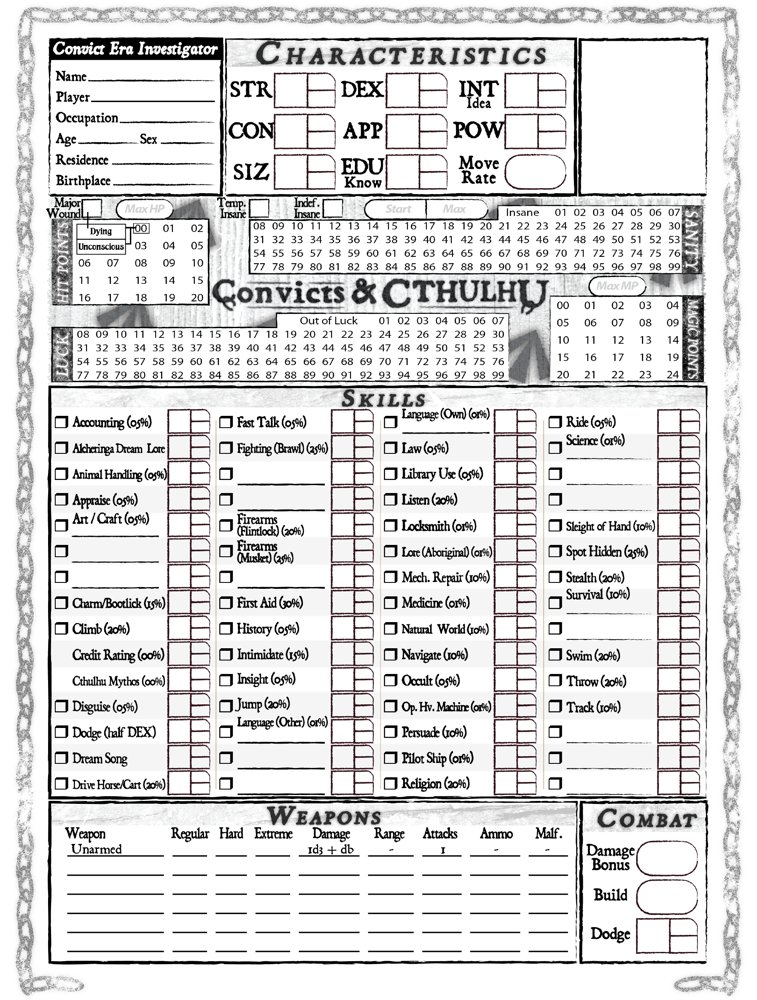

## Лист сыщика

**Надписи бланка (с. 1) в переводе:**

- **Сыщик каторжной эпохи:** Имя · Игрок · Профессия · Возраст · Пол · Место жительства · Место рождения.
- **Характеристики:** СИЛ · ЛВК · ИНТ (Идея) · ВЫН · НАР · МОЩ · ТЕЛ · ОБР (Знание) · Скорость. Справа — пустая рамка для портрета.
- **Пункты здоровья:** Серьёзная рана · Макс. ПЗ · При смерти · Без сознания · шкала 00–20.
- **Рассудок:** Временное безумие · Бессрочное безумие · Начальный · Максимальный · Безумие (шкала 01–99).
- **Удача:** Удача кончилась (шкала 01–99).
- **Пункты магии:** Макс. ПМ (шкала 00–24).
- **Навыки** (базовые значения — как напечатаны на бланке):

| | | | |
|---|---|---|---|
| Бухгалтерское дело (05%) | Красноречие (05%) | Родной язык (01%) | Верховая езда (05%) |
| Знание Алчеринги | Ближний бой (драка) (25%) | Юриспруденция (05%) | Наука (01%) |
| Обращение с животными (05%) | ___ | Работа в библиотеке (05%) | ___ |
| Оценка (05%) | ___ | Слух (20%) | ___ |
| Искусство/ремесло (05%) | Стрельба (кремнёвое оружие) (20%) | Взлом (01%) | Ловкость рук (10%) |
| ___ | Стрельба (мушкет) (25%) | Тайные знания (аборигенов) (01%) | Внимание (25%) |
| ___ | ___ | Механика (10%) | Скрытность (20%) |
| Обаяние/подхалимство (15%) | Первая помощь (30%) | Медицина (01%) | Выживание (10%) |
| Лазание (20%) | История (05%) | Естествознание (10%) | ___ |
| Средства (00%) | Запугивание (15%) | Ориентирование (10%) | Плавание (20%) |
| Мифы Ктулху (00%) | Проницательность (05%) | Оккультизм (05%) | Метание (20%) |
| Маскировка (05%) | Прыжки (20%) | Управление тяжёлыми машинами (01%) | Чтение следов (10%) |
| Уклонение (½ ЛВК) | Иностранный язык (01%) | Убеждение (10%) | ___ |
| Песнь сновидений | ___ | Пилотирование (корабль) (01%) | ___ |
| Управление лошадью/повозкой (20%) | ___ | Религия (20%) | ___ |

- **Оружие:** Оружие · Обычный · Трудный · Чрезвычайный · Урон · Дальность · Атак · Боезапас · Осечка. Первая строка: Безоружный — урон 1d3 + БкУ, атак 1.
- **Бой:** Бонус к урону · Комплекция · Уклонение.

*Прим. перев.: на бланке у Обращения с животными и Оценки стоит база 05%, у Плавания — 20%, а в списке навыков (с. 20) — 15%, 15% и 05%; приведено как напечатано на бланке.*
