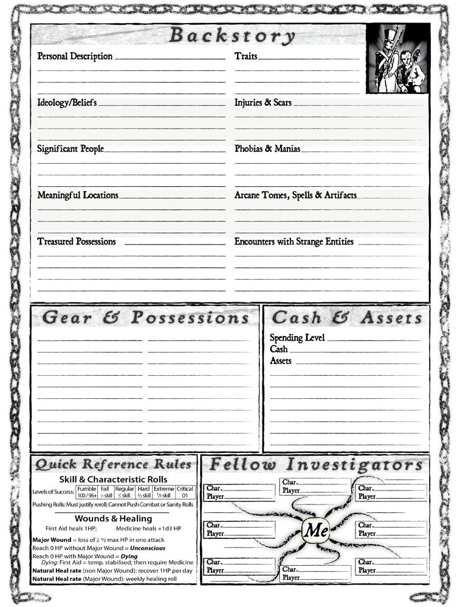

**Надписи бланка (с. 2) в переводе:**

- **Биография:** Внешность · Идеалы и принципы · Значимые люди · Важные места · Ценное имущество · Черты характера · Ранения и шрамы · Фобии и мании · Тайные книги, заклинания и артефакты · Встречи со странными существами.
- **Снаряжение и имущество.**
- **Деньги и активы:** Уровень расходов · Наличные · Активы.
- **Краткая памятка по правилам.**
    - *Проверки навыков и характеристик.* Степени успеха: крах — 100/96+; неудача — больше навыка; обычный успех — не больше навыка; трудный — ½ навыка; чрезвычайный — ⅕ навыка; критический — 01. Повторная проверка: нужно обосновать повтор; нельзя повторять проверки в бою и проверки Рассудка.
    - *Раны и лечение.* Первая помощь восстанавливает 1 ПЗ; Медицина — ещё +1d3 ПЗ. Серьёзная рана — потеря не меньше половины макс. ПЗ от одной атаки. 0 ПЗ без серьёзной раны — без сознания. 0 ПЗ с серьёзной раной — при смерти; при смерти: Первая помощь временно стабилизирует, затем нужна Медицина. Естественное восстановление (без серьёзной раны): 1 ПЗ в день. Естественное восстановление (серьёзная рана): еженедельная проверка выздоровления.
- **Товарищи-сыщики:** в середине — «Я», вокруг — поля «Персонаж» и «Игрок» для остальных сыщиков.
