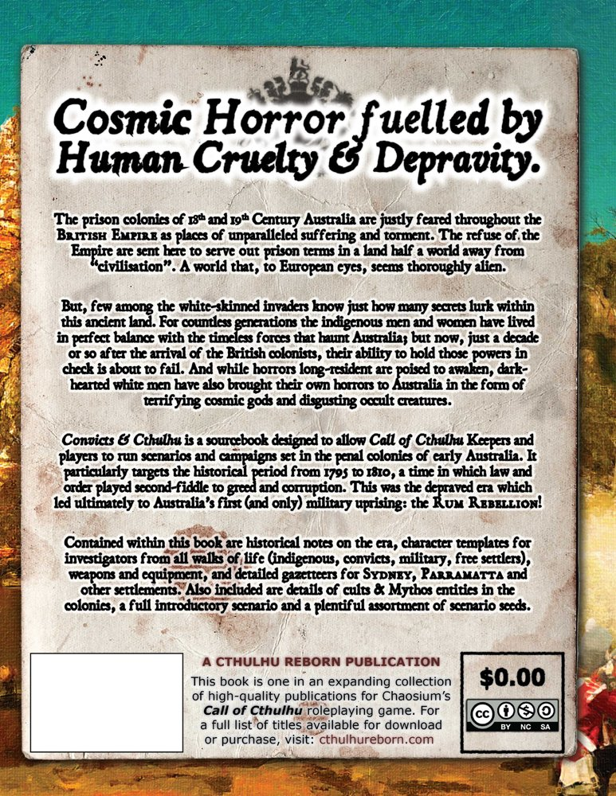

> **Космический ужас, подпитанный людской жестокостью и развратом.**
>
> Каторжные колонии Австралии XVIII и XIX веков по праву внушают страх по всей **Британской империи** как места беспримерных страданий и мук. Отбросы империи отправляют сюда отбывать срок в земле на другом краю света от «цивилизации». В мире, который европейцам кажется совершенно чуждым.
>
> Но мало кто из белокожих захватчиков знает, сколько тайн таится в этой древней земле. Бессчётные поколения коренные мужчины и женщины жили в совершенном равновесии с вневременными силами, что обитают в Австралии; но теперь, лет через десять после прибытия британских колонистов, их способность держать эти силы в узде начинает слабеть. И пока ужасы, давно живущие здесь, готовы пробудиться, люди с чёрным сердцем и белой кожей привезли в Австралию и собственные ужасы — в виде страшных космических богов и омерзительных оккультных тварей.
>
> «Каторжники и Ктулху» — книга-сеттинг, которая позволяет Хранителям и игрокам «Зова Ктулху» вести сценарии и кампании в каторжных колониях ранней Австралии. Особое внимание в ней уделено историческому периоду с 1795 по 1810 год — времени, когда закон и порядок уступили место алчности и продажности. Это была порочная эпоха, приведшая в конце концов к первому (и единственному) в истории Австралии военному мятежу — **Ромовому бунту**!
>
> В книге — исторические заметки об эпохе, шаблоны сыщиков из всех слоёв общества (аборигены, каторжники, военные, свободные поселенцы), оружие и снаряжение, подробные описания **Сиднея**, **Парраматты** и других поселений. Здесь же — сведения о культах и сущностях Мифов в колониях, полный вводный сценарий и множество набросков сценариев.

**Издание Cthulhu Reborn.** Эта книга — одна из растущего собрания высококачественных изданий для ролевой игры «Зов Ктулху» от Chaosium. Полный список изданий, доступных для скачивания или покупки, — на сайте cthulhureborn.com.

Цена: $0.00. Лицензия Creative Commons BY-NC-SA (с указанием авторства, некоммерческая, с сохранением условий).
