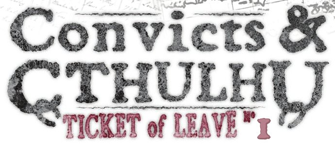
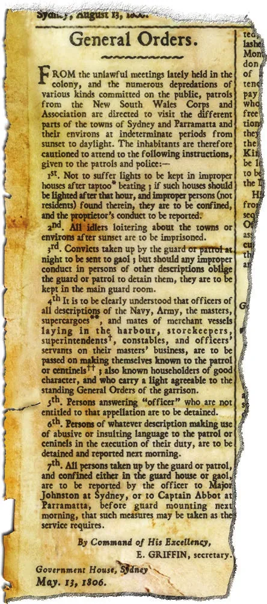

НОЧНЫЕ УЖАСЫ

Convicts &amp; Cthulhu — Отпускной билет № 1

*Вверху страницы — логотип «Convicts & Cthulhu — Ticket of Leave № 1» и заглавие «Night Terrors» («Ночные ужасы») на фоне старинных рукописей и гравюр.*

> «Отпускные билеты» (Tickets-of-Leave) — небольшие самостоятельные дополнения к сеттингу [«Convicts & Cthulhu»](https://www.cthulhureborn.com) для лавкрафтовских ролевых игр в ранних каторжных колониях Австралии. В каждом — подборка игровых элементов: их можно использовать все вместе как набросок мини-сценария или по отдельности — как детали, которые обогатят сценарий вашего собственного сочинения.

> **Выходные данные**
>
> «Отпускной билет» № 1 написали Джефф Гиллан (Geoff Gillan) и Дин Энгельхардт (Dean Engelhardt); © 2016. Издатель — Cthulhu Reborn Publishing (www.cthulhureborn.com).
>
> Сеттинг «Convicts & Cthulhu» издаёт Cthulhu Reborn Publishing; он доступен на RPGNow и DrivethruRPG по модели «Плати сколько хочешь» (Pay-What-You-Want).
>
> *Call of Cthulhu* («Зов Ктулху») — зарегистрированный товарный знак Chaosium Inc., используется с разрешения (www.chaosium.com).
>
> Лицензия Creative Commons BY-NC-SA.

# Вступление

Ночные расследования — основа лавкрафтовской прозы и ролевых сценариев, но в каторжных колониях ранней Австралии красться в темноте в поисках улик бывает и трудно, и опасно. Для каторжников ограничения на ночные передвижения за пределами тюрьмы всегда были крайне строгими. Но в эпоху растущего беззакония и распущенности, которую охватывает сеттинг «Convicts & Cthulhu», даже свободные поселенцы и солдаты ходят после темноты не так свободно, как прежде. Приведённый ниже приказ губернатора даёт представление о том, насколько суровы правила ночного комендантского часа. Эти строго соблюдаемые правила дают Хранителю возможность осложнять жизнь сыщикам: им придётся прятаться в тенях, чтобы избежать наказания за незаконное пребывание на улицах Сиднея или Парраматты. А жутко пустые улицы городков — выразительный фон для сцены-другой… или, как показано ниже, даже основа целого сценария.

# Ночной дозор

Как сказано в приказе, приведённом рядом, губернатор распорядился создать ночные патрули — отряды, которые следят за соблюдением ночного комендантского часа: время от времени обходят улицы и окрестности и арестовывают тех, кто нарушает правила. Этот короткий сценарий отводит сыщикам роль членов одного из таких патрулей, которому поручено несколько весьма запоминающихся ночей следить за улицами Сиднея или Парраматты.

> **Раздатка: «Общие приказы» губернатора о ночных патрулях**
>
> *Сидней, 13 августа 180…*
>
> **Общие приказы.**
>
> Ввиду незаконных сборищ, недавно имевших место в колонии, и многочисленных грабежей разного рода, чинимых публике, патрулям Корпуса Нового Южного Уэльса и Ассоциации предписывается в разное, заранее не назначенное время от заката до рассвета обходить различные части городов Сиднея и Парраматты и их окрестности. Посему жителям надлежит соблюдать следующие наставления, данные патрулям и полиции:
>
> 1-е. Не допускать огней в непотребных домах после боя тапту\*; если такие дома будут освещены после этого часа и в них обнаружатся непотребные лица (не жильцы), их надлежит задержать, а о поведении хозяина доложить.
>
> 2-е. Всех праздношатающихся по городам и окрестностям после заката надлежит заключать под стражу.
>
> 3-е. Каторжников, задержанных караулом или патрулём ночью, отправлять в тюрьму; если же непотребное поведение лиц иного звания вынудит караул или патруль задержать их, их надлежит содержать в главной караульне.
>
> 4-е. Надлежит ясно понимать, что офицеров всех родов Флота и Армии, шкиперов, суперкарго\*\* и помощников торговых судов, стоящих в гавани, кладовщиков, смотрителей†, констеблей и офицерских слуг по делам их хозяев следует пропускать, когда они назовут себя патрулю или часовы솆; равно как и известных домовладельцев доброй репутации, несущих огонь согласно постоянным Общим приказам гарнизона.
>
> 5-е. Лиц, назвавшихся «офицером», не имея права на это звание, надлежит задерживать.
>
> 6-е. Лиц любого звания, позволяющих себе бранные или оскорбительные слова в адрес патруля или часовых при исполнении ими обязанностей, надлежит задерживать, а наутро докладывать о них.
>
> 7-е. О всех лицах, задержанных караулом или патрулём и заключённых в караульню или тюрьму, офицер докладывает майору Джонстону в Сиднее или капитану Эбботу в Парраматте до утреннего развода караулов, дабы были приняты меры, каких требует служба.
>
> По приказу Его Превосходительства,  
> Э. Гриффин, секретарь.
>
> Дом правительства, Сидней,  
> 13 мая 1806 года.

*Прим. перев.: так в оригинале — дата в шапке вырезки (13 августа, год оборван) не совпадает с датой под приказом (13 мая 1806 года); в 6-м пункте опечатка «ceninels» вместо «centinels».*

*Сноски, поясняющие старинные слова этой вырезки и язык, свойственный колонии Новый Южный Уэльс, — на с. 4 этого дополнения.*
