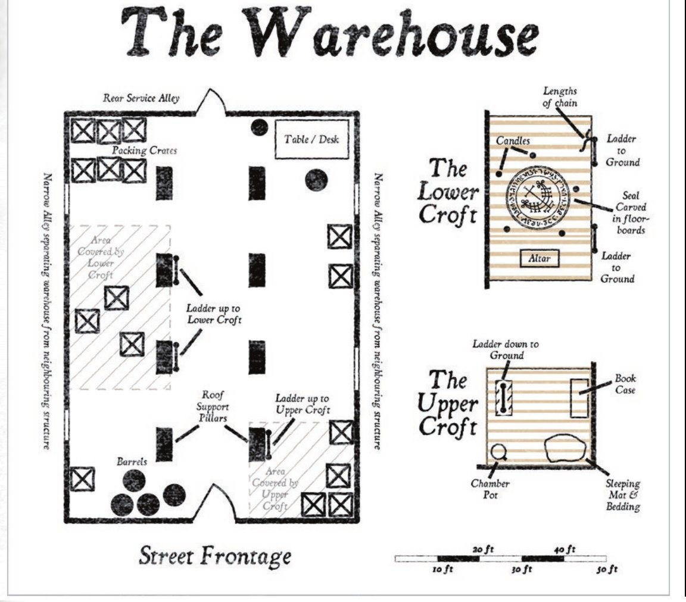

### Ночь третья

Бросайте на встречи, как в первую ночь; впрочем, Хранитель может и пропустить случайные встречи. Сторожа у склада, сыщики могут услышать странную литанию. Рабочие склада скрывают культ, который недавно напортачил с заклинанием и случайно вызвал Бродягу между измерениями. Теперь культисты в отчаянии пытаются подобрать ритуал, который изгонит тварь. Если патруль не решит сторожить склад, к командиру может прийти один из рабочих, признаться, что творится что-то странное, и отдаться на милость властей (Хранителю на заметку: в Новом Южном Уэльсе такое обычно плохо кончается).

## Развязка

Как патруль поступит с культистами на складе, решают сами сыщики. Один очевидный путь — просто схватить культистов и запереть их. Если патруль так и не выследил Бродягу между измерениями, тварь будет и дальше возникать в случайных местах и утаскивать ничего не подозревающих людей. У неё, похоже, есть цель, которую не постигнет ни один здравомыслящий человек. Чтобы провести ритуал, патрулю, возможно, придётся завербовать одного из культистов. Или же местный знахарь аборигенов может увидеть пространственные следы, по которым ходит эта тварь, и предсказать, где она появится в следующий раз; возможно, есть и древние духи Времени сновидений, которых тоже можно призвать, чтобы они выгнали ужас Мифов из города.

**План склада** (ключ к карте)

*Первый этаж (слева):*

- **Rear Service Alley** — служебный проулок за складом.
- **Packing Crates** — ящики для упаковки.
- **Table / Desk** — стол/конторка.
- **Area Covered by Lower Croft** — часть этажа под нижними антресолями.
- **Ladder up to Lower Croft** — лестница на нижние антресоли.
- **Roof Support Pillars** — опорные столбы крыши.
- **Ladder up to Upper Croft** — лестница на верхние антресоли.
- **Barrels** — бочки.
- **Area Covered by Upper Croft** — часть этажа под верхними антресолями.
- **Street Frontage** — фасад на улицу.
- **Narrow Alley separating warehouse from neighbouring structure** (слева и справа) — узкий проулок, отделяющий склад от соседнего строения.

*Нижние антресоли (The Lower Croft):*

- **Lengths of chain** — отрезки цепей.
- **Candles** — свечи.
- **Ladder to Ground** (две) — лестница на первый этаж.
- **Seal Carved in floor-boards** — печать, вырезанная в половицах.
- **Altar** — алтарь.

*Верхние антресоли (The Upper Croft):*

- **Ladder down to Ground** — лестница вниз, на первый этаж.
- **Book Case** — книжный шкаф.
- **Chamber Pot** — ночной горшок.
- **Sleeping Mat & Bedding** — спальная циновка и постель.

*Масштабная линейка: 20, 30 и 40 футов (около 7, 10 и 13 м).*

> **Сноски**
>
> Они поясняют старинные слова из вырезки «Правительственной газеты» на с. 1.
>
> \*Тапту (taptoo) — старинное слово, форма военного термина «tattoo». Здесь оно означает обычай посылать барабанщика в обход поселения: он непрерывно бьёт в барабан, давая знак, что все солдаты должны вернуться в казармы. По традиции барабанщик тапту начинал обход в 21:30 и заканчивал в 22:00.
>
> \*\*Суперкарго — человек, нанятый плыть на парусном судне вместе с ценным грузом, чтобы обеспечить его сохранность и продать груз по воле владельца. Это не то же самое, что «фактор», который смотрит за товаром, только пока тот находится в его порту.
>
> † Список должностей смотрителей в колонии — на с. 19 «Convicts & Cthulhu».
>
> †† Centinel — старинное написание слова «sentinel», то есть часовой — солдат, который несёт караул.

---

*Понравилось прочитанное, но у вас ещё нет основной книги «Convicts & Cthulhu»? Загляните на RPGNow или DrivethruRPG и возьмите себе экземпляр — в PDF или в мягкой обложке (печать по требованию). Оба варианта доступны по модели «Плати сколько хочешь»: вы платите только себестоимость экземпляра (0 долларов за PDF или около 4 долларов США за книгу в мягкой обложке) и сколько угодно сверху — как благодарность Cthulhu Reborn.*
