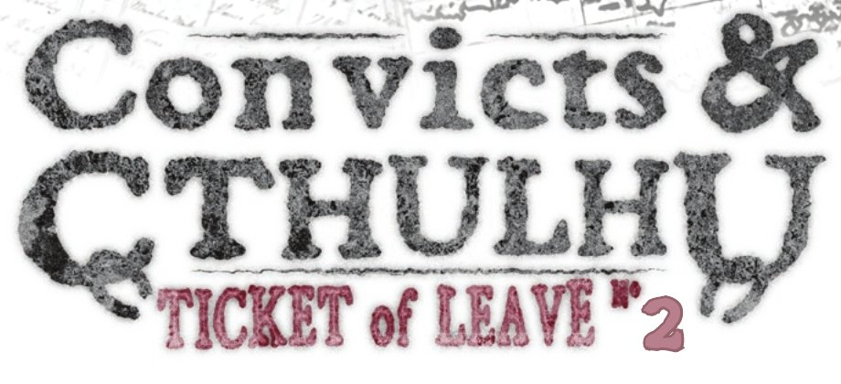
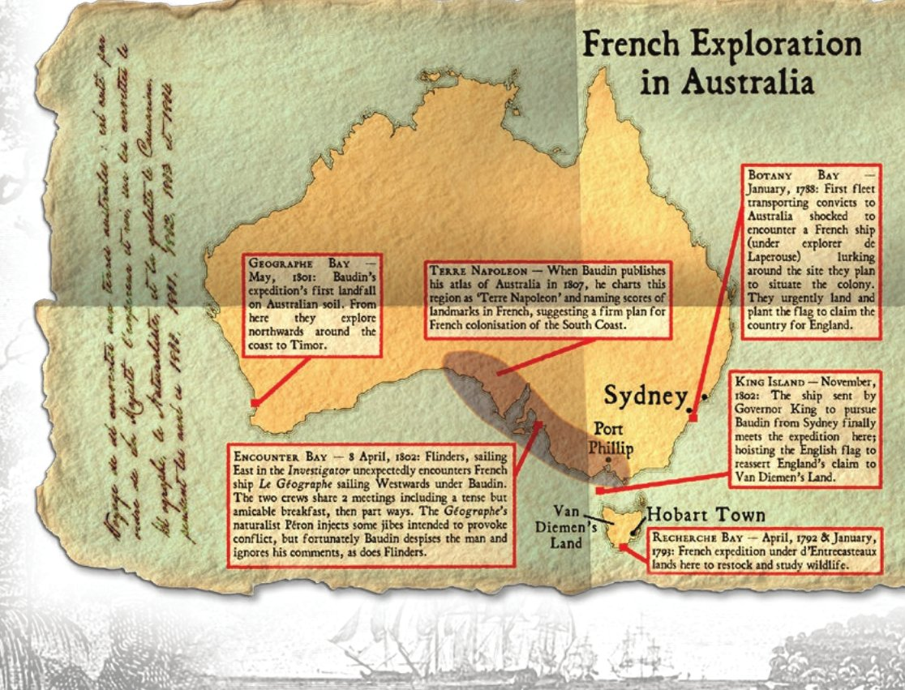

УЖАС ТРИКОЛОРА

Convicts &amp; Cthulhu — Отпускной билет № 2

*Вверху страницы — логотип «Convicts & Cthulhu — Ticket of Leave № 2» и заглавие «Tricolour Terror» («Ужас триколора») на фоне старинных рукописей и гравюр.*

> «Отпускные билеты» (Tickets-of-Leave) — небольшие самостоятельные дополнения к сеттингу «Convicts & Cthulhu» для лавкрафтовских ролевых игр в ранних каторжных колониях Австралии. В каждом — подборка игровых элементов: их можно использовать все вместе как набросок мини-сценария или по отдельности — как детали, которые обогатят сценарий вашего собственного сочинения.

> **Выходные данные**
>
> «Отпускной билет» № 2 написали Джефф Гиллан (Geoff Gillan) и Дин Энгельхардт (Dean Engelhardt); © 2016. Издатель — Cthulhu Reborn Publishing (www.cthulhureborn.com).
>
> Сеттинг «Convicts & Cthulhu» издаёт Cthulhu Reborn Publishing; он доступен на RPGNow и DrivethruRPG по модели «Плати сколько хочешь» (Pay-What-You-Want).
>
> *Call of Cthulhu* («Зов Ктулху») — зарегистрированный товарный знак Chaosium Inc., используется с разрешения (www.chaosium.com).
>
> Лицензия Creative Commons BY-NC-SA.

# Вступление

Как описано в «Convicts & Cthulhu», ранние дни колониальной Австралии совпадают с грандиозными событиями, которые происходят на другом краю света, в Европе. В эти годы народ Франции сначала поднимается и свергает монархию во Французской революции, а всего через несколько лет Англия оказывается в войне с новорождённой Французской республикой. Легко подумать, что события, происходящие так далеко от затерянных новых колоний в Австралии, мало влияли на повседневную жизнь людей в Новом Южном Уэльсе. Но это не так.

Даже без быстрой связи (вести о великих событиях шли много месяцев) молодые колонии прекрасно знали о вражде между Францией и великой Британской империей. И для колонистов Франция была не отвлечённой угрозой, а — благодаря её великим морским плаваниям и деятельному флоту в регионе — ещё и возможным источником прямого столкновения. Эти тревоги и порождённые ими подчас безрассудные страхи тяжело давили и на первых поселенцев, и на чиновников. Этот тёмный, нависший страх даёт интересные сюжетные возможности для сценариев *«Зова Ктулху»* в ранней Австралии. Некоторые из этих влияний уже намечены в «Convicts & Cthulhu», а заметки ниже дают Хранителю дополнительные средства, чтобы вплести галльские мотивы в свои истории антиподного ужаса.

**Французские исследования Австралии** (подписи на карте)

- **Залив Географ — май 1801 года.** Первая высадка экспедиции Бодена на австралийскую землю. Отсюда экспедиция исследует побережье к северу, до Тимора.
- **Земля Наполеона.** Когда Боден в 1807 году издаёт свой атлас Австралии, он наносит этот край как «Землю Наполеона» и даёт французские имена десяткам ориентиров — будто у Франции был твёрдый план колонизировать Южное побережье.
- **Ботани-Бей — январь 1788 года.** Первый флот, везущий каторжников в Австралию, с потрясением застаёт французский корабль (под началом исследователя де Лаперуза), который крутится у того самого места, где англичане собираются основать колонию. Они спешно высаживаются и поднимают флаг, объявляя страну английской.
- **Остров Кинг — ноябрь 1802 года.** Корабль, посланный губернатором Кингом вдогонку за Боденом из Сиднея, наконец находит экспедицию здесь; англичане поднимают английский флаг, чтобы вновь заявить права Англии на Землю Ван-Димена.
- **Залив Встречи — 8 апреля 1802 года.** Флиндерс, идущий на восток на «Инвестигейторе», неожиданно встречает французский корабль «Географ», идущий на запад под началом Бодена. Экипажи встречаются дважды, в том числе за напряжённым, но дружеским завтраком, и расходятся. Натуралист «Географа» Перон отпускает колкости, чтобы вызвать ссору, но, к счастью, Боден его презирает и не обращает внимания на его слова — как и Флиндерс.
- **Бухта Решерш — апрель 1792 и январь 1793 года.** Французская экспедиция под началом д’Антркасто высаживается здесь, чтобы пополнить припасы и изучать животный мир.
- Также на карте: Сидней, Порт-Филлип, Земля Ван-Димена, Хобарт-Таун.

*Слева на карте — вертикальная надпись по-французски: заглавие отчёта о плавании Бодена («Путешествие для открытий в Южные земли… на корветах „Географ“, „Натуралист“ и шхуне „Казуарина“ в 1800, 1801, 1802, 1803 и 1804 годах»).*

> **Французские и английские встречи**
>
> Карта рядом обобщает некоторые места, где пересекались французские и английские интересы при исследовании ранней Австралии, что приводило к любопытным встречам. Хранитель может взять эти исторические случаи зерном события сценария или вдохновением для других — исторически не задокументированных — встреч того же рода.
