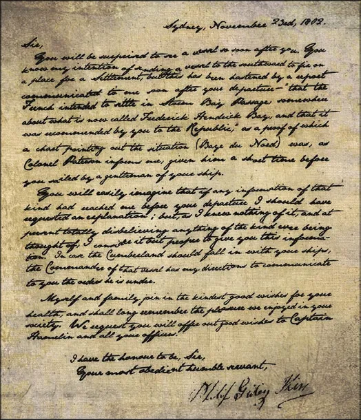

> **Раздатка: Письмо губернатора Кинга Николя Бодену**
>
> *Сидней, 23 ноября 1802 года.*
>
> Сэр,
>
> Вы удивитесь, увидев судно так скоро после вашего ухода. Вам известно моё намерение послать судно на юг, чтобы выбрать место для поселения, но его ускорило донесение, полученное мною вскоре после вашего отплытия, — «что французы намерены поселиться в проливе Сторм-Бей где-то около места, ныне называемого заливом Фредерика Хендрика, и что вы рекомендовали его Республике»; в доказательство чего, как сообщает мне полковник Патерсон, ему незадолго до вашего отплытия вручил карту с указанием места (Бе-дю-Нор) некий джентльмен с вашего корабля.
>
> Вы легко поймёте, что, дойди до меня подобные сведения до вашего отплытия, я попросил бы объяснений; но, поскольку я ничего об этом не знал и ныне совершенно не верю, что о чём-либо подобном когда-либо помышляли, я считаю лишь должным сообщить вам эти сведения. Если «Камберленд» встретится с вашими кораблями, командир этого судна имеет мои указания сообщить вам приказы, которые ему даны.
>
> Я и моя семья присоединяемся к сердечнейшим пожеланиям вам здоровья и долго будем помнить удовольствие вашего общества. Просим передать наши добрые пожелания капитану Амлену и всем вашим офицерам.
>
> Имею честь быть, сэр,  
> вашим покорнейшим слугой,  
> *Филип Гидли Кинг*

*Подпись сбоку от письма в книге: «Письмо губернатора Кинга Николасу Бодену».*

# «Новые Мистерии»: французские оккультные исследования в южной части Тихого океана

Французское королевство и республика, как и сам французский народ, издавна и тесно связаны со многими эзотерическими традициями, лежащими в основе европейского оккультизма. Поэтому неудивительно, что даже в эпоху «Convicts & Cthulhu» существуют многочисленные французские общества и объединения, которые обладают значительными знаниями о скрытых сторонах Мифов Ктулху. Большинство этих групп действует в тени, но их влияние простирается далеко — по мнению некоторых, до самых высоких кругов. Помня об этом, любопытно поразмыслить, почему Франция так целеустремлённо исследовала и колонизировала южную часть Тихого океана — часть света, где, как известно, есть несколько мест огромного значения для Мифов. Не могло ли быть так, что многие из невероятных «научных» морских экспедиций в Тихий океан XVIII — начала XIX века были не просто исследовательскими плаваниями, но и поисками следов Мифов?

Сыщики, изучающие мучительный вопрос о том, насколько культы или общества Мифов влияли на великие французские морские экспедиции в южную часть Тихого океана, могут наткнуться на упоминание (вымышленной) группы, известной лишь как Les Nouveaux Mystères («Новые Мистерии»). Несколько ключевых офицеров — обычно лишь среднего звания, — участвовавших в важных французских экспедициях, были как-то смутно связаны с этой группой. Хотя некоторые это оспаривают, многие учёные считают эту организацию чем-то вроде общества открытия Мифов, которое спонсировало экспедиции или влияло на них, направляя капитанов исследовать одни группы островов и обходить другие. Её конечная цель остаётся неизвестной.

При построении загадки Мифов в каторжных колониях Австралии косвенное участие французских оккультных групп вроде «Новых Мистерий» (знающих о Мифах или нет) — отличная возможность ввести некоторые традиционные элементы сценариев *«Зова Ктулху»*. У большинства каторжников и английских солдат, служащих в Новом Южном Уэльсе, мало причин держать при себе затхлые старые тома тайных знаний, но о французских дворянах-изгнанниках, бежавших от Революции, или о тайных участниках французских морских экспедиций, рыщущих у берегов Австралии, этого не скажешь. Вполне возможно, такие люди привезли с собой любые оккультные силы или влияния Мифов — даже проделав путь через полмира.

## Новые профессии

Чтобы взглянуть на противостояние колониальных австралийцев и французов с другой стороны, Хранитель может захотеть провести сценарий, в котором некоторые или все сыщики — французские мореплаватели. По большей части таких персонажей можно создать по шаблонам профессий из «Convicts & Cthulhu»; ниже даны два чисто французских дополнения.

### Французский натуралист

Французские натуралисты, как и многие английские, были одновременно исследователями, моряками, навигаторами, учёными и художниками. Многие из них пришли с военной службы и могут владеть боевыми навыками.

**Профессиональные навыки:** Оценка, Искусство/ремесло (картография или живопись), Естествознание, Убеждение, Пилотирование (корабль), Ориентирование, Наука (метеорология или зоология), любой другой навык.

**Средства:** 0–99 (среди французов; при делах с англичанами — вдвое меньше; в военное время проверка Средств становится трудной).

**Очки профессиональных навыков:** ОБР × 2 + ЛВК × 2.
