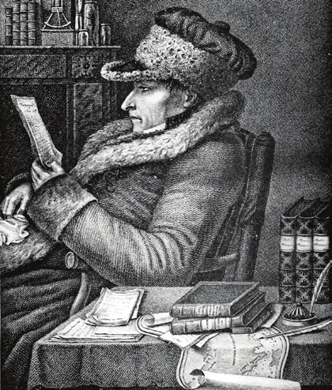

## Франсуа Перон (1754–1803)



*Прим. перев.: так в оригинале — годы жизни Перона повторяют годы Бодена; исторически Перон жил в 1775–1810 годах.*

Перон потерял глаз в армии, попал в плен и в заключение. Там он читал книги об исследователях, а после того как его из-за потерянного глаза списали из армии и отправили на родину, изучал естественную историю. Он вошёл в экспедицию Бодена натуралистом и антропологом. К тому времени, как экспедиция достигла западного побережья Австралии, смерти и дезертирство оставили Перона единственным зоологом. Он классифицировал 2 500 видов и собрал 100 000 образцов животного мира. Он также много наблюдал встреченных экспедицией аборигенов. Его работы легли в основу более поздних трудов Жана-Батиста Ламарка, одного из первых сторонников эволюции. По возвращении во Францию он написал официальный отчёт о плавании Бодена. Перон был большим патриотом и задевал некоторых встреченных англичан, в том числе губернатора Кинга.

```stat
СИЛ 45    ВЫН 30    ТЕЛ 60    ЛВК 70    ИНТ 85
НАР 55    МОЩ 35    ОБР 75    Рассудок 45    ПЗ 9
БкУ: нет    Комплекция: 0    Скорость: 7    ПМ: 7

Навыки: Бухгалтерское дело 55%, Первая помощь 25%, Тайные знания (аборигенов) 25%, Медицина 40%, Естествознание 75%, Ориентирование 35%, Наука (метеорология) 45%, Наука (зоология) 65%.
```

*Прим. перев.: так в оригинале — Скорость 7; по характеристикам выходит 8, Скорость 7 сходится с поправкой на возраст 40–49 лет при напечатанных годах жизни.*

Подробнее: http://adb.anu.edu.au/biography/peron-francois-2545

# Зерно приключения: Ужас триколора

Это зерно приключения — о потерявшейся партии французских исследователей у берегов Нового Южного Уэльса. Приключение может происходить в любое время эпохи «Convicts & Cthulhu» — и в мир, и в войну. Различия в зависимости от того, идёт ли война, — см. в заметках. Игроки могут взять роли французских моряков или натуралистов либо британских чиновников или их слуг-каторжников, расследующих рассказ французов. Хранитель может позволить торговому судну отправиться вслед за французской экспедицией — тогда можно играть и торговцами.

## Начало приключения

Шлюпку с французского корабля «Ремаркабль» выбрасывает в районе Хоксбери, и её доставляют на юг, в Сидней. В ней шестеро человек, все измождены. Если французы враждебны, экипаж арестуют и под конвоем приведут к губернатору; если Франция сейчас не воюет с Британией, с ними обойдутся вежливо, но в конце концов всё равно доложат о них губернатору как о чужеземных гостях. Экипаж утверждает, что был в составе французской научно-исследовательской экспедиции в Тихом океане и отстал от своего корабля, который теперь загадочно исчез. По их словам, они были южнее Коул-Ривер и пошли на корабельной шлюпке на берег за водой. Когда они вернулись, корабля не было, а на его месте плавало море таинственных колоколообразных штук. Они похожи на коралл, но склизкие и пахнут водорослями. Французы попытались втащить одну в шлюпку, но она странно завибрировала, и её выбросили за борт, боясь, что она разнесёт шлюпку. Они поплыли на юг, подверглись нападению туземцев, а через неделю их занесло в воды Хоксбери — к тому времени голодных и отчаявшихся.

## Поиски

Губернатор собирает команду, в том числе сыщиков, чтобы найти французский корабль и заодно выяснить, нет ли у французов враждебных намерений. (Так было бы и в мирное время между Францией и Британией: подозрения глубоки.) Он даёт им военный корабль или платит за торговое судно — как решат Хранитель и группа сыщиков.

Судно идёт на север и две недели проводит в море, пытаясь найти, где находится французский корабль. Оно заходит и в воды Хоксбери, но никаких следов ни таинственных колоколообразных штук, ни французов не находится.
