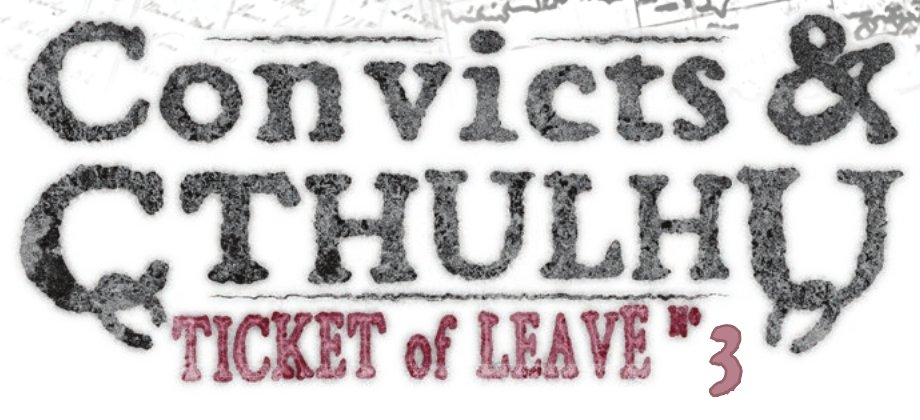
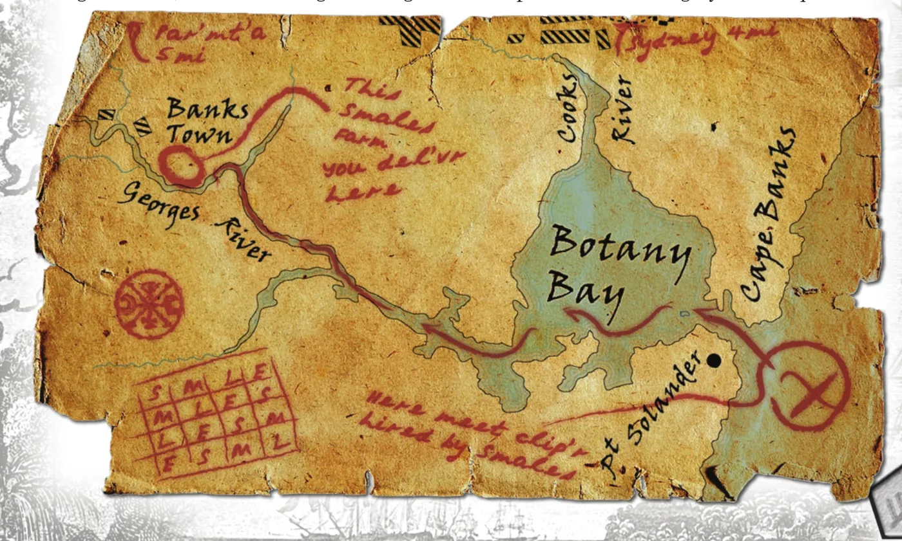

ПРЕСТУПНОЕ ПРЕДПРИЯТИЕ

Convicts &amp; Cthulhu — Отпускной билет № 3

*Вверху страницы — логотип «Convicts & Cthulhu — Ticket of Leave № 3» и заглавие «Criminal Enterprise» («Преступное предприятие») на фоне старинных рукописей и гравюр. Сценарий этого выпуска — «Сияет, как золото» (с. 5).*

> «Отпускные билеты» (Tickets-of-Leave) — небольшие самостоятельные дополнения к сеттингу «Convicts & Cthulhu» для лавкрафтовских ролевых игр в ранних каторжных колониях Австралии. В каждом — подборка игровых элементов: их можно использовать все вместе как набросок мини-сценария или по отдельности — как детали, которые обогатят сценарий вашего собственного сочинения.

> **Выходные данные**
>
> «Отпускной билет» № 3 написали Джефф Гиллан (Geoff Gillan) и Дин Энгельхардт (Dean Engelhardt); © 2016. Издатель — Cthulhu Reborn Publishing (www.cthulhureborn.com).
>
> Сеттинг «Convicts & Cthulhu» издаёт Cthulhu Reborn Publishing; он доступен на RPGNow и DrivethruRPG по модели «Плати сколько хочешь» (Pay-What-You-Want).
>
> *Call of Cthulhu* («Зов Ктулху») — зарегистрированный товарный знак Chaosium Inc., используется с разрешения (www.chaosium.com).
>
> Лицензия Creative Commons BY-NC-SA.

# Вступление

Учитывая, при каких обстоятельствах были основаны каторжные колонии Австралии, неудивительно, что большинство людей в сеттинге «Convicts & Cthulhu» не понаслышке знакомы с преступлением того или иного рода. Около половины европейцев, живших в это время в Новом Южном Уэльсе, изначально прибыли туда в цепях: это каторжники, сосланные обычно за сравнительно мелкие преступления против собственности.

Многие из остальных — военные тюремщики и другие чиновники — тоже часто были связаны с сомнительными и незаконными делами; некоторым даже пришлось «добровольно» отправиться на службу в колонии из-за тёмных затей, которые плохо кончились.

Часть бывалых преступников Нового Южного Уэльса совсем отказалась от прежних привычек, но многие — нет. Поэтому преступность — неизменная часть колониальной жизни, несмотря на чрезвычайные усилия, которые власти прилагают, чтобы устрашать и карать беззаконие.

Заметки ниже дают Хранителю «Convicts & Cthulhu» средства, чтобы изобразить преступный мир колониальной эпохи, в том числе подробно расписанную преступную банду и набросок сценария, который показывает, что порой обыденное преступление может иметь неожиданные и далеко идущие последствия, связанные с Мифами.

> **Раздатка: Карта Дженкса: путь контрабанды**
>
> *Рукописная карта Ботани-Бей и реки Джорджес; подписи:*
>
> Парр-та 8 км  
> Сидней 6 км  
> Бэнкс-Таун  
> Вот ферма Смейлзов, сюда довезти  
> Река Джорджес  
> Кукс-Ривер  
> Ботани-Бей  
> Кейп-Бэнкс  
> Мыс Соландер  
> Здесь встреча с клипером, нанятым Смейлзами
>
> *В углу — квадрат из букв (первые буквы фамилии Smales — «Смейлз»):*
>
>     S M L E
>     M L E S
>     L E S M
>     E S M L

*Карта в книге дана без подписи; в оригинале на ней «Par'mt'a 5mi» и «Sydney 4mi» (5 и 4 мили). Крестик у входа в залив — место встречи; круглый знак в правом нижнем углу, судя по тексту сценария, похож на знак ритуальной площадки в амбаре Смейлзов.*
