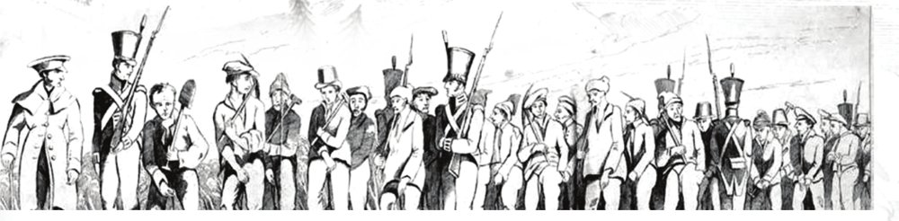

## Феликс Биггс, 32 года, взломщик

```stat
СИЛ 75    ВЫН 75    ТЕЛ 60    ЛВК 80    ИНТ 70
НАР 65    МОЩ 25    ОБР 65    Рассудок 35    ПЗ 13
БкУ: +1d4    Комплекция: 1    Скорость: 9    ПМ: 5

Драка                40% (20/8), урон 1d3 + БкУ
Уклонение            70% (35/14)

Навыки: Обаяние/Угодничество 40%, Лазание 75%, Средства 5%, Управление лошадью/повозкой 60%, Красноречие 35%, Проницательность 40%, Прыжки 40%, Взлом 60%, Метание 35%.
```

Феликс — вор с севера Англии. Дома его коньком было обчищать деревенские и сельские дома и фермы, а время от времени — и большое поместье. Феликс мечтает обчистить поместье Макартура близ Парраматты. Может быть, в следующий раз, когда великий человек уедет со своими овцами в Лондон…

## Сэмюэл Силер, 41 год, моряк и торговец

```stat
СИЛ 60    ВЫН 75    ТЕЛ 65    ЛВК 35    ИНТ 55
НАР 55    МОЩ 55    ОБР 60    Рассудок 55    ПЗ 14
БкУ: +1d4    Комплекция: 1    Скорость: 6    ПМ: 11

Драка                40% (20/8), урон 1d3 + БкУ
Мушкет               55% (27/11), урон 1d10+4 [дальность 100 м; 1 выстрел в 4 раунда]
Уклонение            20% (10/4)

Навыки: Бухгалтерское дело 60%, Оценка 50%, Средства 60%, Юриспруденция 35%, Иностранный язык (французский) 45%, Ориентирование 50%, Пилотирование (лодка) 65%.
```

Моряк и торговец, Сэмюэл — совладелец «Поттс и Силер», небольшого торгового дела с одним кораблём и одним складом в сиднейских доках. Силер провозит контрабандой изрядную часть всего, что ввозит, чтобы не платить «жадным колониальным господам и повелителям». Его компаньон Грэм Поттс закрывает глаза на эти дела и делает вид, что ничего не знает.

## Роберт Мортон, 29 лет, каторжник с отпускным билетом и игрок

```stat
СИЛ 80    ВЫН 35    ТЕЛ 85    ЛВК 70    ИНТ 55
НАР 45    МОЩ 70    ОБР 70    Рассудок 70    ПЗ 12
БкУ: +1d6    Комплекция: 2    Скорость: 7    ПМ: 14

Нож                  70% (35/14), урон 1d6 + БкУ
Уклонение            60% (30/12)

Навыки: Оценка 55%, Обаяние/Угодничество 35%, Средства 10%, Маскировка 50%, Первая помощь 45%, Проницательность 70%, Убеждение 50%, Ловкость рук 55%, Внимание 60%.
```

Мортон — каторжник с отпускным билетом и безрассудный игрок. В Англии он был грабителем и вымогателем, вёл преступную жизнь, которая в конце концов привела его к приговору о ссылке. Однако, прибыв в Новый Южный Уэльс, он упорно старался «завязать» и получить свой отпускной билет. Теперь он рискует той малой свободой, которую заработал, потому что из-за своей безрассудной игры должен Дженксу денег. Когда нужно, он служит для банды Дженкса громилой.

## Обычные дела банды Дженкса

Банду Дженкса в основном движет воровство, но она возьмётся за любое преступление, которое принесёт кругленькую прибыль (особенно если риск невелик). Хранитель может развернуть предложения ниже как примеры того, какие преступления могут совершать члены банды Дженкса. Они могут идти в любом порядке, как пожелает Хранитель:

- **Ограбление лавки.** Банда пытается полуночным налётом взять местную лавку богатого торговца. Владелец может быть соперником кого-то из банды, человеком, отказавшимся платить Дженксу требуемую плату «за защиту», или просто тем, чьи двери не так крепки, как следовало бы.
