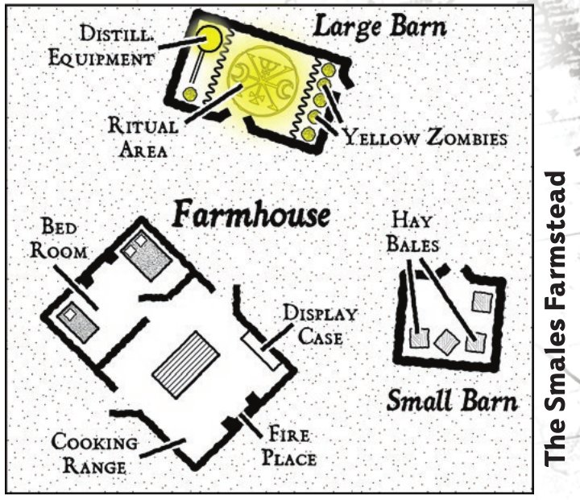

## Ферма Смейлзов

Общую планировку фермы Смейлзов возьмите из описания «крупной фермерской усадьбы» общего назначения на с. 49–50 «Convicts & Cthulhu».

**Ферма Смейлзов** (ключ к плану)

- **Large Barn** — большой амбар: **Distill. Equipment** — перегонный куб; **Ritual Area** — ритуальная площадка; **Yellow Zombies** — жёлтые зомби.
- **Farmhouse** — дом: **Bed Room** — спальня; **Display Case** — шкаф-горка (с золотым кубком); **Cooking Range** — кухонная плита; **Fire Place** — камин.
- **Small Barn** — малый амбар: **Hay Bales** — тюки сена.

Банду встречают мистер и миссис Смейлз — похоже, они повсюду ходят вместе. Их дочь остаётся в доме, если только сыщики не найдут повода выманить её оттуда. Большой амбар фермы остаётся закрытым. Сыщики, возможно, ждут, что фермеры попросят их втащить тяжёлый груз на холм к этому амбару, но те, похоже, вполне довольны, если преступники просто оставят его у реки. Если кто-нибудь спросит, что в амбаре, супруги-фермеры ответят вежливо, но уклончиво. На самом деле амбар — место, где они проводят свои нечестивые обряды, а также место, где днём держат своих мерзких рабов — жёлтых зомби (см. ниже).

Ясно, что супруги Смейлз ждут, что преступники просто оставят незаконный груз, получат плату (ромом) и уйдут. Однако, чтобы выполнить второе поручение Дженкса, сыщикам придётся придумать какой-нибудь повод осмотреться у дома. Насколько это легко или трудно, решает Хранитель в зависимости от тактики, которую выберут игроки. В итоге сыщики должны суметь выяснить, где хранится золотой кубок (на верху шкафа-горки, где также выставлены тонкая стеклянная посуда и вычурные маскарадные маски во французском стиле). Ещё они должны суметь отпереть дверь или окно, чтобы позже преступно проникнуть в дом.

## Ночное ограбление Смейлзов

Если сыщики следуют плану Дженкса, после темноты они вернутся на ферму Смейлзов, чтобы украсть у них золотой кубок. К несчастью, это преступление пройдёт не так гладко, как хотелось бы сыщикам. Получив новый перегонный куб, мистер и миссис Смейлз решили, что эта ночь — прекрасная возможность вернуться к привычному распорядку странных обрядов во славу Короля в жёлтом. Взяв золотой кубок — ключевой предмет обряда, — на закате они исчезают в любопытном амбаре без окон. Из здания слабо доносятся странные нестройные звуки — отчасти распев, отчасти гортанный визг.

Хранитель решает, замешана ли в этом дочь, Сара. Если Хранитель пожелает, она может быть невинна и знать лишь, что родители делают в амбаре «что-то жуткое», ни разу не видев ничего странного или тревожного. Или же она может тайно быть колдовской силой, стоящей за всем делом (возможно, даже дёргая за ниточки двух своих «родителей», которые на самом деле не более чем плотские марионетки, созданные ею, чтобы исполнять её волю).

Если сыщики вломятся в запертый амбар, они увидят всю жуть странных обрядов Смейлзов. Эти странные обряды состоят в том, что пленных — в основном распределённых каторжников-работников с соседних ферм или аборигенов из ближних кланов — обмазывают мерзкой жёлтой краской. Странное и едкое варево, сваренное в их домашнем кубе, — наркотик, который лишает жертву чувств и одновременно поедает её внутренности, пока она ещё жива. Когда эликсир обездвижит жертву, мистер и миссис Смейлз заматывают останки в пропитанные жёлтым бинты. Отвратительные кучи вонючих жёлтых костей и тряпья день-два пузырятся на полу амбара. Затем каждая куча встаёт жёлтым зомби — мерзким слугой Короля в жёлтом. Смейлзы используют этих порочных тварей как стражу, охраняющую их ферму. Потеря Рассудка за то, чтобы увидеть обряд целиком, — 2/2d6.
