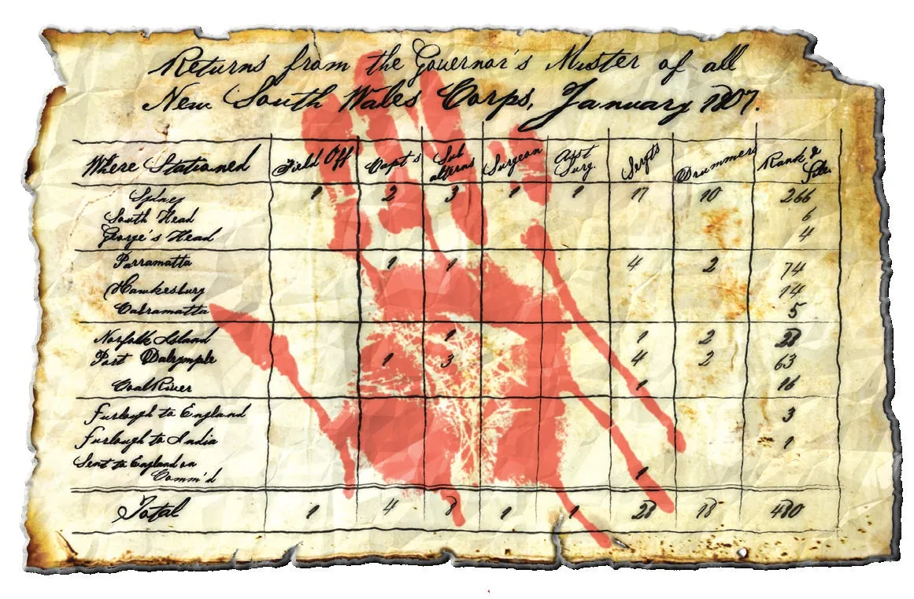

ИСЧЕЗАЮЩИЙ ПРАПОРЩИК

Convicts &amp; Cthulhu — Отпускной билет № 4

*Вверху страницы — логотип «Convicts & Cthulhu — Ticket of Leave № 4» и заглавие «The Vanishing Ensign» («Исчезающий прапорщик») на фоне старинных рукописей и гравюр. Рамка кампании этого выпуска — «Великий смотр» (с. 2).*

> «Отпускные билеты» (Tickets-of-Leave) — небольшие самостоятельные дополнения к сеттингу «Convicts & Cthulhu» для лавкрафтовских ролевых игр в ранних каторжных колониях Австралии. В каждом — подборка игровых элементов: их можно использовать все вместе как набросок мини-сценария или по отдельности — как детали, которые обогатят сценарий вашего собственного сочинения.

> **Выходные данные**
>
> «Отпускной билет» № 4 написали Джефф Гиллан (Geoff Gillan) и Дин Энгельхардт (Dean Engelhardt); иллюстрации на с. 11 и 13 — Рубен Додд (Reuben Dodd). © 2017. PDF издаёт Cthulhu Reborn Publishing (www.cthulhureborn.com).
>
> Сеттинг «Convicts & Cthulhu» издаёт Cthulhu Reborn Publishing; он доступен на RPGNow и DrivethruRPG по модели «Плати сколько хочешь» (Pay-What-You-Want).
>
> *Call of Cthulhu* («Зов Ктулху») — зарегистрированный товарный знак Chaosium Inc., используется с разрешения (www.chaosium.com).
>
> Лицензия Creative Commons BY-NC-SA.

# Вступление

Этот «Отпускной билет» для «Convicts & Cthulhu» даёт Хранителю рамку, побуждающую сыщиков путешествовать в самые отдалённые уголки каторжной колонии Новый Южный Уэльс. Он вдохновлён реальным историческим событием — всеобщим смотром всех войск и орудий, который приказал провести губернатор Блай в 1807 году, — и строит на нём рамку кампании, в которой группа сыщиков вынуждена ездить от одного убогого поста Корпуса Нового Южного Уэльса к другому. Сюда же входит набросок сыскного сценария на основе этих событий — «Исчезающий прапорщик». У наброска три возможные развязки, так что Хранитель может выбрать ту, что лучше подходит его кампании.

Ради наибольшей исторической точности этот материал предполагает, что события происходят при губернаторе Блае, хотя на деле губернаторы колонии постоянно тревожились из-за скудных военных сил в своём распоряжении, и многочисленные смотры поменьше назначались и до, и после смотра Блая 1807 года. Значит, Хранитель может при желании без труда использовать этот материал и для любого другого периода эпохи «Convicts & Cthulhu».

> **Раздатка: Итоги смотра Корпуса Нового Южного Уэльса, январь 1807**
>
> *Итоги губернаторского смотра всего Корпуса Нового Южного Уэльса, январь 1807 года.*
>
> | Где расквартированы | Штаб-офицеры | Капитаны | Субалтерны | Хирург | Пом. хирурга | Сержанты | Барабанщики | Рядовые |
> |---|---|---|---|---|---|---|---|---|
> | Сидней | 1 | 2 | 3 | 1 | 1 | 17 | 10 | 266 |
> | Саут-Хед | — | — | — | — | — | — | — | 6 |
> | Джорджес-Хед | — | — | — | — | — | — | — | 4 |
> | Парраматта | — | 1 | 1 | — | — | 4 | 2 | 74 |
> | Хоксбери | — | — | — | — | — | — | — | 14 |
> | Кабраматта | — | — | — | — | — | — | — | 5 |
> | Остров Норфолк | — | — | 1 | — | — | 1 | 2 | 28 |
> | Порт-Далримпл | — | 1 | 3 | — | — | 4 | 2 | 63 |
> | Коул-Ривер | — | — | — | — | — | 1 | — | 16 |
> | В отпуске в Англии | — | — | — | — | — | — | — | 3 |
> | В отпуске в Индии | — | — | — | — | — | — | — | 1 |
> | Отправлен в Англию по службе | — | — | — | — | — | 1 | — | — |
> | **Итого** | 1 | 4 | 8 | 1 | 1 | 28 | 18 | 480 |

*Прим. перев.: так в оригинале — сумма барабанщиков по строкам 16, а в «Итого» — 18 (возможно, часть числа скрыта отпечатком ладони). Число рядовых на острове Норфолк читается как 28 (цифра исправлена поверх) — с ним итог 480 сходится. Поверх таблицы — кровавый отпечаток ладони.*
