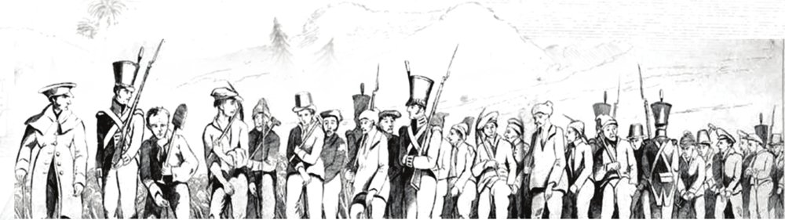

Каждый из этих видов «заданий» сыщиков кратко описан ниже вместе с идеями о том, какие сценарные возможности могут открыть такие изыскания и поездки.

## Поиск в переписке и записях

Одно из того, что нужно установить для точного смотра, — список солдат Корпуса Нового Южного Уэльса, которые по разным причинам сейчас не находятся на своих обычных постах. Одни в отпуске (временно освобождены от службы), другие сейчас под арестом за проступки, третьи сейчас в госпитале, а четвёртые в настоящее время за морем по какому-нибудь казённому делу. Задача группы смотра — перерыть все записи в Доме правительства, чтобы установить, какие офицеры или рядовые Корпуса Нового Южного Уэльса попадают в эти разряды (иначе при подсчёте их пропустят).

В эпоху, когда бумажные записи — единственные существующие, а нужные сведения разбросаны по затхлым книгам учёта, которые ведут несколько разных чиновников, это дело куда кропотливее, чем кажется. Кроме того, оно, скорее всего, потребует множества хождений туда и обратно между Домом правительства, конторами мировых судей колонии, флотским офицером, ведающим портом, хирургами колонии и любыми другими колониальными чиновниками, каких захочет назвать Хранитель. Дело потребует и непомерно долгой расшифровки плохих почерков.

Кроме того, что придётся перерыть записи, хранящиеся в Новом Южном Уэльсе, от группы смотра ждут и переписки с чиновниками дочерних колоний, чтобы справиться о расквартировании солдат Корпуса Нового Южного Уэльса, стоящих там. Как минимум группа должна:

- написать коменданту на острове Норфолк и
- написать коменданту в Порт-Далримпле (небольшом поселении на северном побережье Тасмании — тогда Земли Ван-Димена).

Письма можно отправить с правительственной почтой. Более предприимчивые сыщики могут найти в Сиднейской гавани корабль, идущий в одно из этих мест, и доверить письма капитану. Но в любом случае группе смотра стоит отправить письма пораньше: доставка письма в такие отдалённые места, скорее всего, займёт 2–3 недели (в одну сторону).

> **Пять способов, которыми сценарии могут вырасти из изысканий в записях и переписки** (это лишь примеры; предприимчивому Хранителю предлагается дополнить список):
>
> 1. просмотр или сверка официальных записей могут обнаружить какую-нибудь странную несообразность, которая указывает на деятельность Мифов в определённом месте или на поступки человека, связанного с культом;
> 2. в записях о поступлении в госпиталь могут оказаться странные — невероятные — подробности, которые стоит проверить лично;
> 3. чтение недавней переписки колонии с крошечным постом в Порт-Далримпле ясно показывает, что один из тамошних мировых судей нарочно скрывает сведения об особых грузах, которые отправляют из этого отдалённого места обратно в Порт-Джексон;
> 4. записи колонии обычно исчерпывающи, поэтому пробел в них показывает, что кто-то подделывал официальные записи — возможно, чтобы скрыть, что увёл какой-то товар или даже целый корабль;
> 5. собрание писем, попавшее в руки сыщиков после чьей-то смерти, открывает череду любопытных зашифрованных приписок, которые на деле складываются в целый текст Мифов.
