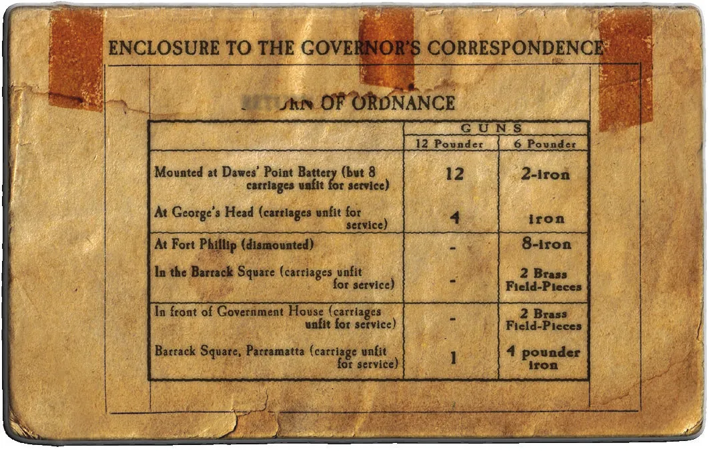

> **Пять способов, которыми сценарии могут возникнуть из посещений мест вокруг Сиднея или Парраматты:**
>
> 1. Пробный выстрел из пушки не удаётся; при ближайшем осмотре вина за этот конфуз ложится на странный липкий ком непонятного вещества, который кто-то (или что-то) засунул глубоко в механизм орудия. Встают вопросы: кто положил этот причудливый свёрток в столь странное место — и зачем?
> 2. Сверка записей казарм с итогами смотра выявляет странное расхождение: есть горстка солдат, которые по записям присутствовали, но которых в день смотра никто не видел. Хотя все уверяют, что прекрасно помнят этих солдат-призраков, каждый опрошенный описывает их внешность совсем не так, как все остальные.
> 3. Разговоры в казармах не для протокола выдают беспокойство солдат: есть определённая группа людей, которые каждое утро после полнолуния не являются на перекличку, и никаких объяснений этому не даётся. Хотя об этом доложили старшему офицеру, никаких мер не принято — а теперь и сам офицер, похоже, оказался среди тех, кто не является на перекличку после полнолуния.
> 4. Выясняется, что один караульный пост в определённые часы ночи регулярно остаётся без часовых. Говорят, что в это же время в небе видны странные огни, а один старый (не слишком надёжный) каторжник уверяет, что видел, как с небес, от звёзд, спускается на крыльях огромное существо.
> 5. Один из офицеров Корпуса Нового Южного Уэльса, которых опрашивает группа, явно безумен (исторических примеров этому удивительно много) и верит, что в снах к нему является сверхъестественное существо. Его солдаты не обращают внимания на его помешательство, но группе смотра нужно собрать довольно сведений, чтобы либо обелить его, либо отстранить от должности. Как расследовать чьи-то сновидческие посещения?

> **Раздатка: Отчёт об орудиях колонии**
>
> *Приложение к переписке губернатора.*
>
> **Отчёт об орудиях**
>
> | Где | Пушки 12-фунтовые | Пушки 6-фунтовые |
> |---|---|---|
> | Установлены на батарее мыса Доуз (но 8 лафетов негодны к службе) | 12 | 2 чугунные |
> | На Джорджес-Хед (лафеты негодны к службе) | 4 | чугунные |
> | В форте Филлип (сняты с лафетов) | — | 8 чугунных |
> | На казарменном плацу (лафеты негодны к службе) | — | 2 медные полевые пушки |
> | Перед Домом правительства (лафеты негодны к службе) | — | 2 медные полевые пушки |
> | Казарменный плац, Парраматта (лафет негоден к службе) | 1 | 4-фунтовая чугунная |

*Фунты здесь — калибр пушек (вес ядра), они не переводятся в килограммы.*
