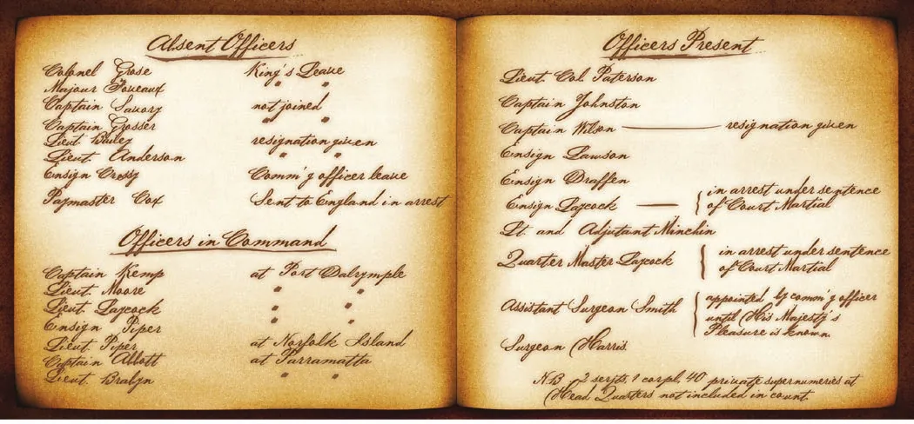

> **Раздатка: Книга смотра: офицеры Корпуса**
>
> **Отсутствующие офицеры**
>
> полковник Гроуз — отпуск от короля  
> майор Фово — то же  
> капитан Сейвори — не прибыл  
> капитан Проссер — то же  
> лейтенант Бейли — подал в отставку  
> лейтенант Андерсон — то же  
> прапорщик Кресси — отпуск от командира  
> казначей Кокс — отправлен в Англию под арестом
>
> **Командующие офицеры**
>
> капитан Кемп — в Порт-Далримпле  
> лейтенант Мур — то же  
> лейтенант Лейкок — то же  
> прапорщик Пайпер — то же  
> лейтенант Пайпер — на острове Норфолк  
> капитан Эббот — в Парраматте  
> лейтенант Брабин — то же
>
> **Присутствующие офицеры**
>
> подполковник Патерсон  
> капитан Джонстон  
> капитан Уилсон — подал в отставку  
> прапорщик Лоусон  
> прапорщик Драффен  
> прапорщик Лейкок — под арестом по приговору военного суда  
> лейтенант и адъютант Минчин  
> квартирмейстер Лейкок — под арестом по приговору военного суда  
> помощник хирурга Смит — назначен командиром до изъявления воли Его Величества  
> хирург Харрис
>
> *Примечание: 2 сержанта, 1 капрал, 40 рядовых сверх штата при штабе в счёт не включены.*

## Дальние места: Коул-Ривер и Хоксбери

Пожалуй, самая долгая часть губернаторского смотра — необходимость ездить в самые отдалённые края колонии Новый Южный Уэльс, в том числе во второй каторжный лагерь на Коул-Ривер и в поселения в глубине материка вдоль реки Хоксбери. Если Хранитель пожелает, в список мест для посещения можно включить и другие, ещё реже заселённые края — например, окрестности Ботани-Бей.

Поездка в любое из этих отдалённых мест почти наверняка потребует плавания морем: чтобы облегчить смотр, губернатор выделил небольшое судно — куттер «Гвиневра». Его хозяин и командир — капитан Спиллман. Он достаточно исполнителен, когда за ним смотрят, но воспользуется плаваниями, чтобы немного заняться контрабандой; сыщики могут помешать ему или нажиться на этом — как пожелают.

Подробности о поселениях на Коул-Ривер и в других отдалённых краях есть в «Convicts & Cthulhu», хотя большая часть драмы, связанной с исполнением приказов губернатора в этих диких глухих краях, будет связана со встречами вдали от «цивилизации». Хранитель волен населить неисследованный буш любыми природными угрозами или угрозами Мифов Ктулху.

Нога белого человека почти не ступала по некоторым из этих земель, так что ранее неведомые ужасы здесь более чем правдоподобны. Кроме того, сама отдалённость некоторых из этих мест делает их привлекательными для странных культов, которые разворачивают здесь дела покрупнее, подальше от любопытных глаз городков и ферм. Даже если не считать противоестественных угроз, которые могут встретиться в неисследованных лесах, сыщики, хоть немного сошедшие с проторённой тропы или забредшие слишком далеко от поселений, легко могут наткнуться на туземные группы, почти не знакомые с европейцами. Такие группы аборигенов могут повести себя по-разному — от враждебности (особенно если на них недавно жестоко напали белые поселенцы) до сочувствия (если сыщики, похоже, попали в беду).

Число отдалённых краёв, куда должна ехать группа смотра, можно расширить как угодно Хранителю — возможно, обрекая сыщиков на опасные плавания вверх и вниз вдоль всей колонии. Как минимум группе придётся посетить:

- **Каторжный лагерь Коул-Ривер** (C&C, с. 51–52) — осмотреть строй и проверить записи;
- **цепочку маленьких фермерских поселений**, разбросанных вверх по **Хоксбери до Ричмонд-Хилла** (C&C, с. 54) — оценить оборону и размещение частей Корпуса Нового Южного Уэльса вокруг этого редко заселённого фермерского края.
