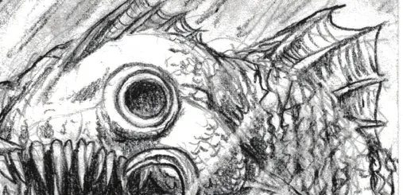

**Джоб Трэшер.** Трэшер тоже был гибридом. Поселенец в последнем месте сценария вспоминает, что Трэшер и Добли дружили. Трэшер был распределённым каторжником, работавшим у этого поселенца, и у того до сих пор хранится записная книжка, принадлежавшая каторжнику. В ней черновики писем Трэшера к Добли, где объясняется состояние последнего и то, что в конце концов он должен уйти в море, где его будут направлять его братья и сёстры. Если раскопать могилу Трэшера, окажется, что каторжник умер насильственной смертью — ему проломили голову. Сыщики также найдут свидетельства, что они не первые, кто выкапывает тело Трэшера: похоже, кто-то уже выкапывал мёртвого каторжника, что-то разыскивая. На самом деле в этом деле они потерпели неудачу: в животе Трэшера до сих пор лежит фетиш Матери Гидры. Шутки с ним могут привлечь её (скорее всего, нежеланное) внимание.

**Развязка.** Когда Добли найдут, он будет в отпуске по болезни, далеко зашедший по пути превращения в глубоководного. Добли убил Трэшера, потому что не хотел принимать того, что говорил ему Трэшер, и из страха разоблачения. Когда его припрут к стене, он бежит к ближайшей воде. Там его с нетерпением ждёт целая колония глубоководных.

### Прапорщик Эрнест Добли — гибрид глубоководного

```stat
СИЛ 80    ВЫН 70    ТЕЛ 25    ЛВК 50    ИНТ 50
НАР 30    МОЩ 85    ОБР 45    Рассудок 25    ПЗ 9
БкУ: нет    Комплекция: 0    Скорость: 8*    ПМ: 17

* Может также плавать со Скорость 8.

Драка                45% (22/9), урон 1d3 + БкУ
Нож                  45% (22/9), урон 1d6 + БкУ
Уклонение            35% (17/7)

Броня: нет.

Навыки: Средства 20%, Проницательность 45%, Прыжки 45%, Слух 60%, Внимание 45%, Плавание 80%.

Потеря Рассудка: 0/1d4 пункта Рассудка за то, чтобы увидеть мерзкие рыбьи черты Добли; если
его врождённая способность «Слиться с фоном» (см. ниже) заставит кого-то забыть встречу,
все потерянные пункты Рассудка возвращаются.

ОСОБЫЕ СПОСОБНОСТИ
Глубокие лёгкие: может оставаться под водой вдвое дольше обычного человека.
```

*Прим. перев.: возраст Добли не указан; Скорость 8 по характеристикам сходится с поправкой на возраст 40–49 лет.*



> **Слиться с фоном.** У Добли есть особая способность заставлять тех, кто его встретил, забыть о встрече. Она действует как заклинание «Затуманить память» (см. с. 250 «Зова Ктулху» 7-й редакции). Если Добли хочет, чтобы его забыли, ему нужно лишь пожертвовать 1d6 ПМ и 2 пункта Рассудка, чтобы применить эту силу против любого числа свидетелей. Тот из его целей, у кого выше характеристика МОЩ, должен пройти встречную проверку МОЩ против МОЩ Добли. Если Добли добьётся лучшего результата, все свидетели забудут, что вообще встречали его (и вернут все пункты Рассудка, потерянные из-за его отвратительной внешности). Если обе стороны получат результат одного уровня, свидетели всё же будут помнить встречу с Добли, хотя подробности встречи в их памяти будут очень смутными.

> **Фетиш Матери Гидры**
>
> Эта резная статуэтка высотой около 10 см изображает мерзкого гибрида рыбы и человека и вырезана из неопознаваемого зелёного мылкого камня. Фетиш неприятен на ощупь: кажется, что он едва заметно извивается в руке держащего (хотя ни разу видимо не шевелится). Если человек держит статуэтку дольше пяти минут, её врождённая противоестественная сила попытается проникнуть в его разум. Держащий должен пройти череду встречных проверок МОЩ против МОЩ статуэтки, равной 75. Первый провал вызывает видение огромного зелёного подводного царства, кишащего привлекательными представителями противоположного пола; второй провал заставляет держащего статуэтку отправиться к ближайшему побережью.
>
> Если фетишу удастся довести своего носителя до моря, разрешается последняя встречная проверка МОЩ: успех позволяет поражённому на миг прийти в себя — чудовищность ужаса Матери Гидры становится достаточным потрясением, чтобы разорвать связь (это стоит 2/2d6 пунктов Рассудка, но позволяет выронить фетиш). Если же и эта последняя проверка провалена, носитель фетиша вынужден войти в солёные глубины, громко распевая заклинание, умоляющее Мать Гидру подняться из волн (и невольно жертвуя 3 ПМ). Снизойдёт ли великая Мать к зову — решать Хранителю.
>
> Если Мать Гидру удастся призвать через фетиш, используйте характеристики со с. 286–287 «Зова Ктулху» 7-й редакции.

*Прим. перев.: в оригинале во втором абзаце врезки — «Mother Dagon» («Мать Дагон») вместо «Mother Hydra»; в переводе — «Мать Гидра».*
