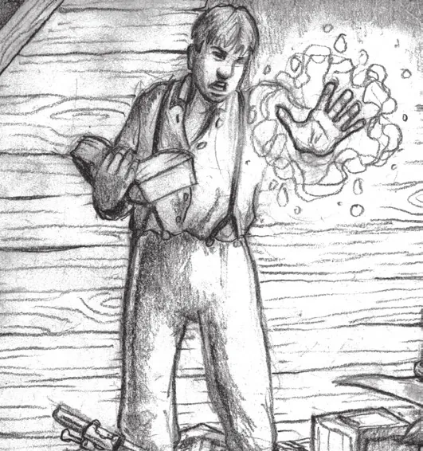

### Разгадка 3: Добли — жертва чёрного колдовства

Если выбран этот вариант, правда о загадочных событиях такова: Эрнест Добли — безмозглая марионетка под властью Трэшера, могущественного колдуна Мифов.

**Тайна Добли.** Добли — важная составляющая огромного ритуала Мифов, который проводит мерзкий каторжник Джоб Трэшер (инсценировавший собственную смерть, чтобы не привлекать внимания соперничающих культистов). Роль прапорщика — бездумно прочертить огромный путь через всю колонию, который, когда будет завершён, заставит явиться Йог-Сотота.

**Особые улики:**

- Описания Добли очевидцами нужно подправить, подчеркнув, как потрёпан его мундир (его запасной мундир на самом деле надет на чучело, закопанное в могиле, якобы принадлежащей Трэшеру, см. ниже).
- В отдалённом месте сценария (например, на Проспект-Хилле, в глухой дикой местности к западу от Парраматты) кто-то вспоминает любопытный случай, связывающий Добли и Трэшера: прапорщику поручили надзирать за отрядом из шести каторжников, посланных в глушь валить лес. Джоб Трэшер был одним из каторжников этого отряда. Несмотря на ясный день, каторжники, по рассказам, безвременно погибли, когда молния ударила в дерево и вспыхнувший пожар убил их всех. Прапорщик Добли пережил беду, но с тех пор уже не был прежним.
- Если сыщики сумеют найти место предполагаемого удара молнии, они не обнаружат никаких следов подобного; вместо этого на нескольких деревьях вырезаны магические знаки.
- Сыщики, расспрашивающие каторжников о Джобе Трэшере, узнают, что его очень боятся: одно его имя внушает каторжникам ужас.
- В другом отдалённом каторжном месте (например, на Коул-Ривер) сыщики находят каторжника — теперь без руки и ноги, — который расскажет о Трэшере больше, обвиняя его в безумии и колдовстве. Он предупреждает каторжников держаться от него подальше любой ценой.
- Улики в конце концов должны позволить сыщикам выследить логово Трэшера на ферме в глубинке; там он числится распределённым каторжником-работником, но на деле перебил семью поселенца и сам хозяйничает на ферме.

**Джоб Трэшер.** Джоб Трэшер на самом деле — древний и ужасный колдун Мифов, инсценировавший собственную смерть. В «могиле» Трэшера лежит чучело — грубая копия Добли. Трэшер превратил Добли в свою колдовскую марионетку и заставляет его прочерчивать шаги по колонии как часть могучего заклинания, которое задумал Джоб Трэшер. Часть заклинания — постоянное действие наподобие «Затуманить память» (см. описание заклинания на с. 250 «Зова Ктулху» 7-й редакции): Добли трудно вспомнить, и он легко ускользает от внимания. Конечная цель ритуального заклинания — призвать Йог-Сотота, который, как верит Трэшер, дарует ему бессмертие.

**Развязка.** Возможны два исхода: либо сыщики выследят Трэшера на его ферме до того, как ритуал будет завершён, либо безмозглый Добли завершит свой тайный переход через колонию, и дверь для Йог-Сотота откроется.

В первом случае развязкой, скорее всего, станет схватка на ферме, которую занял Трэшер. Его логово охраняют стражи Мифов — как минимум в амбаре у него шантак (характеристики — на с. 306 «Зова Ктулху» 7-й редакции).
