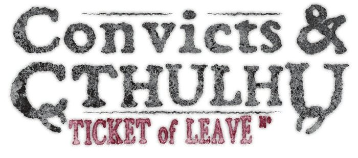
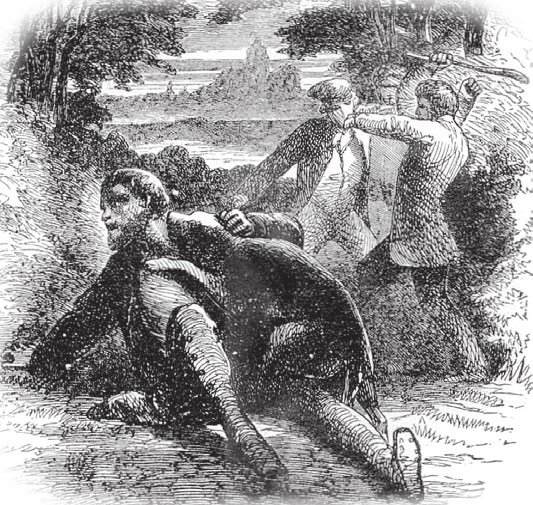

ПРОКЛЯТЫЕ И ПОРОЧНЫЕ

Convicts &amp; Cthulhu — Отпускной билет № 5

*Вверху страницы — логотип «Convicts & Cthulhu — Ticket of Leave № 5» и заглавие «The Damned & The Degenerate» («Проклятые и порочные»).*

> «Отпускные билеты» (Tickets-of-Leave) — небольшие самостоятельные дополнения к сеттингу [«Convicts & Cthulhu»](https://www.cthulhureborn.com) для лавкрафтовских ролевых игр в ранних каторжных колониях Австралии. В каждом — подборка игровых элементов: их можно использовать все вместе как набросок мини-сценария или по отдельности — как детали, которые обогатят сценарий вашего собственного сочинения.

> **Выходные данные**
>
> «Отпускной билет» № 5 написали Дин Энгельхардт (Dean Engelhardt) и Джефф Гиллан (Geoff Gillan); © 2017. Издатель — Cthulhu Reborn Publishing (www.cthulhureborn.com).
>
> Сеттинг «Convicts & Cthulhu» издаёт Cthulhu Reborn Publishing; он доступен на RPGNow и DrivethruRPG по модели «Плати сколько хочешь» (Pay-What-You-Want).
>
> *Call of Cthulhu* («Зов Ктулху») — зарегистрированный товарный знак Chaosium Inc., используется с разрешения (www.chaosium.com).
>
> Лицензия Creative Commons BY-NC-SA.

# Введение

Первые дни европейского заселения Австралии отмечены скудостью и нехваткой всего. Но одного колониям, похоже, хватало всегда — колоритных и плутоватых персонажей. Безнравственные бездельники, безжалостные торговцы пороком или добродетельные люди, впавшие в нужду, — ранние каторжные колонии словно магнитом притягивали распутных и порочных. Этому немало помогли обстоятельства основания колонии: она была настоящей свалкой — сначала для худших из преступных сословий Англии, а позже для ирландских политических смутьянов, которых нужно было заставить замолчать. Но проклятыми и порочными были не только каторжники: солдаты и колониальные чиновники, согласившиеся управлять суровыми тюрьмами на другом конце света, порой и сами были людьми «сомнительного нрава». Даже те, кто приезжал в колонию добровольно, свободными поселенцами, чаще всего бежали от чего-то дурного в Европе — долгов, преследований или тёмных дел.

Сомнительное собрание мошенников, из которого состояло раннее европейское население Австралии, несомненно превращало жизнь там в своего рода ад. Но то же население «проклятых и порочных» — поразительный фон для ролевых игр ужаса и тайны. Нет такой тьмы, которую мог бы придумать Хранитель, — убийство, разврат или людоедство, — которой так или иначе не было бы в прошлом или делах исторических персонажей этой эпохи.

В книге [«Convicts & Cthulhu»](https://www.cthulhureborn.com) уже есть раздел с простыми правилами, позволяющими игрокам и Хранителям создавать самых разных персонажей, плутоватых и добродетельных. Ради места он намеренно краток — всего около дюжины шаблонов профессий, а на деле это лишь верхушка списка сомнительных типов, которые могут появиться в ваших играх «Convicts & Cthulhu». Этот «Отпускной билет» возвращается к списку и сильно его расширяет. Он также предлагает несколько мелких поправок к работе отдельных навыков сыщиков *C&C*. Наконец, в помощь Хранителям, желающим населить игры готовыми персонажами — персонажами Хранителя или сыщиками, которых можно сразу ввести в игру, — даны реальные исторические примеры. Они показывают не самые известные типы персонажей, добрых и дурных, которые встречались в каторжных колониях.
