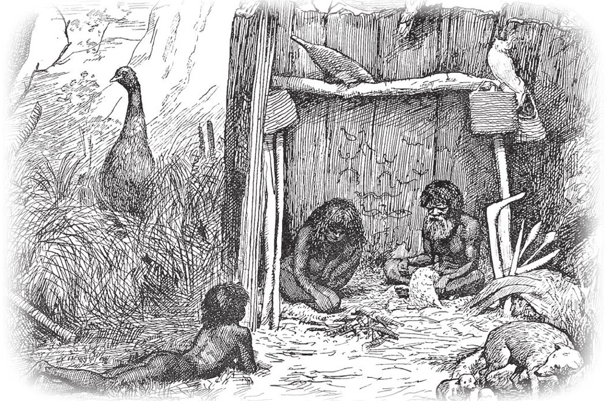

# Расширенный список профессий каторжной эпохи

Как сказано выше, колонии ранней Австралии кишат самыми разными проклятыми и порочными персонажами. Четырнадцать шаблонов профессий из «Convicts & Cthulhu» (с. 21–23) покрывают многие распространённые типы. Но для игроков, у которых более разнообразные замыслы сыщиков, и для Хранителей, которым пригодятся новые типы персонажей Хранителя, на следующих страницах дан расширенный набор профессий каторжной эпохи.

Этот список включает все исходные профессии книги «Convicts & Cthulhu», обновлённые с учётом описанных выше поправок к навыкам. Поэтому этот материал можно считать окончательным единым источником шаблонов профессий для сеттинга.

# Сыщики-аборигены

Как сказано в «Convicts & Cthulhu», одна из особенно благодарных ролевых задач, за которую могут взяться игроки, — сыграть члена одной из многих групп коренных жителей, вытесненных прибытием европейцев в 1788 году.

Особенность игры таким персонажем — нужно отдельно следить за двумя разными значениями «Средств»: одно отражает положение персонажа в своей общине коренных жителей, другое — (обычно очень низкое) положение, которое он занимает во властной иерархии европейского общества. В шаблонах профессий ниже определены две разные категории коренных персонажей — те, кто живёт в основном традиционным укладом и почти (намеренно) не общается с белыми, и те, кто пошёл работать на европейцев. У последних «Средства», купленные при создании персонажа, отражают *положение среди европейцев* (его фактическое положение среди групп аборигенов — вдвое меньше).

У персонажей, живущих традиционным укладом (в описании профессии — пометка [традиционный уклад]), купленные «Средства» определяют *положение среди коренных групп*. Его фактические Средства среди европейцев — где-то от 0 до 5, смотря с кем приходится иметь дело — с милосердными европейцами или с куда более обычной непросвещённой публикой.

