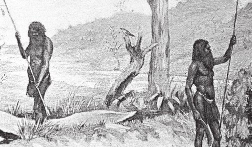

…кенгуру или другого зверя), а большинство женщин проводит дни, собирая овощи и ягоды (они и составляют основу пропитания племени). Подробнее о традиционном укладе аборигенов — в книге Chaosium *Secrets of Australia*.

**Пункты навыков профессии:** ОБР × 2 + (ЛВК × 2 или СИЛ × 2)

**Средства:** 0–99 только в общине аборигенов; в европейской колонии — 0–5

**Рекомендуемые связи:** члены своей общины аборигенов, в том числе старейшины и знахари

**Навыки:** Знание Алчеринги, Искусство/ремесло (любое), Ближний бой или Метание, Слух, Тайные знания (аборигенов), Естествознание, Скрытность, Выживание (буш).

### Проводник-абориген: Дэниел Муваттин (1791–1816)

```stat
СИЛ 70   ВЫН 75   ТЕЛ 90   ЛВК 65   ИНТ 80
НАР 65   МОЩ 45   ОБР 75   Рассудок 45   ПЗ 16
БкУ: +1d4   Комплекция: 1   Скорость: 7   ПМ: 9

Навыки: Обаяние/Подхалимство 25%, Средства 15%, Уклонение 40%,
Ближний бой (драка) 60%, Иностранный язык (английский) 25%,
Иностранный язык (разные языки аборигенов окрестностей Сиднея) 45%,
Слух 60%, Тайные знания (аборигенов) 50%, Ориентирование 60%,
Выживание (буш) 65%, Метание 40%, Чтение следов 75%.
```

> Дэниел Муваттин был проводником-аборигеном известного ботаника Джорджа Кейли; он был и моряком и побывал в Лондоне. Его имя на местном языке значило «тропа в буше». Он родился около Парраматты, и его усыновил каторжник Нового Южного Уэльса Ричард Партридж (он же Ричард Райс), «левша-палач». В 14 лет Дэниел стал у Кейли переводчиком, птицеловом, проводником и слугой в его экспедициях по окрестностям Сиднея. Он жил в коттедже Кейли в Парраматте.
>
> Кейли утверждал, что Дэниел знал больше языков внутренних земель, чем любой другой знакомый ему абориген. Он отплыл с Кейли в Лондон и, как говорили, разглагольствовал в лондонских кофейнях о превосходстве буша. В Англии он начал пить, из-за чего поссорился с Кейли. Вернувшись из Лондона один, он ушёл в буш. Потом работал батраком на ферме, но в 1816 году был осуждён за изнасилование и ограбление Ханны Рассел, дочери поселенца из каторжников. В ноябре того же года его повесили — он стал первым аборигеном, законно казнённым в Австралии.
>
> **Источники:** Keith Vincent Smith, Australian Dictionary of Biography, http://adb.anu.edu.au/biography/moowattin-daniel-13107; Michael Anne Cameron, «Richard Partridge: The Left-Handed Flogger», https://stjohnscemeteryparramatta.org/bio/richard-partridge/



## Мореход из аборигенов

В европейские морские экспедиции для исследования отдалённых краёв Австралии часто берут одного или нескольких аборигенов. Такие мореходы должны быть одновременно моряками и помощниками на борту, а при встрече с другими народами — неофициальными советниками и посланниками, примерно как описанные выше проводники. Иногда мореход уже дружен с кем-то из белых на борту и отправляется в путь из любопытства и жажды приключений.

**Пункты навыков профессии:** ОБР × 2 + (НАР × 2 или МОЩ × 2)

**Средства:** 10–40 в колониальном обществе; в общине аборигенов это число делится пополам — там не доверяют тем, кто решил работать на белых

**Рекомендуемые связи:** капитаны кораблей, исследователи или землемеры, моряки торгового флота или зверобои, члены своей общины аборигенов

**Навыки:** Лазание или Слух, Ближний бой или Метание, Иностранный язык (английский), Тайные знания (аборигенов), Естествознание, Ориентирование, Пилотирование (судно) или Управление лошадью/волом/повозкой, Выживание (буш) или Скрытность.
