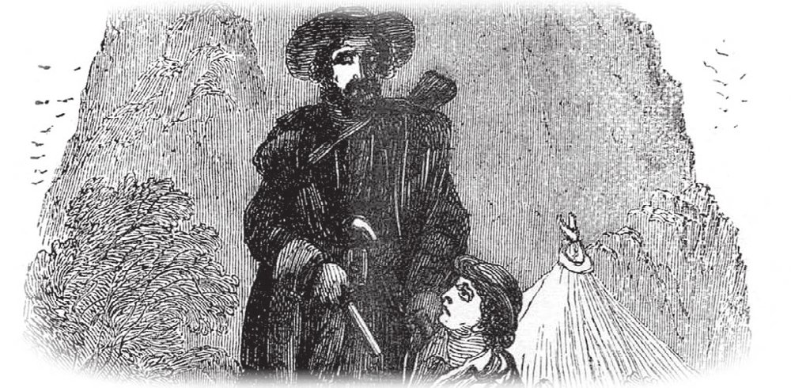

> **Первые бушрейнджеры**
>
> Австралийских разбойников — «бушрейнджеров» — обычно связывают с более поздним периодом истории Австралии, но корни этого явления — в каторжной эпохе. Первыми бушрейнджерами были каторжники, бежавшие в буш. Одних поймали, других быстро убили, третьи прибились к группам аборигенов. Но остальные стали жить подножным кормом, грабя поселенцев, казённые склады и аборигенов.
>
> Первым бушрейнджером обычно считают Джона Цезаря — чернокожего уроженца Вест-Индии, который в 1790 году бежал и жил рыбной ловлей, охотой и тем, что давали сочувствующие фермеры. Губернатор Хантер назначил за его голову награду — около 23 л рома, — и колониальное общество не могло перед этим устоять. Вскоре после этого его застрелили.
>
> На Земле Ван-Димена (нынешняя Тасмания) в голодные времена губернаторы вооружали каторжников и посылали их в буш охотиться за мясом. Вряд ли им стоило удивляться, что многие не вернулись и вскоре стали бедствием, грабя и белые общины, и аборигенов.
>
> Краткая история бушрейнджеров: http://www.australia.gov.au/about-australia/australian-story/early-austn-bushrangers
>
> В «Convicts & Cthulhu» нет отдельной профессии «бушрейнджер». Это мужчины и женщины других профессий, решившие бежать из колонии и попытаться прокормиться во враждебной глуши. Скорее всего, на такой суровый выбор решатся беглые каторжники, но так могут поступить и солдаты, у которых есть причина дезертировать (скажем, потому что они — случайно или нет — убили своего командира).
>
> В игре бушрейнджера создают так: сначала выбирают исходную профессию (каторжника или другую) и создают персонажа по её шаблону. Это человек, каким он был до того, как стал разбойником. Затем, если персонаж-бушрейнджер как-то сумел выжить в глуши хотя бы несколько месяцев, он получает «пакетом» такие бонусы и штрафы:
>
> - +25 к Выживанию (буш);
> - +15 к Обаянию или к Иностранному языку (местный язык аборигенов);
> - +10 к Ремеслу (кулинария), Ремеслу (рыбная ловля) или Ремеслу (охота);
> - −20 к ВЫН;
> - −10 к НАР;
> - −2d4 Рассудка.

