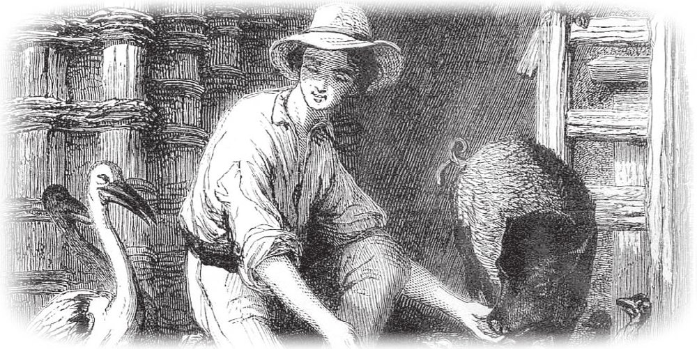

**Пункты навыков профессии:** ОБР × 2 + НАР × 2

**Средства:** см. примечание выше

**Рекомендуемые связи:** другие каторжники, магистраты или другие чиновники, свободные поселенцы

**Навыки:** Искусство/ремесло (любое), Оценка, Иностранный язык, Чтение и письмо (английский), Верховая езда, один социальный навык (Обаяние, Красноречие, Запугивание или Убеждение), два любых других навыка как личные специальности или навыки эпохи.

## Бывшая прислуга

Одни из лучших мест для низших сословий Англии и Шотландии — служба в домашней прислуге, в штате богатых землевладельцев и аристократов. К несчастью, такие места зависят и от порой капризной воли хозяина или хозяйки дома: если слуга не угодил господам, обвинить его в краже или другом мелком преступлении обычно проще простого. Обычно за этим следуют поспешный суд и приговор к ссылке в колонии. Разумеется, не все слуги, оказавшиеся в Австралии, и впрямь были невиновны в преступлениях, за которые их осудили…

**Пункты навыков профессии:** ОБР × 2 + (НАР × 2 или МОЩ × 2)

**Средства:** см. примечание выше

**Рекомендуемые связи:** другие каторжники, чиновники или старшие чины Корпуса Нового Южного Уэльса, свободные поселенцы

**Навыки:** Оценка, Искусство/ремесло (любое, например кулинария, портняжное дело), Управление лошадью/волом/повозкой, Проницательность, Слух, Естествознание, Внимание, два любых других навыка как личные специальности или навыки эпохи.

## Чернорабочий

Многие мужчины (и некоторые женщины) в эту эпоху заняты простым ручным трудом. Каторжники с таким прошлым хорошо подготовлены к суровой физической жизни в каторжных колониях. Особенно умелые или трудолюбивые работники могут получить хорошее распределение к свободным поселенцам, у которых всегда длинный список ручных работ, нужных, чтобы обустроить и вести хозяйство.

**Пункты навыков профессии:** ОБР × 2 + (ЛВК × 2 или СИЛ × 2)

**Средства:** см. примечание выше

**Рекомендуемые связи:** другие каторжники, свободные поселенцы

**Навыки:** Лазание, Управление лошадью/волом/повозкой, Прыжки, Ближний бой (драка), Естествознание, Верховая езда, Метание, один любой другой навык как личная специальность.
