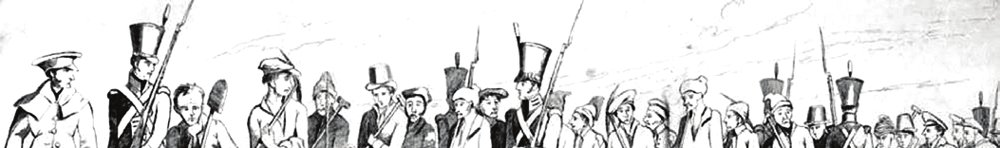

## Браконьер

Браконьерство — кража скота и дичи; в обществе, где животные — ценное имущество (и важный источник пищи), это нередкое занятие. Одни браконьеры крадут, чтобы прокормить семью, другие подходят к делу ради наживы.

**Пункты навыков профессии:** ОБР × 2 + ЛВК × 2

**Средства:** см. примечание выше

**Рекомендуемые связи:** другие каторжники, преступные шайки в поселениях, купцы

**Навыки:** Обращение с животными, Лазание, Слух, Взлом, Ловкость рук, Внимание, Скрытность, один любой другой навык как личная специальность.

## Политический смутьян/военнопленный

Некоторые мужчины и женщины, отбывающие каторгу в австралийских колониях, виновны лишь в том, что слишком рьяно протестовали против какого-то политического или религиозного дела в Англии. В эту эпоху вокруг владычества над Ирландией большое напряжение, но не только сторонников этого дела удобно отправляли на другой конец света, чтобы «убрать с дороги». Кроме таких политических заключённых, в колонии есть и немного пленных из стран, воюющих с Англией (обычно французов).

**Пункты навыков профессии:** ОБР × 2 + (НАР × 2 или МОЩ × 2)

**Средства:** см. примечание выше

**Рекомендуемые связи:** другие каторжники, магистраты, чиновники или свободные поселенцы схожих взглядов и происхождения

**Навыки:** Маскировка, Ближний бой, Стрельба, Первая помощь, Проницательность, Внимание, Скрытность, один социальный навык (Обаяние, Красноречие, Запугивание или Убеждение).

# Сыщики на государственной и военной службе

Управление австралийскими каторжными колониями в основном вели военные тюремщики того или иного рода при помощи разных гражданских чиновников. Описание отдельных должностей, из которых состояла колониальная администрация, — на с. 18–19 «Convicts & Cthulhu».

## Ботаник/натуралист

С точки зрения европейской науки флора и фауна Австралии совершенно чужды. В Англии велик интерес к систематическому описанию сотен странных новых видов растений и животных, которыми кишит буш вокруг колоний. Это насущное бремя ложится на немногих учёных колонии, и как следует справиться с ним можно только на собственном опыте — в экспедициях в дикие края.

**Пункты навыков профессии:** ОБР × 4

**Средства:** 20–80

**Рекомендуемые связи:** чиновники, команды кораблей (торговых и военных), исследователи и землемеры, следопыты из аборигенов

**Навыки:** Искусство/ремесло (любое), Естествознание, Чтение и письмо (английский), Работа в библиотеке, Наука (ботаника или зоология), один социальный навык (Обаяние, Красноречие, Запугивание или Убеждение), два любых других навыка как личные специальности.

## Врач

Колония кишит болезнями. Отчасти виноваты ужасные санитарные условия на кораблях, везущих каторжников в Австралию, но не меньше — распутная жизнь в колониях. Неблагодарная работа лечить больных и раненых солдат и каторжников ложится на небольшую горстку врачей…

