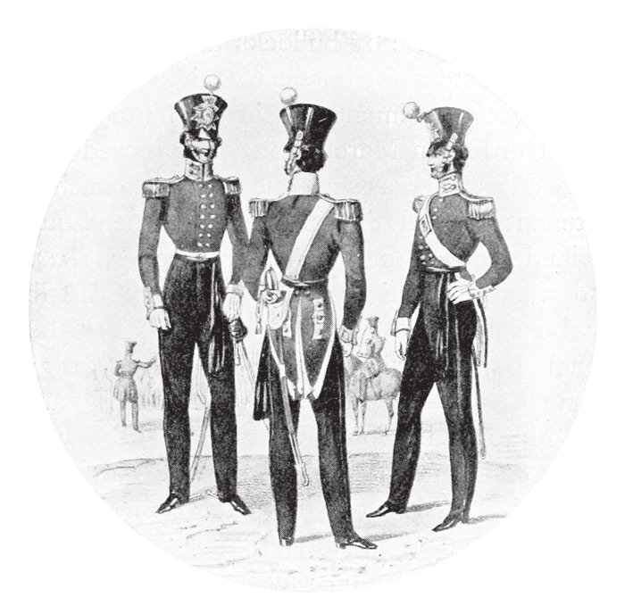

…этих должностей занимают младшие военные, но столько же — чистые гражданские служащие. Работа не блестящая, зато куда безопаснее многих других в колониях, и всегда есть выгода в том, чтобы распоряжаться документами колонии и решать, какие из них дойдут до власть имущих.

**Пункты навыков профессии:** ОБР × 4

**Средства:** 30–70

**Рекомендуемые связи:** другие чиновники, преступные шайки, помощники из каторжников

**Навыки:** Бухгалтерское дело, Юриспруденция, Работа в библиотеке, Слух, Убеждение или Обаяние/Подхалимство, Чтение и письмо (английский), Внимание, один любой другой навык как научная или личная специальность.

### Офицер Корпуса Нового Южного Уэльса: Николас Бейли (1770–1823)

```stat
СИЛ 75   ВЫН 60   ТЕЛ 60   ЛВК 70   ИНТ 75
НАР 65   МОЩ 50   ОБР 70   Рассудок 45   ПЗ 12
БкУ: +1d4   Комплекция: 1   Скорость: 8   ПМ: 10

Навыки: Обаяние/Подхалимство 50%, Средства 60%, Уклонение 55%,
Стрельба (кремнёвый пистолет) 45%, Стрельба (мушкет) 50%,
Первая помощь 50%, История 45%, Запугивание 60%,
Иностранный язык (французский) 41%, Юриспруденция 55%, Слух 40%,
Чтение и письмо (английский) 41%, Верховая езда 25%, Скрытность 55%.
```

*Прим. перев.: так в оригинале — Скорость 8; по характеристикам (СИЛ и ЛВК больше ТЕЛ) выходит 9, возраст не указан.*

> Бейли был племянником графа Аксбриджа. Семья через связи добыла ему патент энсина в Корпусе Нового Южного Уэльса. Он прибыл в Новый Южный Уэльс в 1797 году и получил земельные наделы в Сиднее. В 1800 году служил на острове Норфолк, в 1801 году вернулся в Сидней и женился на Саре Лейкок; у них было девять детей. Бейли тянуло к скандалам: по пути в колонию он решил, что подчинённый сговаривается захватить корабль, и арестовал его (обвинение потом сняли); он заседал в суде над сиднейским трактирщиком, решение которого губернатор отменил, заподозрив лжесвидетельство.
>
> Позже он вместе с Макартуром поддержал Ромовый бунт против Блая; поссорился с Макартуром и примкнул к будущему губернатору Лаклану Маккуори; поссорился с Маккуори и примкнул к его врагам, чтобы вредить ему. Его обвиняли в распространении крамольных пасквилей на губернатора Кинга, в жестоком обращении со слугами-каторжниками, в незаконном хранении спиртного — а затем в неявке на заседание о его незаконном хранении спиртного.
>
> Несмотря на это, какое-то время он процветал. В 1802 году его произвели в лейтенанты, в 1803 году он вышел в отставку. Затем он был личным секретарём Джонстона в период военного правления; военно-морским офицером колонии (должность, а не чин — см. «Convicts & Cthulhu», с. 19); секретарём молодого Банка Нового Южного Уэльса и владел многими участками, в том числе фермой в Кабраматте. Он был из тех редких людей, кто враждовал почти со всеми противоборствующими сторонами Нового Южного Уэльса. Современники к тому же намекали, что к смерти он был безумен.
>
> **Источники:** B H Fletcher, Australian Dictionary of Biography, http://adb.anu.edu.au/biography/bayly-nicholas-1758; http://www.the1788-1820pioneerassociation.org.au/Sarah%20Laycock.html



## Юрист/магистрат

Австралийские колонии невероятно сутяжны. Парламента или другого представительного правления, которое улаживало бы вопросы, нет, поэтому любые споры решаются только судом. С одной стороны, суды этой эпохи часто состоят из трибуналов без особой юридической тонкости, но каторжники Нового Южного Уэльса имели больше прав, чем заключённые в Англии: они могли владеть имуществом и судиться, защищая свои права. Поэтому юристы и…
