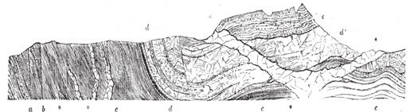

### Картограф и гидрограф: Уильям Брэдли (1757–1833)

```stat
СИЛ 60   ВЫН 60   ТЕЛ 80   ЛВК 55   ИНТ 80
НАР 90   МОЩ 50   ОБР 90   Рассудок 50   ПЗ 14
БкУ: +1d4   Комплекция: 1   Скорость: 5   ПМ: 10

Навыки: Бухгалтерское дело 30%, Искусство/ремесло (рисование) 65%,
Средства 35%, Стрельба (кремнёвый пистолет) 40%, Первая помощь 60%,
Проницательность 37%, Работа в библиотеке 35%,
Тайные знания (аборигенов) 40%, Ориентирование 70%,
Чтение и письмо (английский) 70%, Внимание 65%, Выживание (буш) 50%,
Чтение следов 46%.
```

*Прим. перев.: так в оригинале — Скорость 5; по характеристикам (СИЛ и ЛВК меньше ТЕЛ) выходит 7, а 5 подходит лишь к поправке на возраст 60–69 лет; возраст не указан.*

> Брэдли — флотский офицер, прибывший с Первым флотом лейтенантом. Вместе с будущим губернатором Джоном Хантером он снял на карту Сиднейскую гавань и северный берег. Он жил на борту своего корабля «Сириус», предпочитая не участвовать в колониальной жизни. Он заседал магистратом в суде, а также снял на карту реку Парраматта.
>
> В съёмках его особенно интересовали встречные аборигены, и он делал о них много заметок в дневниках. В 1790 году Брэдли был на «Сириусе», когда тот разбился у острова Норфолк. Застряв на острове, он со своим капитаном Джоном Хантером снял остров и составил карты. Губернатор Филлип рекомендовал произвести Брэдли в мастер-коммандеры, и в 1792 году тот вернулся в Англию.
>
> Командуя брандером «Комет» в Англии, он участвовал в морском сражении с французами, известном как Славное первое июня. Затем он сделал блестящую флотскую карьеру и дослужился до контр-адмирала. Похоже, Брэдли страдал душевной болезнью — возможно, ещё со времён Австралии. Его поведение в Англии стало очень странным и обнаруживало признаки помешательства, что подорвало его карьеру. После неприятностей с законом он уехал из Англии во Францию, где и умер в 1833 году.
>
> **Источники:** Janet D Hine, Australian Dictionary of Biography, http://adb.anu.edu.au/biography/bradley-william-1820; см. также Phil Mulhearn, «Early Hydrographers of Sydney», http://dictionaryofsydney.org/entry/early_hydrographers_of_sydney

### Минералог: Адоларий Уильям Генри Хамфри (1782–1829)

```stat
СИЛ 65   ВЫН 50   ТЕЛ 65   ЛВК 70   ИНТ 75
НАР 45   МОЩ 55   ОБР 80   Рассудок 55   ПЗ 11
БкУ: +1d4   Комплекция: 1   Скорость: 8   ПМ: 11

Навыки: Искусство/ремесло (резьба по кости) 20%, Оценка 50%, Лазание 40%,
Средства 40%, Красноречие 40%, Стрельба (мушкет) 40%, Прыжки 40%,
Естествознание 40%, Ориентирование 37%,
Чтение и письмо (английский) 50%, Верховая езда 45%,
Наука (геология) 60%, Внимание 60%, Плавание 40%.
```

> Кроме, пожалуй, самого роскошного имени в колонии, Хамфри отличался тем, что был правительственным минералогом колонии Земля Ван-Димена и работал в Управлении землемера и минералога. Уроженец Вестминстера в Лондоне, он отплыл с Дэвидом Коллинзом основывать (так и не состоявшуюся) колонию в Порт-Филлипе в 1803 году. В 1804 году он снял на карту район Порт-Далримпла, затем с Коллинзом отправился на реку Дервент и исследовал те места.
>
> С 1805 по 1807 год Хамфри был в Новом Южном Уэльсе и на острове Норфолк, но в 1807 году вернулся в Лонсестон и поселился на Земле Ван-Димена. Он открыл солончаки Танбридж, ставшие благом для колонии. В 1812 году он ушёл с поста минералога, а в 1818 году стал коронером, начальником полиции и главным магистратом — одним из самых могущественных людей Земли Ван-Димена.
>
> Он стал членом Законодательного и Исполнительного советов Земли Ван-Димена, и сменявшие друг друга губернаторы хвалили его за усердие и честность. В 1828 году он ушёл в отставку по болезни и умер на следующий год. Его жена, каторжница Гарриет Саттон, так хорошо вела его хозяйство, что заслужила похвалу земельного комиссара.
>
> **Источник:** G H Stancombe, Australian Dictionary of Biography, http://adb.anu.edu.au/biography/humphrey-adolarius-william-henry-2212


