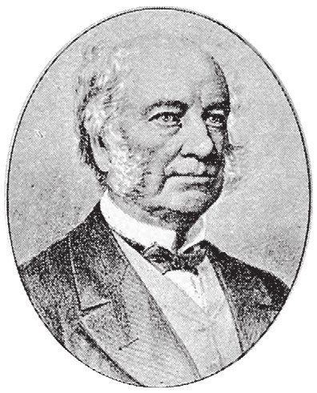

**Пункты навыков профессии:** ОБР × 2 + (ЛВК × 2 или СИЛ × 2)

**Средства:** 15–45

**Рекомендуемые связи:** другие служащие Корпуса Нового Южного Уэльса, мошенники, контрабандисты, каторжники

**Навыки:** Обаяние/Подхалимство, Ближний бой (драка), Стрельба (любая), Азартные игры, Проницательность, Верховая езда, Внимание, один любой другой навык как личная специальность.

## Пастор/капеллан

Духовное благополучие всех членов новых колоний — солдат, свободных поселенцев и даже каторжников — дело немаловажное. Для этого в колонии есть горстка пасторов и капелланов, которые отвечают за подобающие протестантские службы в обжитых местах колонии. Священник может постоянно служить в одном из крупных поселений (Сиднее или Парраматте) или получить назначение объезжать с богослужениями множество мелких мест.

**Пункты навыков профессии:** ОБР × 2 + НАР × 2

**Средства:** 9–50

**Рекомендуемые связи:** другие тюремные священники, другие мелкие чиновники, врачи, каторжники

**Навыки:** История или Юриспруденция, Проницательность, Иностранный язык, Работа в библиотеке, Слух, Чтение и письмо (английский), Религия, один социальный навык (Обаяние, Красноречие, Запугивание или Убеждение).

## Корабельный казначей

Одна из самых доверенных должностей на корабле вне обычной цепи командования — корабельный казначей: он отвечает за сохранность всех денег и ценностей на борту. Хитрые казначеи не прочь злоупотребить этим, чтобы набить карманы, но в большинстве своём корабельный казначей кристально честен (за это его обычно и выбирают).

**Пункты навыков профессии:** ОБР × 4

**Средства:** 20–50

**Рекомендуемые связи:** флотские офицеры и нижние чины, моряки торгового флота

**Навыки:** Бухгалтерское дело, Оценка, Юриспруденция, Слух, Чтение и письмо (английский), Выживание (море) или Плавание, один социальный навык (Обаяние, Красноречие, Запугивание или Убеждение), один любой другой навык как личная специальность.

# Сыщики — свободные поселенцы

Большинство людей в австралийских каторжных колониях оказались там либо по приговору (каторжники), либо по службе (военные и гражданские чиновники). Но были и те, кто приехал в молодые колонии совершенно добровольно — обычно с оптимистичной надеждой начать в колониях новую жизнь или хотя бы сбежать от старой. Разные общественные взгляды свободных поселенцев кратко описаны на с. 18 «Convicts & Cthulhu».

## Фермер-поселенец

Большинство свободных поселенцев приезжает в новые австралийские колонии, чтобы завести ферму (в надежде разбогатеть или хотя бы начать новую жизнь). Того же добиваются и многие каторжники в годы после окончания срока или после помилования. Земледелие — ещё и дополнительный доход для действующих и бывших офицеров, некоторым из которых в награду за службу дали земельные наделы.
