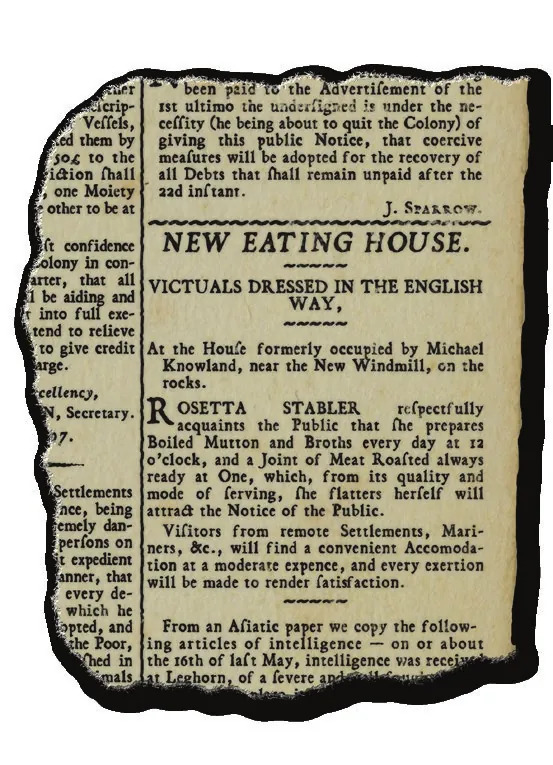

> **Свободные жёны каторжников**
>
> Особая категория занятий для женщин — свободные жёны, решившие последовать за мужьями-каторжниками в ссылку. (Бывало и так, что свободные мужчины и семьи следовали за женщинами-каторжницами.) Каторжника могли даже приписать к собственной жене. Например, в 1803 году Уильям Стейблер был сослан, а в 1806 году его приписали поваром к харчевне его жены Розы в Роксе (см. её объявление на вырезке из «Сидней газетт» от 3 июля 1803 года рядом). Известно и то, что женщины порой просили землю, а потом добивались, чтобы к ним приписали мужей помогать её обрабатывать, — и так строили своё благосостояние в новой стране. Конечно, иногда такие замыслы кончались плохо. Один каторжник писал жене в Англию, что женщины, как известно, «теряют доброе имя» по пути сюда и по прибытии узнают, что их мужья «не обязаны принимать их при таких обстоятельствах».
>
> **Источники:** *Colonial Eve: Sources on Women in Australia 1788–1914*, с. 35; NSW State Library: *Families of Convicts* в разделе *Convicts: Life in the Colony*, http://guides.sl.nsw.gov.au/content.php?pid=445387&sid=3649015

> **Раздатка: объявление Розетты Стейблер («Сидней газетт», 3 июля 1803 года)**
>
> **НОВАЯ ХАРЧЕВНЯ.**
>
> **КУШАНЬЯ ПО-АНГЛИЙСКИ.**
>
> В доме, где прежде жил Майкл Ноуленд, близ Новой мельницы, в Роксе.
>
> РОЗЕТТА СТЕЙБЛЕР почтительно извещает публику, что каждый день в 12 часов готовит варёную баранину и похлёбки, а к часу всегда готов жареный кусок мяса, который, по качеству и подаче, как она льстит себя надеждой, привлечёт внимание публики.
>
> Приезжие из дальних поселений, моряки и пр. найдут удобный ночлег за умеренную плату, и будут приложены все усилия, чтобы им угодить.

*Выше и ниже объявления на вырезке видны обрывки соседних заметок: объявление J. Sparrow о взыскании долгов и известия «из азиатской газеты» из Ливорно.*

**Пункты навыков профессии:** ОБР × 2 + (НАР × 2 или МОЩ × 2)

**Средства:** 9–70

**Рекомендуемые связи:** другие купцы (здесь и в Англии), чиновники, Корпус Нового Южного Уэльса, контрабандисты, моряки торгового флота, суперкарго

**Навыки:** Бухгалтерское дело, Оценка, Проницательность, Юриспруденция, Ловкость рук или Чтение и письмо (английский), Внимание, два социальных навыка (Обаяние, Красноречие, Запугивание или Убеждение).

## Моряк торгового флота

Большинство кораблей, приходящих в австралийские колонии, идут по казённым делам — перевозят каторжников, свободных поселенцев или жизненно важные припасы. Но не все эти корабли принадлежат флоту Его Величества. Множество коммерческих парусников нанимают для этих важных казённых задач, и столько же частных кораблей приходит в колонию просто ради прибыли — сбыть груз за деньги. На всех этих судах служат моряки, которые, в отличие от своих военных собратьев, вольны приходить и уходить, куда позовёт прилив прибыли.

**Пункты навыков профессии:** ОБР × 2 + (ЛВК × 2 или СИЛ × 2)

**Средства:** 20–40

**Рекомендуемые связи:** морские пехотинцы и флот, купцы, контрабандисты, преступные шайки

**Навыки:** Первая помощь, Механика, Естествознание, Ориентирование, Пилотирование (судно), Внимание, Плавание, один социальный навык (Обаяние, Красноречие, Запугивание или Убеждение).
