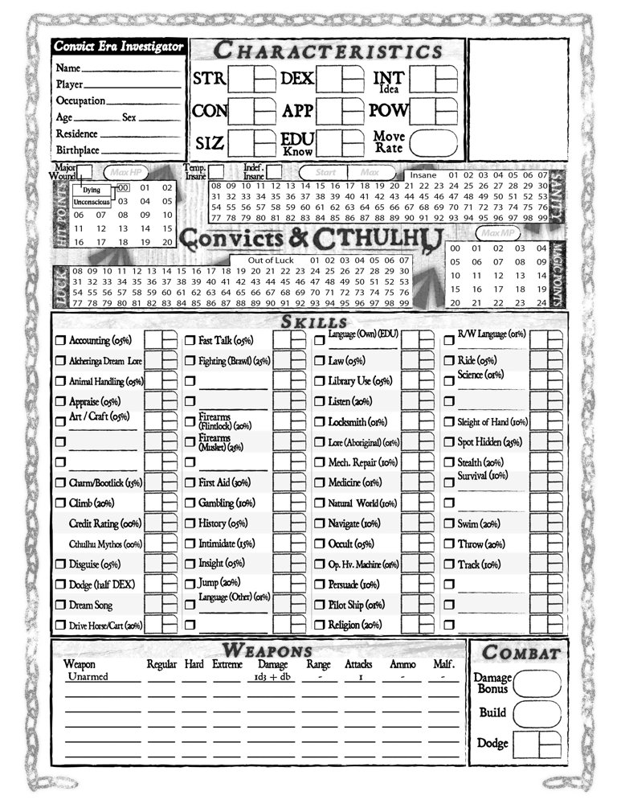

# Лист сыщика каторжной эпохи

*Ниже — перевод надписей листа; поля для записи оставлены пустыми.*

**Сыщик каторжной эпохи (Convict Era Investigator):** имя; игрок; профессия; возраст; пол; место жительства; место рождения.

**Характеристики:** СИЛ; ЛВК; ИНТ (Идея); ВЫН; НАР; МОЩ; ТЕЛ; ОБР (Знания); Скорость. Справа — пустая рамка для портрета.

**Пункты здоровья:** серьёзная рана (отметка); максимум ПЗ; шкала 00–20 с отметками «При смерти» и «Без сознания» у нуля.

**Рассудок:** временное безумие (отметка); бессрочное безумие (отметка); начальный; максимальный; шкала 00–99, «Безумие» у нуля.

**Удача:** шкала 00–99, «Удача иссякла» у нуля.

**Пункты магии:** максимум ПМ; шкала 00–24.

**Навыки** (в скобках — базовый шанс, как на листе):

| Навык | База | Навык | База |
|---|---|---|---|
| Бухгалтерское дело | 05% | Иностранный язык (два поля) | 01% |
| Знание Алчеринги | — | Родной язык | ОБР |
| Обращение с животными | 05% | Юриспруденция | 05% |
| Оценка | 05% | Работа в библиотеке | 05% |
| Искусство/ремесло (три поля) | 05% | Слух | 20% |
| Обаяние/Подхалимство | 15% | Взлом | 01% |
| Лазание | 20% | Тайные знания (аборигенов) | 01% |
| Средства | 00% | Механика | 10% |
| Мифы Ктулху | 00% | Медицина | 01% |
| Маскировка | 05% | Естествознание | 10% |
| Уклонение | половина ЛВК | Ориентирование | 10% |
| Песнь сновидений | — | Оккультизм | 05% |
| Управление лошадью/повозкой | 20% | Управление тяжёлыми машинами | 01% |
| Красноречие | 05% | Убеждение | 10% |
| Ближний бой (драка) + два пустых поля | 25% | Пилотирование (судно) | 01% |
| Стрельба (кремнёвый пистолет) | 20% | Религия | 20% |
| Стрельба (мушкет) + пустое поле | 25% | Чтение и письмо | 01% |
| Первая помощь | 30% | Верховая езда | 05% |
| Азартные игры | 10% | Наука (два поля) | 01% |
| История | 05% | Ловкость рук | 10% |
| Запугивание | 15% | Внимание | 25% |
| Проницательность | 05% | Скрытность | 20% |
| Прыжки | 20% | Выживание (два поля) | 10% |
| | | Плавание | 20% |
| | | Метание | 20% |
| | | Чтение следов | 10% |
| | | (три пустых поля) | |

*Прим. перев.: так в оригинале — у Знания Алчеринги и Песни сновидений на листе базы нет; Взрывчатки на листе нет (редкий навык, см. с. 2); база Азартных игр (10%) дана только на листе.*

**Оружие:** оружие; обычный; трудный; чрезвычайный (уровни успеха); урон; дальность; атаки; боеприпасы; осечка. Первая строка заполнена: «Без оружия — урон 1d3 + БкУ, дальность —, атак 1, боеприпасов —, осечки —».

**Бой:** бонус к урону; Комплекция; Уклонение.
