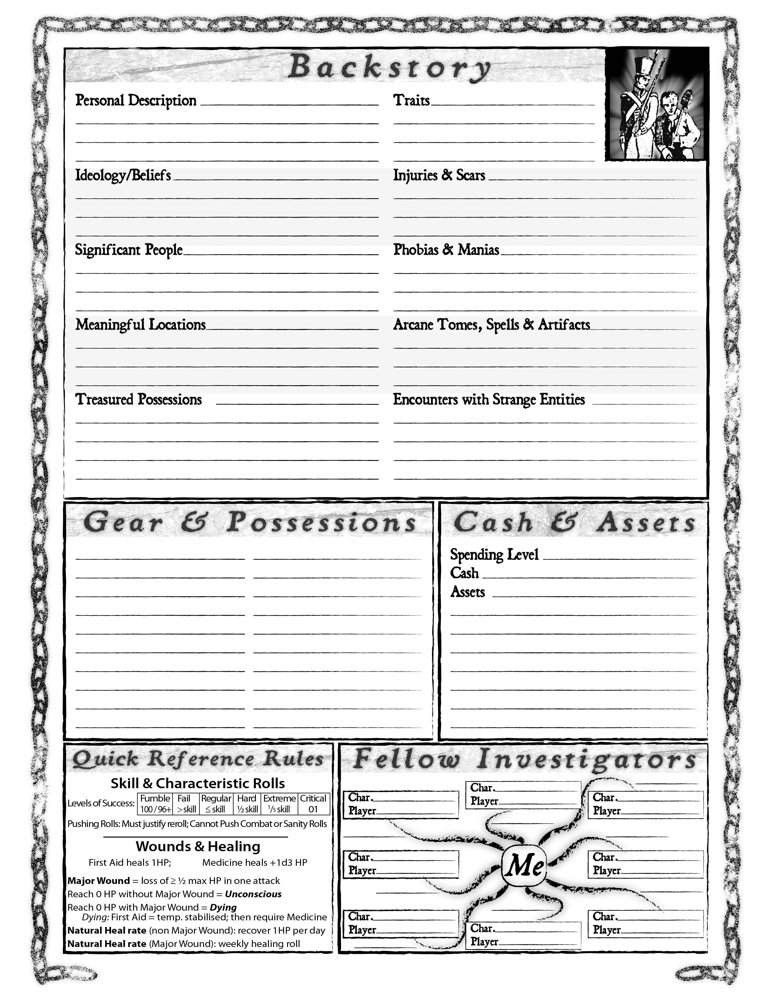

**Предыстория:** внешность; черты характера; убеждения и взгляды; травмы и шрамы; значимые люди; фобии и мании; памятные места; тайные книги, заклинания и артефакты; ценное имущество; встречи со странными сущностями. В углу — рисунок: солдат с мушкетом и каторжник с лопатой.

**Снаряжение и имущество:** пустые строки.

**Деньги и активы:** уровень расходов; наличные; активы.

**Памятка правил**

*Проверки навыков и характеристик*

| Уровень успеха | Крах | Провал | Обычный | Трудный | Чрезвычайный | Критический |
|---|---|---|---|---|---|---|
| Результат | 100 / 96+ | > навыка | ≤ навыка | ½ навыка | ⅕ навыка | 01 |

Повторная проверка: нужно обосновать переброс; нельзя повторять проверки боя и Рассудка.

*Раны и лечение*

- Первая помощь восстанавливает 1 ПЗ; Медицина — ещё +1d3 ПЗ.
- **Серьёзная рана** — потеря не меньше половины максимума ПЗ за одну атаку.
- 0 ПЗ без серьёзной раны — ***без сознания***.
- 0 ПЗ с серьёзной раной — ***при смерти***. *При смерти:* Первая помощь временно стабилизирует; затем нужна Медицина.
- **Естественное лечение** (без серьёзной раны): 1 ПЗ в день.
- **Естественное лечение** (серьёзная рана): еженедельная проверка выздоровления.

**Товарищи-сыщики:** в центре — «Я», от него щупальца тянутся к восьми рамкам «Персонаж … Игрок …» и строкам для пометок о связях.
