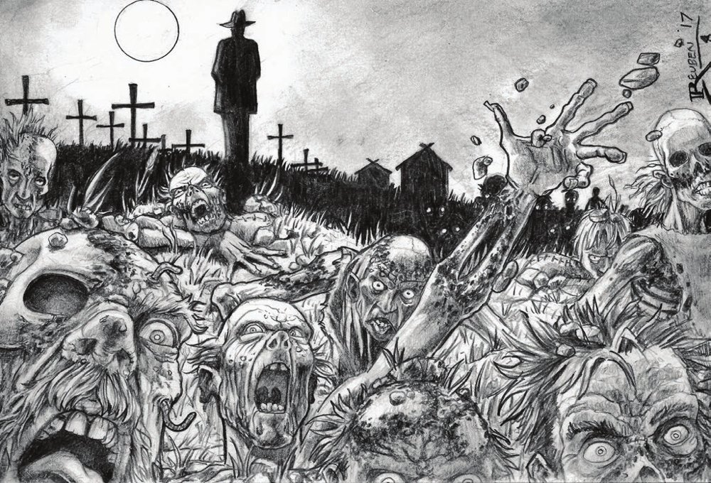

НОЧЬ КАТОРЖНЫХ МЕРТВЕЦОВ

Convicts &amp; Cthulhu — Отпускной билет № 6

*Вверху страницы — логотип «Convicts & Cthulhu — Ticket of Leave № 6» и заглавие «Night of the Convict Dead» («Ночь каторжных мертвецов»).*

> «Отпускные билеты» (Tickets-of-Leave) — небольшие самостоятельные дополнения к сеттингу [«Convicts & Cthulhu»](https://www.cthulhureborn.com) для лавкрафтовских ролевых игр в ранних каторжных колониях Австралии. В каждом — подборка игровых элементов: их можно использовать все вместе как набросок мини-сценария или по отдельности — как детали, которые обогатят сценарий вашего собственного сочинения.

> **Выходные данные**
>
> «Отпускной билет» № 6 написали Джефф Гиллан (Geoff Gillan) и Дин Энгельхардт (Dean Engelhardt); оригинальные иллюстрации — Рубен Додд (Reuben Dodd). © 2017. PDF издаёт Cthulhu Reborn Publishing (www.cthulhureborn.com).
>
> Сеттинг «Convicts & Cthulhu» издаёт Cthulhu Reborn Publishing; он доступен на RPGNow и DrivethruRPG по модели «Плати сколько хочешь» (Pay-What-You-Want).
>
> *Call of Cthulhu* («Зов Ктулху») — зарегистрированный товарный знак Chaosium Inc., используется с разрешения (www.chaosium.com).
>
> Лицензия Creative Commons BY-NC-SA.

# Введение

Каторжные колонии ранней Австралии — места нездоровые: болезни, плохая гигиена и временами голод (когда кончались припасы) — всё сговорилось, чтобы сделать жизнь большинства каторжников и поселенцев более чем нездоровой. Вместе с режимом жестоких телесных наказаний — и временами смертной казни — это значит, что Смерть — частая гостья колоний.

Этот «Отпускной билет» для [«Convicts & Cthulhu»](https://www.cthulhureborn.com) рассматривает практическую сторону смерти в колониях — а именно погребение и избавление от трупов умерших. Тема мрачная, но очень полезная как отправная точка для множества историй ужаса и потусторонней тайны. В конце концов, где были бы рассказы Г. Ф. Лавкрафта, Эдгара Аллана По (не говоря уж о Джордже А. Ромеро) без готового запаса трупов…?

В первые дни колонии почти не заботились о правильном и единообразном погребении мёртвых и почти не записывали, где могилы. Это любопытное положение открывает интересные возможности для историй о расхищении могил и некромантии; в этом дополнении разобран один такой пример. Здесь же — исторические заметки о местах и обычаях погребения каторжной эпохи — на случай, если случится худшее и сыщик или любимый персонаж Хранителя отправится к Создателю и его придётся хоронить.

