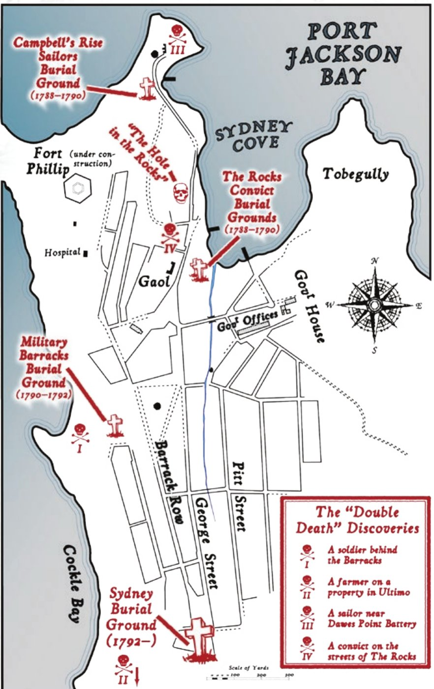

…каторжников. Надгробия на некаторжных участках бывают довольно затейливыми (французский гость колонии в 1802 году даже отметил, что надгробные статуи здесь куда изящнее, чем он ожидал).

**Места погребений Сиднея, старые и новые.**

*Надписи карты:*

| Надпись | Перевод |
|---|---|
| Port Jackson Bay | залив Порт-Джексон |
| Sydney Cove | Сиднейская бухта |
| Campbell’s Rise Sailors Burial Ground (1788–1790) | Матросское кладбище на хребте Кэмпбелла (1788–1790) |
| “The Hole in the Rocks” | «Дыра в Роксе» |
| The Rocks Convict Burial Grounds (1788–1790) | Каторжное кладбище в Роксе (1788–1790) |
| Fort Phillip (under construction) | форт Филлип (строится) |
| Hospital | госпиталь |
| Gaol | тюрьма |
| Gov’t Offices | казённые конторы |
| Gov’t House | Дом правительства |
| Tobegully | Тобегалли |
| Military Barracks Burial Ground (1790–1792) | Кладбище за Военными казармами (1790–1792) |
| Barrack Row, George Street, Pitt Street | Бэррак-Роу, Джордж-стрит, Питт-стрит |
| Cockle Bay | бухта Кокл |
| Sydney Burial Ground (1792–) | Сиднейское кладбище (с 1792) |

*Прим. перев.: так в оригинале — на карте «Campbell’s Rise», в тексте и таблице — «Campbell’s Ridge» (хребет Кэмпбелла).*

**Находки «двойных смертей»** (ключ карты):

- I — солдат за казармами;
- II — фермер на участке в Ультимо (стрелка — участок за краем карты);
- III — моряк у батареи мыс Доуз;
- IV — каторжник на улицах Рокса.

## Другие места погребения

Кладбище в конце Джордж-стрит — единственное действующее место погребения в поселении Сидней, но в колонии есть и другие места, где хоронят (или хоронили) тела умерших европейцев:

- **Старые места в Сиднее:** как сказано выше, самые ранние погребения (1788–1790) были либо в окрестностях «Рокса» (каторжники), либо на мысе мыс Доуз (моряки). С 1790 по 1792 год людей всех званий хоронили на временном кладбище за Военными казармами.
- **Традиционные места погребения аборигенов:** аборигены окрестностей Сиднея хоронят умерших либо просто в земле (обычных членов общины), либо после кремации (старейшин). С умершими иногда хоронят их личные вещи. Такие погребения часто бывают у воды — в устьях рек или на побережье. Аборигенов, живущих в городе, после смерти обычно хоронят (колонисты) по британскому обычаю.
- **Парраматта:** в отличие от Сиднея, общественное кладбище в поселении Парраматта прямо связано с церковью — церковью Святого Иоанна. Первое погребение здесь — ребёнок каторжников — прошло в 1790 году. [Это кладбище и даже этот надгробный камень сохранились до наших дней, так что кладбище Святого Иоанна — старейшее сохранившееся европейское место погребения в Австралии.] Кладбище церкви Святого Иоанна — немногим больше, чем открытый выгон рядом с церковью на окраине Парраматты. Вскоре после эпохи «Convicts & Cthulhu» его обнесут оградой и рвом, чтобы защитить могилы. Церковь Святого Иоанна протестантская, но на кладбище хоронят людей всех вер.
- **Погребения на частной земле:** иногда умерших просто хоронят на частной ферме — может быть, под землёй, которую они сами возделывали. Особенно часто так бывает на фермах в глухих или отдалённых частях колонии.
- **Эбенезер на Хоксбери:** Эбенезер — небольшое поселение пресвитериан на реке Хоксбери; есть церковь и (с 1807 года) кладбище.

# Похоронные обычаи и обряды

Эпоха «Convicts & Cthulhu» — время постепенного перехода от более практичного и функционального уклада, обычного для XVIII века, к более чувствительному подходу, типичному для первой половины XIX века. Если старые обычаи ставили во главу угла целесообразность и гигиену при избавлении от трупов, то новые — более обрядовые проявления скорби.
