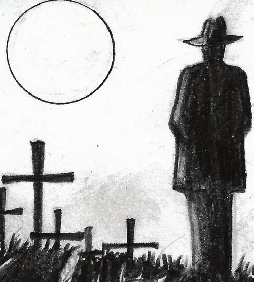

…удачно слил её тайную литургию с обрядами, которыми пользовался в некромантических опытах. И очень вовремя: срок его пребывания в колонии быстро истекает. Всего через два месяца он отбудет наказание и станет свободным человеком, которому позволено вернуться в Великобританию. Остаётся лишь испытать ритуал, пока у него есть сравнительная свобода колонии и защита Гектора.

Первые четыре пробы оказались неудачными — они подняли шатающихся кровожадных тварей, — но Стич верит, что он близок к цели. Он подправил ритуал и к началу сценария заканчивает готовить следующее великое магическое действо. Это большое заклинание, как он искренне верит, полностью вернёт к жизни молодую женщину, выкопанную на Сиднейском кладбище. К несчастью для него и для многих колонистов, живых и мёртвых, всё вот-вот пойдёт ужасно не так.

## Начало сценария

В Сиднее начали задаваться вопросами о внезапной череде необычных смертей в городе. Найти человека мёртвым на улице или в глухом месте — не редкость, но эти находки просто странные. Начать с того, что на месте каждой находки рядом друг с другом лежат не один, а два трупа: один явно только что умер насильственной смертью, другой — странно истлевший и обветренный. Уже начинают расходиться жуткие слухи.

Эти неприятные находки — на деле итог опытов Джонатана Стича с его новым ритуалом воскрешения. За последние недели было четыре таких пробы, и каждая создала мерзкого безмозглого зомби — совсем не то желанное «настоящее воскрешение», на которое надеялся Стич. Его нежить бродила по неосвещённым ночным улицам Сиднея, пока не натыкалась на жертву, которой могла насытиться. Насытившись кровью и мозгами, этих тупых тварей покидало оживлявшее их заклинание, и они возвращались в состояние смерти. Поэтому каждая умерла недалеко от своей жертвы.

Опыты — хоть и не вполне удачные — каждый раз учили некроманта чему-то новому о ритуале. Вот почему теперь он готовится провести свой великий ритуал в течение недели. Это и вызовет последующую «Ночь каторжных мертвецов».

## Как вовлечь сыщиков

Сыщики попадают в сценарий потому, что либо у них есть прямая причина расследовать странные находки трупов, либо кто-то приказал им разобраться в этой загадке.

Сыщики могут быть из любой группы чиновников или свободных поселенцев, в том числе распределёнными каторжниками или помощниками-аборигенами, которым правительство поручило унять истерию. Скорее всего, хотя бы один сыщик в команде будет военным или гражданским чиновником колонии; ему и поручат быть старшим. Если все игроки хотят играть сыщиками другого рода — скажем, каторжниками или аборигенами, — Хранителю придётся придумать, почему группа расследует странные смерти. Может быть, они потеряли друзей в первой вспышке и сами решили во всём разобраться за спиной властей.

Хранителю стоит особо следить за сыщиками, которые по своему прошлому служат правительству — военными или гражданскими писарями. Привилегированное место Джонатана Стича в Доме правительства даёт ему доступ к большинству донесений, проходящих через стол губернатора (и ко многим другим). Если сыщику есть причина передавать сведения начальству в правительстве или он вообще работает в Доме правительства, Стич может очень быстро узнать о…
