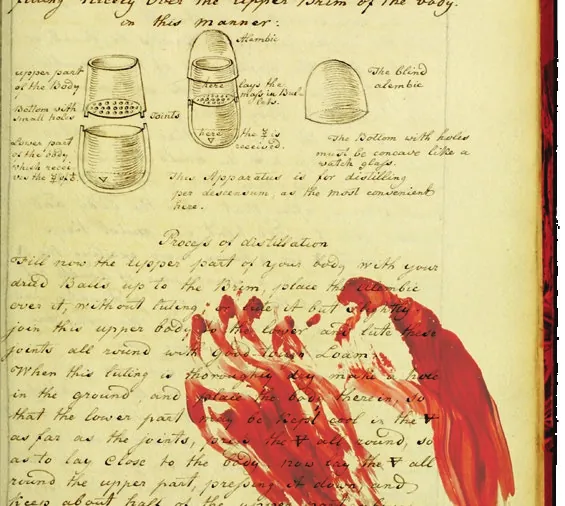

- **Пёс по кличке Губернатор.** Сыщикам, которые расспрашивают, чем можно объяснить ямы, вырытые на кладбищах Сиднея, в конце концов расскажут о желтовато-буром бродячем псе, которого часто видят роющимся на одних и тех же участках кладбищ. По словам местных, этого пса приютила группа аборигенов из рода кадигал, которая сейчас стоит лагерем у внешней гавани. Если сыщики разыщут эту семью кадигал, они без труда найдут пса — его назвали в честь нынешнего губернатора, со всеми титулами (например, «Губернатор, достопочтенный Уильям Блай»). Пёс не имеет к делу никакого отношения, но кадигал охотно поддержат в любом белом мысль, что он важен: увлечения белых они и в лучшие времена находят непостижимыми.
- **Казённые и военные бумаги.** Если сыщики заподозрят Джонатана Стича или Гектора Хамдина, они могут захотеть просмотреть колониальные записи, где упоминаются эти люди. Такой поиск (с проверкой **Работы в библиотеке**) может открыть многое из их прошлого, описанного во введении для Хранителя. Но Хранителю стоит помнить, что и Стич, и Хамдин — люди хитрые и очень умело выглядят безобидными, даже кроткими или неуклюжими. Чтобы вся правда об их натуре вышла на свет, может понадобиться более глубокое расследование — например, разговоры с их сослуживцами или товарищами по работе.
- **Дом Джонатана Стича.** Узнав имя Стича, сыщики, скорее всего, захотят обыскать место, где он живёт. Стич — каторжник, но доверенный, и потому ему позволено держать маленький дом. Он стоит улицей дальше от ряда домов военных офицеров. Дома в этом квартале печально известны тем, что то и дело рушатся и их отстраивают заново. (Некоторые суеверные местные верят, что под землёй творится что-то странное, но на деле причина — на редкость плохая постройка.) Впрочем, дом Стича пока держится. Если сыщики вломятся туда и обыщут его, они найдут под половицами под его ночным горшком пачку бумаг. Это старые письма давно умершей жены Джонатана, Элизабет, времён их жизни в Англии. Если Хранитель захочет, они могут раскрыть кое-что о преступном нечестии супругов, хотя и не решающую роль Джонатана в нём.

- **Тетрадь в кабинете Стича.** Ещё один возможный путь расследования — маленький кабинет Стича в Доме правительства. Стич работает здесь почти каждый день, но любой, у кого есть доступ в здание после часов работы, легко может обыскать кабинет. На полке в этой маленькой, до педантичности опрятной комнате некромант держит свои тайные тетради — спрятанные на виду кожаный «журнал» (Day Book) среди десятков таких же книг. Сыщики, прошедшие проверку **Внимания**, заметят, что на этом томе меньше пыли, чем на соседних. Именно на страницах этой тетради Стич ведёт рабочие записи о ритуале, который готовит (то есть о заклинании, которое он слепил).
- **Квартира Хамдина: незадачливый шантажист.** Сыщики, подозревающие лейтенанта Хамдина, могут обыскать военные казармы, где он живёт. Проверка **Внимания** при таком осмотре откроет любопытную записку, зарытую на дне грязного сундука с носками. Подписана она грубым чёрным пятном, похожим на ворону. Если сыщики поспрашивают, кто мог написать это письмо с шантажом, несколько человек скажут им, что знаком вороны пользуется Генри Кроу, каторжник из рабочей команды. Увы, на этом след обрывается: Кроу недавно пропал. Сыщики могут заподозрить, что Хамдин как-то избавился от шантажиста, но на деле Кроу просто сбежал и прячется где-то в буше. Если кто-нибудь догадается нанять следопытов-аборигенов, его легко найти (хотя ничего особенно важного для дела он не знает).

> **Раздатка: записка шантажиста**
>
> *Я знаю, чем ты занят. Хочу грога, и побольше, чтобы мой язык умолк.*
>
> [подпись — грубое чёрное пятно, похожее на ворону]
