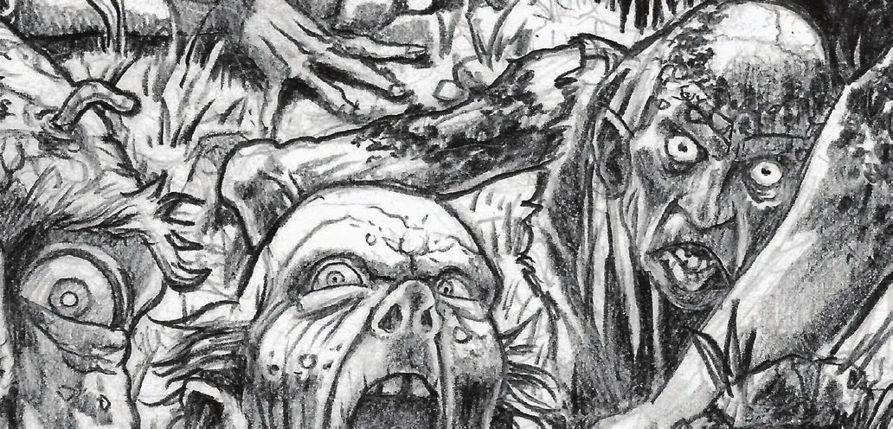

Запустив эту ужасную сцену, малодушный Джонатан в панике бежит с кладбища и запирается в военных казармах, чтобы защищаться. Сыщики вольны справляться с положением как сумеют. Скорее всего, в конце концов к ним присоединится отряд солдат Корпуса Нового Южного Уэльса, посланный усмирить зомби. Увы, мушкеты — не слишком действенное оружие против армии зомби.

Как сказано во врезке рядом, заклинание длится 12 часов. Это значит, что, если орду зомби не перебить, она будет продолжать свой голодный разгул до самого следующего дня. Это может посеять немалый хаос. Любой человек (то есть не зомби), умерший за эти 12 часов рядом с кладбищем или рядом с кем-то из зомби, сам тоже встанет зомби. (Заметьте: это продолжение действия заклинания, а не настоящая зомби-зараза — о таком варианте см. ниже.) Ясно, что у сыщиков работы невпроворот.

## Последствия и развязка

Удастся ли сыщикам предотвратить или подавить Ночь каторжных мертвецов или нет, вести об ужасе широко не разойдутся. Правительство замалчивает историю об оживших мертвецах, утверждая, что пьяная вакханалия каторжников, офицеров и распутных поселенцев, осквернявших кладбище, породила безумные россказни об оживших трупах. Всякого, кого услышат пересказывающим эту историю, сочтут участником этого разврата и выпорют за участие в нём. Сам губернатор поверит, что всё это был пьяный бунт, — что звучит очень знакомо для тех, кто знает колониальную жизнь.

Сыщики, остановившие недоучку-некроманта до того, как он сотворил великий ритуал, получают 1d4 Рассудка; те, кто видел Ночь каторжных мертвецов, но как-то не дал ей перерасти в повальную резню, получают 1d6 Рассудка. Убийство или иное обезвреживание главного злодея (Стича или — в варианте — Люцифера) стоит ещё 1d4 Рассудка. Напротив, концовка, в которой некромант остаётся жив и на свободе, обречена привести к продолжению — «Рассвету каторжных мертвецов»!

# Как подстроить сценарий: три варианта

Смотря по кампании Хранителя и любимому стилю игры, он может захотеть переделать сценарий. Вот несколько идей для вариантов.

## Шайка Люцифера

В этом варианте настоящий злодей — другой. Стич — лишь неудачливая жалкая пешка; настоящий вдохновитель — Люцифер Джонс, который возглавляет настоящую сатанинскую кабалу. Джонатан играет в некроманта, но на деле он ничто без тёмной магии, которой владеет кабала. Люцифер — глава этого ордена (числом, разумеется, 13), а Гектор — его орудие. Сатанисты намерены…
