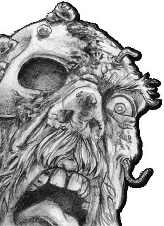

# Характеристики

Ниже — характеристики зомби и ключевых персонажей Хранителя.

## Известковые зомби

Умерших каторжников в австралийских каторжных поселениях обычно хоронят нагими, засыпав слоем едкой негашёной извести (чтобы обеззаразить тела и не дать распространиться болезни). Оживлённые, такие трупы возвращаются к жизни известковыми зомби — мерзкими ковыляющими пародиями на мужчин и женщин, с чертами, наполовину расплавленными едким порошком. Остатки извести, в которую их погрузили, дают этим зомби особые способы вредить.

Каторжники, из которых они получаются, обычно были людьми сильными и грубыми, поэтому известковые зомби, как правило, крупнее и мощнее среднего зомби, хотя так же безмозглы и тупы.

```stat
хар.   средние   броски
СИЛ    75        (4d6+1)×5      Средние ПЗ: 12
ВЫН    50        (2d6+3)×5      Скорость: 5 (ковыляет)
ТЕЛ    75        (2d6+8)×5      Средний БкУ: +1d4
ЛВК    45        (2d6+2)×5      Средняя Комплекция: 1
МОЩ    05        05             ПМ: 01

АТАКИ
Атак за раунд: 1
Укус         45% (22/9), урон 1d3 + БкУ + химические ожоги (см. ниже)
Уклонение    известковые зомби не уклоняются
```



**ОСОБЫЕ СПОСОБНОСТИ**

**Химические ожоги:** известковые зомби покрыты негашёной известью, часть которой всё ещё держится на их телах. Негашёная известь — очень едкий порошок, вызывающий тяжёлые химические ожоги при попадании на кожу или в глаза. Она обезвоживает тело и может замедлить разложение, поэтому такой зомби лучше сохранился и крепче. Ожоги бывают от самой извести или от её пыли. Если известковый зомби успешно укусил или схватил жертву, она теряет ещё 1 ПЗ за раунд, пока ожог не обработают. При проваленной проверке Удачи едкая пыль обжигает и глаза жертвы — она слепнет до лечения. Обычное лечение ожогов кожи и глаз — промывание водой. При крахе проверки лечения глаз зрение персонажа повреждено навсегда.

**Уязвимость к воде:** негашёная известь при соприкосновении с водой может разбухать и быстро нагреваться. Если окатить зомби большим количеством воды (не меньше бутылки), он получает ещё 1d6−1 урона. Однако если это опускает ПЗ известкового зомби ниже 0, бурная химическая реакция заставит тварь яростно взорваться, обдав всех в радиусе 2 м едкой плотью. Все в этой области получают химические ожоги, как описано выше.

**Броня:** игнорирует урон, если удар не нацелен именно в голову и не наносит серьёзной раны. Если попадание пришлось в голову, урон обычный (но все такие атаки делаются со штрафной костью). Если нанесена серьёзная рана, часть плоти известкового зомби отваливается и падает зловонной лужей очень едкой химической жижи. Кроме того, любая атака, при которой кожа атакующего касается известкового зомби (или его отвалившейся плоти), вызывает химические ожоги, как описано ниже.

*Прим. перев.: так в оригинале — «как описано ниже», хотя ожоги описаны выше. Броня в этом профиле и в таблице десяти зомби (1 очко) дана по-разному.*

**Потеря Рассудка:** 1/1d8 Рассудка, чтобы увидеть известкового зомби. Заметьте, что известковые зомби голые, а это в ту эпоху кое-кого смущает.

## Десять известковых зомби

| | СИЛ | ВЫН | ТЕЛ | ЛВК | ИНТ | МОЩ | ПЗ | Комплекция | БкУ |
|---|---|---|---|---|---|---|---|---|---|
| Первый | 70 | 40 | 65 | 30 | – | 05 | 10 | 1 | +1d4 |
| Второй | 75 | 35 | 90 | 25 | – | 05 | 12 | 2 | +1d6 |
| Третий | 70 | 70 | 80 | 40 | – | 05 | 15 | 1 | +1d4 |
| Четвёртый | 50 | 50 | 55 | 45 | – | 05 | 10 | 0 | нет |
| Пятый | 65 | 40 | 60 | 55 | – | 05 | 10 | 1 | +1d4 |
| Шестой | 85 | 35 | 75 | 45 | – | 05 | 11 | 1 | +1d4 |
| Седьмой | 55 | 65 | 95 | 45 | – | 05 | 16 | 1 | +1d4 |
| Восьмой | 70 | 45 | 75 | 50 | – | 05 | 12 | 1 | +1d4 |
| Девятый | 40 | 25 | 90 | 45 | – | 05 | 11 | 1 | +1d4 |
| Десятый | 85 | 45 | 75 | 30 | – | 05 | 12 | 1 | +1d4 |

```stat
Скорость: 5        ПМ: 01

Ближний бой   45% (22/9), урон 1d3 + БкУ,
              плюс химический ожог (см. выше).
Уклонение     зомби никогда не уклоняются.

Броня: 1 очко — покрытая известью кожа. Прикосновение к ней
вызывает химические ожоги и дополнительный урон (см. выше).

Потеря Рассудка: 1/1d8 Рассудка, чтобы увидеть известкового зомби.
```
