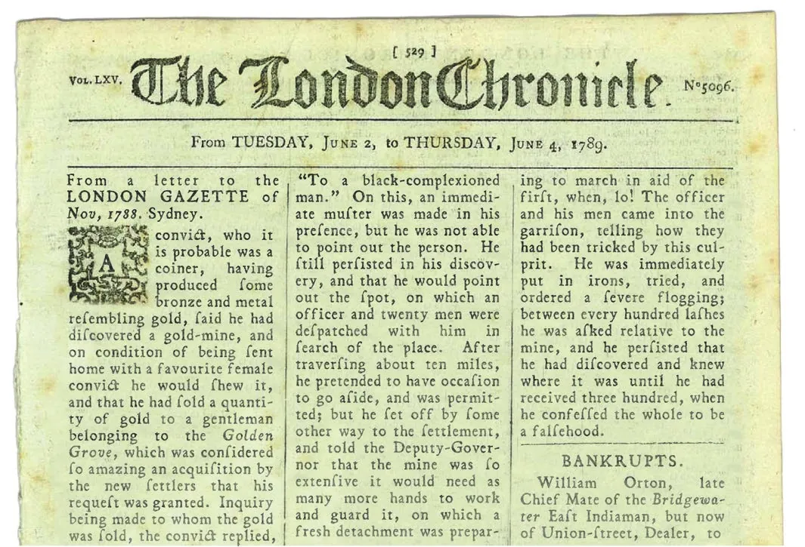

ОПАСНЫЕ ЖИЛЫ

Convicts &amp; Cthulhu — Отпускной билет № 7

*Вверху страницы — логотип «Convicts & Cthulhu — Ticket of Leave № 7» и заглавие «Seams of Peril» («Опасные жилы»).*

> «Отпускные билеты» (Tickets-of-Leave) — небольшие самостоятельные дополнения к сеттингу [«Convicts & Cthulhu»](https://www.cthulhureborn.com) для лавкрафтовских ролевых игр в ранних каторжных колониях Австралии. В каждом — подборка игровых элементов: их можно использовать все вместе как набросок мини-сценария или по отдельности — как детали, которые обогатят сценарий вашего собственного сочинения.

> **Выходные данные**
>
> «Отпускной билет» № 7 написали Дин Энгельхардт (Dean Engelhardt) и Джефф Гиллан (Geoff Gillan). © 2017. Издатель — Cthulhu Reborn Publishing (www.cthulhureborn.com).
>
> Сеттинг «Convicts & Cthulhu» издаёт Cthulhu Reborn Publishing; он доступен на RPGNow и DrivethruRPG по модели «Плати сколько хочешь» (Pay-What-You-Want).
>
> В этом PDF используются товарные знаки и/или авторские права Chaosium Inc/Moon Design Publications LLC по правилам Chaosium для фанатских материалов (Fan Material Policy). Нам прямо запрещено брать с вас плату за использование этого материала или доступ к нему. Этот PDF не издан, не одобрен и не утверждён особо Chaosium Inc. Подробнее о продукции Chaosium Inc — на www.chaosium.com.
>
> Лицензия Creative Commons BY-NC-SA.

# Введение

Довольно известно, что на раннюю колониальную историю Австралии сильно повлияли несколько крупных «золотых лихорадок», которые привели в новые колонии огромное множество людей и в конце концов положили конец ссылке каторжников. В эпоху [«Convicts & Cthulhu»](https://www.cthulhureborn.com) до всех этих великих открытий ещё четыре-пять десятилетий. Но это не значит, что каторжные колонии были совсем невосприимчивы к небольшой «золотой горячке» — настоящей или мнимой.

На деле первое «открытие» золота в Новом Южном Уэльсе относится к самому раннему времени после заселения белыми. Каторжник по имени Джеймс Дейли смело заявил, что нашёл богатую золотую жилу в месте, известном только ему. Дейли — профессиональный подделыватель — усердно предлагал свою историю всем подряд и наделал немало шума. Похоже, всех взволновала мысль, что недавно заселённая земля Нового Южного Уэльса может подарить ценные сокровища. Беда была только в том, что история была чистой выдумкой — по-видимому, чтобы морочить власти достаточно долго и заработать Дейли (и его любимой любовнице) билет домой, в Англию.

Этот любопытный эпизод настоящей каторжной истории, с небольшими поправками, может стать занятной отправной точкой для мрачной истории лавкрафтовского ужаса. В конце концов, кто сказал, что странная руда, которую Дейли предъявил как доказательство своей…

> **Раздатка: «Лондонская хроника», 1789**
>
> [ 529 ]
>
> Том LXV. **«Лондонская хроника».** № 5096.
>
> Со ВТОРНИКА, 2 июня, по ЧЕТВЕРГ, 4 июня 1789 года.
>
> *Из письма в «ЛОНДОН ГАЗЕТТ» от ноября 1788 года. Сидней.*
>
> Один каторжник — вероятно, фальшивомонетчик, — предъявив немного бронзы и металла, похожего на золото, заявил, что открыл золотой прииск и покажет его при условии, что его отправят домой вместе с любимой каторжницей, и что он продал некоторое количество золота джентльмену с «Голден Гроув»; новые поселенцы сочли это столь поразительным приобретением, что его просьбу удовлетворили. Когда спросили, кому было продано золото, каторжник ответил: «Чернолицему человеку». Тотчас в его присутствии устроили перекличку, но указать этого человека он не смог. Он по-прежнему стоял на своём открытии и обещал показать место, после чего с ним отправили офицера и двадцать человек на поиски. Пройдя около 16 км, он сделал вид, что ему нужно отойти, и ему позволили; но он другой дорогой ушёл в поселение и сказал вице-губернатору, что прииск так велик, что понадобится ещё столько же рук, чтобы его разрабатывать и охранять, и новый отряд уже готовился выступить на помощь первому, как вдруг — о! — офицер и его люди вернулись в гарнизон, рассказывая, как этот негодяй их провёл. Его тотчас заковали, судили и приговорили к жестокой порке; после каждой сотни плетей его спрашивали о прииске, и он стоял на том, что открыл его и знает, где он, пока не получил триста, — тогда он признался, что всё это ложь.
>
> **БАНКРОТЫ.**
>
> Уильям Ортон, бывший старший помощник ост-индского судна «Бриджуотер», ныне торговец с Юнион-стрит, — *(обрыв вырезки)*
