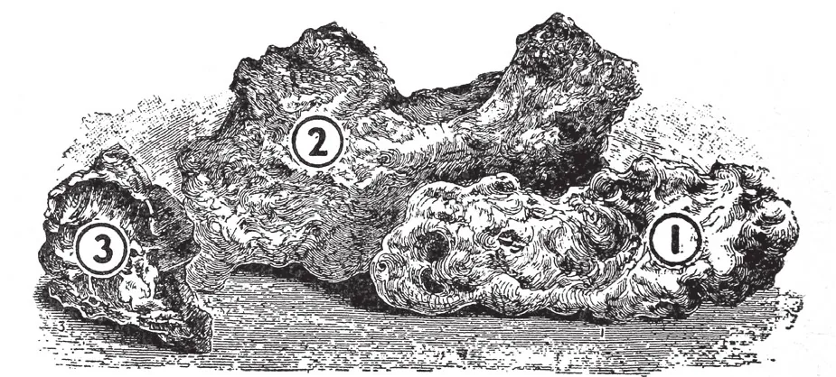

…глушь и сбежать в горы, где, как верят каторжники, лежит дорога в Китай. (Это настоящее заблуждение каторжной эпохи, которое среди необразованных людей рассеивалось очень долго.)

Однако в этом деле больше, чем кажется на первый взгляд… насколько больше — зависит от того, какой вариант участия Мифов выберет Хранитель.

## Ложь порождает ложь

С тех пор как Фаддин впервые пришёл к колониальным властям со своим заявлением, по казармам и кабакам Сиднея пошли слухи. Конечно, власть имущие старались держать возможную находку золота в тайне, но Фаддину и его приятелям-каторжникам ничего не стоило распускать сплетни всем, кто готов слушать. По правде, им даже нравится поднявшееся внимание. В целом вышел растущий и меняющийся набор историй: одни близки к исходной лжи Фаддина, другие обросли куда более странными подробностями — одни описывают необычные свойства самородков каторжника, другие — странных людей, с которыми его видели.

По одной версии кабацкой байки, с самими «золотыми самородками» Фаддина что-то не так: кое-кто уверяет, что видел, как они светятся странным блеском, «не похожим ни на что на Божьей земле». Другие утверждают, что вещи прокляты, и перечисляют тех, кто трогал камни и потом загадочно заболел или внезапно сошёл с ума. Одна версия даже утверждает, что несколько младших солдат Корпуса Нового Южного Уэльса, которым поручили охранять самородки, таинственно сбежали за ночь, не взяв с собой ничего из своих вещей.

Второй ряд расходящихся историй приукрашивает личность таинственного моряка «Фрэнсиса Коскера», от которого Фаддин, по его словам, и узнал местоположение прииска. Одни рассказчики уверяют, что знают из надёжного источника: человек, которого подслушал Фаддин, был на самом деле французским военным капитаном по фамилии Коскен, возможно, засланным проникнуть в колонию перед возможным вторжением. Другие путают моряка «Коскера» с темнолицым человеком, которого время от времени видят в тех же заведениях, что и Фаддина, и который порой кажется «необычайно короток» с каторжником.

# Как вовлечь сыщиков

Есть три главных способа, которыми Хранитель может втянуть сыщиков в грязный обман Корнелиуса Фаддина: через любопытство, разбуженное сверхъестественной стороной подслушанных кабацких историй; через жадность, разожжённую возможностью огромных золотых богатств; или через прямой приказ колониального правительства проверить заявление Фаддина.

## Официальная правительственная экспедиция

Очевидный способ вовлечь сыщиков в приключение — сделать их официальной экспедицией, собранной губернатором, чтобы проверить правдивость истории. В конце концов, в исходном историческом рассказе за «золотым прииском» послали два отряда, так что сиднейские власти явно не остались в стороне от золотой лихорадки.

В этом случае Фаддин обратился к губернатору, а тот, в свою очередь, призывает сыщиков выслушать историю Фаддина и снарядить экспедицию в глушь, чтобы найти прииск. Губернатор и слышать не хочет о том, чтобы просто освободить этого человека в обмен на сведения (у Блая особенно найдётся пара крепких слов насчёт такого нелепого предложения), но настаивает, чтобы сыщики…
