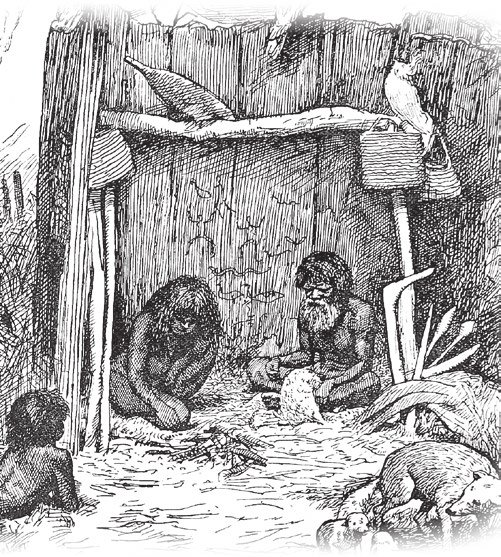

…об «Эрле Корнуоллисе» и его отплытии верны. Это ост-индское судно, сейчас используемое как каторжный корабль; оно везёт около 250 каторжников и ушло в Англию десять дней назад. Если проверка исследовательского навыка сыщика особенно удачна, он ещё и откопает (очень неполную) судовую роль последней команды «Эрла Корнуоллиса»: никакого Коскера в ней нет.

*Прим. перев.: так в оригинале — на с. 5 «Эрл Корнуоллис» ушёл «в Бенгалию», а здесь — «в Англию».*

Сыщики, проверяющие слух о французском военном моряке по фамилии «Коскен», найдут упоминание о таком человеке в официальном реестре прибывавших в колонию судов. Года три назад французский корабль — часть «научной экспедиции» — на несколько дней останавливался в Сиднее (подробнее о делах французов в колонии — в «Отпускном билете» № 2). Одного из старших офицеров звали Франсуа Коскен. То, что этот визит был задолго до времени истории Фаддина, делает связь между ними маловероятной (хотя, по усмотрению Хранителя, Фаддин мог держать в голове именно фамилию француза, когда сочинял свою историю).

## «Чернолицый человек»

В питейных заведениях Сиднея немало людей, которые утверждают, что Фаддин время от времени заходит в их привычное место в компании дикого на вид чернокожего человека — не из местных аборигенов, а какого-то другого «смуглолицего сорта». По этим рассказам, Фаддин и темнокожий человек казались очень близко знакомыми («не разлей вода»). Но никто не знает, кто этот человек, и в кабак он, похоже, приходит только вместе с Фаддином.

Есть ли что-то за этими смутными историями, зависит от того, какой вариант использует Хранитель. При варианте Мифов B («Чернолицый человек») эти истории — важные улики: этот чёрный человек — аватар Ньярлатхотепа, а встречи в кабаке, которые видели ненадёжные завсегдатаи, на деле были тайными свиданиями, на которых Внешний бог соблазнил каторжника стать своим бездумным орудием хаоса. При любом другом варианте Мифов рассказы о чернокожих людях — просто клевета, которую распускают другие каторжники, имеющие зуб на Фаддина (список удивительно длинный). В этом случае истории — чистый вымысел, чтобы выставить каторжника распутником, который водится с дикарями самым нездоровым образом: погоня за такими сплетнями может доставить сыщикам непристойное развлечение, но расследованию не поможет.

Если используется вариант «Чернолицый человек», сыщики могут найти надёжных свидетелей, видевших, как Фаддин и темнокожий человек шли бок о бок по залитым луной улицам Сиднея. Сыщиков может затянуть погоня за чередой свидетельских рассказов, которые шаг за шагом откроют, куда шли эти двое, — на большое кладбище колонии (подробнее оно описано в «Отпускном билете» № 6). Подробнее об опасностях, которые могут ждать в конце такой охоты, — в разделе этого варианта Мифов.

## Мудрость аборигенов

Прежде чем отправиться в отдалённую и плохо изученную часть колонии, сыщики, возможно, захотят разузнать то немногое, что известно о местности, где Фаддин, по его словам, сделал своё открытие. Официальные колониальные съёмочные карты легко посмотреть, но в тех краях на них ничего нет — это буквально белое пятно на официальной карте.

Куда более вероятный путь к полезным сведениям — поговорить с аборигенами, знающими эти края. Если сыщики сами аборигены или в хороших отношениях со следопытом, они легко узнают, что никто из коренных жителей нигде в глуши не видел ничего даже отдалённо похожего на самородки Фаддина. Но чтобы получить подробные сведения, сыщикам придётся поговорить с…
