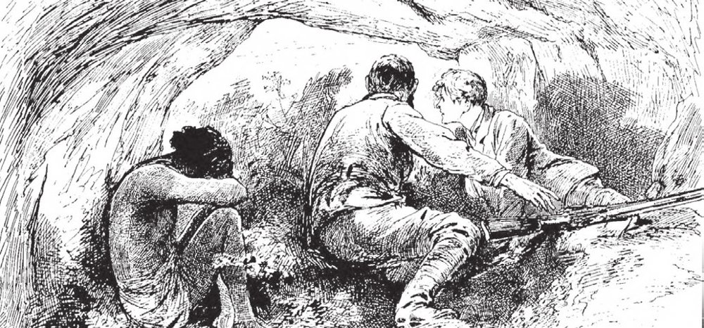

## Вариант C: омут Гурангача

В этом варианте нет ничего странного ни в золотых «самородках», ни в сомнительной компании Фаддина. Все ходящие истории — нелепая ложь и выдумки. Реален, однако, двуличный план каторжника сбежать из колонии в обмен на местоположение своего фальшивого прииска.

Чтобы осуществить этот план, он поведёт экспедицию сыщиков в отдалённый край предгорий Голубых гор — место, выбранное им за уединённость (он считает, что сбежать будет проще, когда экспедиция толком заблудится). К несчастью, в выбранном Фаддином краю обитают свои древние ужасы, как экспедиция обнаружит на свою беду.

Среди аборигенов гандангарра (Голубые горы) край, куда направляется экспедиция, печально известен как опасный. Это место сна Гурангача — могучего духа (или «буррингиллинга») из их традиционных историй Времени сновидений. Говорили, что Гурангач — наполовину рыба, наполовину рептилия, с переливчатой чешуёй зелёного, пурпурного и золотого цвета и с могучими сияющими глазами, свет которых пронзал глубокую воду. Местных с малых лет учат не подходить слишком близко к одному омуту, если они не принесли подношение, чтобы умилостивить Гурангача. Иначе — беда: дух может хлестнуть своим могучим языком, как однажды сделал, создавая некоторые здешние реки.

Сыщики-аборигены, скорее всего, отнесутся к легендам песенных троп народа гандангарра очень серьёзно, тогда как большинство белых сыщиков от них отмахнётся. Однако совсем сбрасывать эти рассказы со счетов опасно: в этом омуте на самом деле живёт ужасная водяная тварь-криптид — огромное существо с тёмным мехом и злобно острыми зубами и когтями. В будущие десятилетия повторяющиеся встречи с подобными чудищами в омутах и реках и вокруг них заставят колонистов дать имя этим неуловимым, но смертоносным ужасам — баньип. Но в этот момент истории у этих существ нет имени; однако всякий, кто слышит их зловещий вой на ветру, содрогается при мысли о встрече с таким неведомым хищником.

Есть ли связь между баньипом и рассказом о Гурангаче — решать Хранителю. Возможно, рассказы о свирепых нападениях у омута за многие сотни (тысячи?) лет со временем сложились в историю. А может быть, Дух Гурангача — совсем иная сущность, а баньип — лишь недавний пришелец, поселившийся в омуте (возможно, к досаде духа Времени сновидений).

Несомненно лишь одно: путь, выбранный нечестным каторжником Фаддином, приведёт экспедицию к этому омуту. Добрые Хранители могут как-то предупредить сыщиков — например, дать им услышать…
